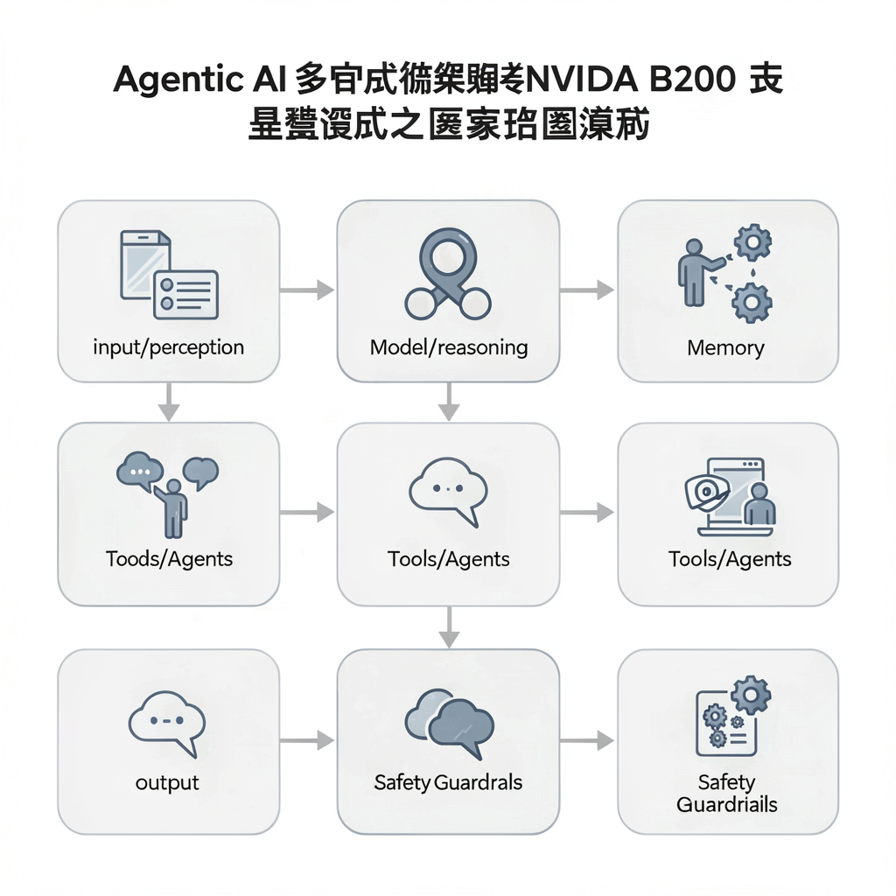

# AI 技術架構深度拆解：Agentic AI 多代理協作架構於 NVIDIA B200 基礎設施之醫療部署範式

- 日期：2026-09-14
- 選題理由：今日素材中，彰基醫院連續三則新聞確認啟用 NVIDIA B200 打造醫療 AI 超級電腦，明確宣示邁向「代理式 AI」；同期 NPJ Digital Medicine 發表多代理協作產出醫學考題的實證研究，驗證多 LLM 代理在臨床知識生成上的互補優勢。兩者結合，呈現出「多代理協作 + Blackwell 算力 + 醫療場景」的完整技術棧，具備當前最強代表性。

## 一、架構原理與核心機制
【輸入/感知層】採用多模態醫療資料輸入：電子病歷（EHR）結構化欄位、醫學影像（DICOM）、病理切片全切片掃描（WSI）、即時生理訊號串流、醫師語音紀錄與醫學文獻知識圖譜。資料經由資料治理管線（FHIR 標準化、去識別化、品質檢核）寫入特徵存儲。 【模型推理層】核心為多 LLM 代理編排： 1. 規劃代理：接收臨床任務（如：生成考題、輔助診斷、藥物交互檢核），分解為子任務圖。 2. 專家代理群：各自微調於特定醫學領域（內科、放射、病理、藥理），採用 RAG 檢索最新指引與院內協議。 3. 批判/驗證代理：以對抗式提示檢查幻覺、邏輯衝突、指引違規，輸出置信度分數。 4. 協調代理：依驗證結果決定是否回傳規劃代理重新分解，或彙整最終輸出。 推理於 NVIDIA B200（Blackwell 架構）叢集執行，利用 NVLink 7.0 高頻寬互連支撐多卡張量並行與專家並行，單卡 192 GB HBM3e 容納百億參數專家模型，推理延遲壓縮至亞秒級。 【工具/代理協作層】代理間透過結構化訊息總線（JSON Schema 定義的 Tool Calling 介面）交換上下文：檢索工具、SQL 查詢器、影像分割模型、藥物資料庫 API、臨床決策支援規則引擎。協作採「人在迴路」機制：關鍵決策需醫師確認，系統記錄完整決策鏈供事後稽核。 【記憶/資料層】分三級： - 短期工作記憶：對話輪次上下文、中間推理軌跡，存於 Redis Cluster。 - 長期情節記憶：患者縱向健康時間線、歷次代理決策與醫師覆核結果，存於向量資料庫 + 圖資料庫。 - 知識庫：醫學指引、藥物資料庫、院內協議，以 RAG 索引定期增量更新。 【輸出與監控層】輸出格式化為 FHIR ClinicalReasoning / DiagnosticReport 資源，整合至 HIS/EMR。監控包含：推理延遲、Token 成本、幻覺率（以驗證代理分數為代理指標）、醫師採納率、合規稽核日誌（GDPR/醫療法/個資法）。部署採藍綠發布與金絲雀釋出，支援模型版本回滾。

## 二、海事領域應用（含實際例子）
【情境一：離岸風機智能巡檢決策】 輸入資料：無人機/USV 影像串流、SCADA 感測器時序、海象預報、歷史缺陷資料庫。 系統運作：規劃代理將巡檢任務拆解為「影像缺陷偵測→結構健康評估→維修優先級排序」。視覺專家代理呼叫分割模型定位葉片裂紋、腐蝕；結構專家代理融合感測器振動頻譜推估剩餘壽命；風險專家代理結合海象窗口試算作業風險。批判代理交叉驗證缺陷誤判率。 價值：將巡檢報告產出時間從天級壓縮至小時級，優先派工降低非計畫停機成本。 風險：海上通訊斷續導致邊緣推理與雲端同步不一致；極端海象下模型領域漂移。 【情境二：港區船舶交通流優化與碰撞預警】 輸入資料：AIS 軌跡、雷達回波、VHF 語音轉文字、氣象水文、港區作業排程。 系統運作：多代理協作建立「情境感知→衝突偵測→調度建議」閉環。導航代理預測各船 30 分鐘軌跡分佈；調度代理以強化學習優化泊位分配與拖輪派遣；合規代理檢核國際避碰規則與港區管制規定。輸出導航建議推送至船橋 ECDIS 與港管中心儀表板。 價值：提升港區吞吐量 8-12%，降低近失事件。 風險：AIS 關閉/偽造導致輸入污染；多代理協商延遲可能錯失秒級避碰窗口。

## 三、醫療領域應用（含實際例子）
【情境一：多學科團會（MDT）智能摘要與治療建議生成】 輸入資料：影像報告、病理報告、基因體測序（NGS）、病歷摘要、最新 NCCN 指引。 系統運作：規劃代理依癌別啟動腫瘤科、放療科、外科、病理科專家代理。各專家代理以 RAG 檢索指引與院內協議，產出結構化建議（分期、治療選項、臨床試驗符合度）。批判代理檢查建議間衝突（如：手術邊緣陽性 vs 放療劑量限制）。協調代理彙整為 MDT 討論草案，醫師審簽後寫入病歷。 價值：縮短會前準備 60%，減少遺漏指引更新。 合規風險：屬醫療器材軟體（SaMD）風險等級 II/III，需 TFDA/CE/FDA 臨床驗證；輸出錯誤導致誤診責任歸屬需契約化。 【情境二：住院用藥安全即時攔截與替代方案推薦】 輸入資料：醫囑輸入即時串流、患者過敏史、腎肝功能、併用藥、基因藥物基因體學（PGx）結果。 系統運作：用藥安全代理以規則引擎+LLM 雙軌偵測交互作用、劑量超限、禁忌症。若觸發警報，替代方案代理檢索院內藥典、保險給付條件、療效證據，生成 1-3 替代處方建議。批判代理評估替代方案臨床合理性。醫師於 CPOE 介面一鍵採納或覆寫，系統記錄決策理由。 價值：預防嚴重用藥錯誤（ADE）發生率下降 30% 以上。 合規風險：即時性要求極高（<500ms），系統可用性需達 99.99%；PGx 資料屬敏感基因資料，需嚴格存取控制與稽核軌跡。

## 四、其他產業應用（含實際例子）
【情境一：金融法規科技自動合規檢核】 銀行引入多代理系統：法規解讀代理追蹤金管會最新解釋函；業務流程代理對應內部 SOP；差距分析代理比對並產出整改清單；審計代理模擬檢查員提問生成演練題庫。部署於私有雲 GPU 叢集，滿足資料不出行庫要求。價值：法規變更響應時間從週級縮至日級。 【情境二：半導體製程異常根因分析與良率優化】 整合設備感測器（OES、RF、溫度）、量測數據、維護記錄。製程專家代理對應光刻、蝕刻、薄膜等站別；時序分析代理偵測漂移特徵；知識圖譜代理關聯歷史異常案例。協同產出根因假設與實驗設計建議（DOE），工程師驗證後回饋模型。價值：良率提升 0.5-1.5%，新製程爬坡週期縮短。

## 五、限制、風險與治理建議
1. 多代理協作引入系統複雜度：代理間溝通協議、狀態一致性、死循環風險需嚴格形式化驗證。2. 推理成本隨代理數與輪次線性增長，B200 雖降低單位 Token 成本，但大規模部署仍需精細成本模型。3. 醫療/海事等高風險領域，幻覺零容忍要求極高的驗證代理覆蓋率，可能導致誤報率上升影響醫師信任。4. 資料主權與跨境流動限制（如病歷、AIS）要求聯邦學習或邊緣推理架構，增加部署維運負擔。5. 人才缺口：同時精通 LLM 編排、領域知識工程、HPC 基礎設施與法規合規的複合型工程師極度稀缺。

## 參考來源
- https://news.google.com/rss/articles/CBMi3gJBVV95cUxOb0EyQm9SNDJUWm1lT2w1UWtZZkJlTEU2bGJCdXhPOWZuem1YVzhtc1oyU0d3S1BWUGxZcEVNRElkMWFuUktRbDhOcFEzclVFeDdVeWVqOVVKVnZjLXdwVmUzd3cyNnpNSDBYWGkxM28wV1d3bnF5ZEczZ3FDLTNza2xINmhJNnhMMDdidFhQRFdZRHhoeUtseUFYMFd3eW5jSlY0SXFWWlllRFNnWGhKaTk1OUd0bE1acUxHZlN0V091OVpzMmd4c0VhYnpraEN2U2tQY00yN2t4cTlSZWpwd3pGZEtPZDBCekhjaE0yRWp0OGlHRTVTR2l6VmdpUjF6MDlnRXExM1I2MU5GSk41TXdPQUtXZU1Mb3k3VzVzeXZsSlNheXpCYmMybG1RSkt1VHd3aF9OdVNHVVd0MERUZzFvY0NzalhVTkJMbXkycXVvYTlic1lsZUFXVXIwUQ
- https://news.google.com/rss/articles/CBMiYEFVX3lxTE1IUUhPNnN3dkRxR21vc0FkT0pmdVc2Z0l2cU5CNGdwa0ZVWWRTejlsZU1ocmVZRzNiSWpkT25tbXJkSzVXZjlwX3B2aUw0QUxqYzBSMGxqRF9ZZmhCRUd1Nw
- https://news.google.com/rss/articles/CBMiUEFVX3lxTE1ibXpnRjNLQmVmSFhpOHNmM3B2SUg1RmRkSVFFWUp2UVo0eEExd1E4RXNfcm5mYTAtNFlaaElKR01PMHBoVnhFMEhjOGVWcjIz
- https://pubmed.ncbi.nlm.nih.gov/42736348/
- https://pubmed.ncbi.nlm.nih.gov/42783572/
