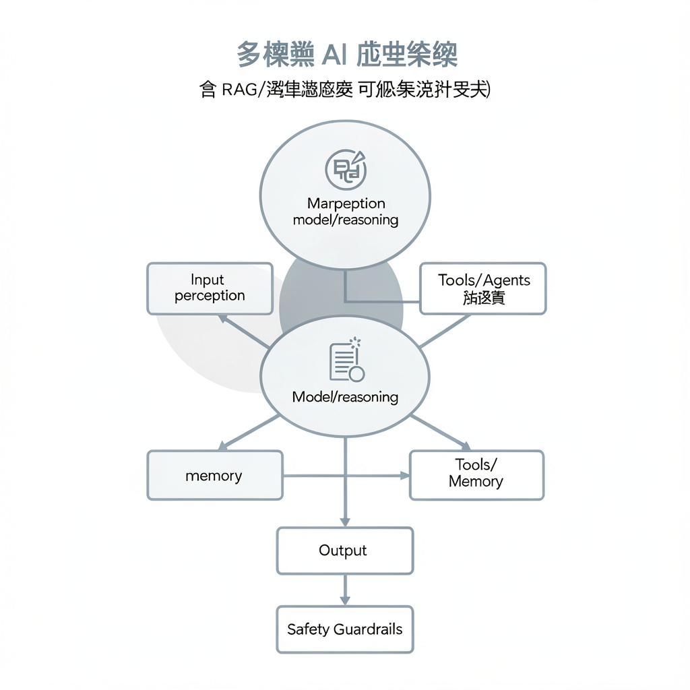

# AI 技術架構深度拆解：多模態 AI 代理架構（含 RAG/混合適應與可解釋決策支援）

- 日期：2026-09-21
- 選題理由：今日素材涵蓋海事多頻段救援、植物組學自演化科學家、臨床決策系統性綜述、多模態腫瘤診斷代理、IoT 可解釋入侵偵測，以及 Cisco/Splunk 安全落地與 AI 監管呼聲，共同指向「多模態感知＋LLM 推理＋RAG/微調混合適應＋工具鏈＋可審計輸出」的通用架構範式。

## 一、架構原理與核心機制
【輸入/感知層】接收異構資料：海事多頻段雷達/光學/熱像影像、AIS 軌跡、氣象數據；醫療影像（CT/MRI/病理切片）、基因體/轉錄體組學、電子病歷文本、醫學指引知識庫；工業 IoT 感測器串流、網路封包、日誌。採用編碼器將各模態映射至統一潛在空間，並以注意力機制對齊跨模態語義。 【模型推理層】以大型語言模型（LLM）為核心控制器，結合領域微調權重與提示工程，執行規劃、推理、工具調用。推理採用思維鏈與自我反思機制，輸出結構化決策草案與信心分數。 【工具/代理協作層】註冊領域工具：海事航路規劃、碰撞風險模型、搜救資源調度 API；醫療影像分割模型、基因變異註釋服務、藥物交互作用檢核；通用程式碼執行、資料庫查詢、知識圖譜遍歷。代理依推理結果動態編排工具鏈，支援並行與重試。 【記憶/資料層】短期工作記憶保存對話上下文與中間推理軌跡；長期知識庫採向量檢索（RAG）儲存領域文獻、法規、歷史案例、組學資料庫，並支援增量更新。混合適應策略：高頻任務採 LoRA/全參數微調固化模式，低頻/新知識任務採 RAG 動態注入，兩者可聯合部署。 【輸出與監控層】產出結構化決策建議、解釋報告（特徵歸因、反事實分析）、審計日誌。部署端加裝輸出守衛：格式驗證、合規規則引擎、人機介面確認機制。監控指標涵蓋延遲、幻覺率、工具調用成功率、資料漂移偵測，支援線上評估與滾動更新。

## 二、海事領域應用（含實際例子）
1. 自主多頻段海上搜救決策系統：情境為夜間惡劣海況落海搜救。輸入包含衛星 SAR 雷達、無人機熱像/可見光影像、AIS 歷史軌跡、即時風浪模型。系統運作：感知層融合多頻段特徵偵測微小目標；推理層結合海流漂流模型生成搜救概率圖；工具層調用航路規劃器為救生艇/直升機產生最優航線與會合點；記憶層檢索歷史同類案例與國際搜救公約規範。價值：縮短決策時間、提高發現率；風險：感測器盲區導致漏報、模型對極端海況泛化不足、通訊中斷造成單點失效。 2. 智慧港區船舶交通管制與碰撞預警：情境為高密度港區多船交會。輸入：岸基雷達軌跡、AIS、VDES 通訊、氣象、港區水深圖。系統運作：代理持續推演多船未來軌跡，呼叫碰撞風險評估工具，若風險超閾值自動生成避讓建議並經人工確認下發。記憶層儲存港區通航規則與歷史違規案例供 RAG 引用。價值：降低人為疏失、優化通航效率；風險：資料延遲造成決策滯後、對非合作目標（關閉 AIS 漁船）感知不足、法律責任歸屬模糊。

## 三、醫療領域應用（含實際例子）
1. 多模態腫瘤多學科會診（MDT）輔助代理：情境為肺癌分期與治療方案制定。輸入：胸部 CT 影像、病理切片全切片掃描、NGS 基因面板報告、電子病歷文本、NCCN 指引最新版。系統運作：影像代理完成結節分割與 TNM 初步分期；病理代理量化免疫組化標記；基因組代理註釋可行動突變；主控代理綜合三模態輸出，透過 RAG 檢索指引條文與臨床試驗資格，生成結構化治療建議與引用來源。價值：縮短會診準備時間、減少遺漏、提供可追溯依據；合規風險：屬醫療器材軟體（SaMD）需 TFDA/CE/FDA 核准、訓練資料隱私與同意、模型偏誤對特定族群表現差異、決策最終責任仍屬醫師。 2. 罕見病基因組解讀與文獻自動綜合系統：情境為疑似遺傳疾病患者三聯體外顯子組分析。輸入：患者及雙親 VCF 變異檔、HPO 表型術語、PubMed/OMIM/ClinVar 最新文獻。系統運作：變異過濾代理依 ACMG 規範分級；文獻代理以 RAG 檢索同基因/同變異功能證據；主控代理整合表型匹配分數、分離分析、文獻證據生成解讀報告。價值：加速解讀、降低專家負擔、支援再分析；合規風險：變異解讀屬臨床檢驗服務需實驗室認證、知識庫更新滯後導致錯誤分類、患者基因資料跨境傳輸法規限制。

## 四、其他產業應用（含實際例子）
1. 工業 IoT 異常偵測與根因分析代理：情境為半導體晶圓廠設備預測性維護。輸入：設備感測器時序（溫度、震動、壓力、氣體流量）、維修紀錄文本、製程參數、設備手冊。系統運作：時序編碼器提取特徵，LLM 代理結合 RAG 檢索歷史故障案例與廠商手冊，生成異常類別、可能根因、建議檢修步驟與信心區間。價值：減少非計畫停機、保留專家隱性知識。 2. 金融合規文檔自動審閱與風險標註：情境為銀行信貸契約與反洗錢政策檢核。輸入：長合約 PDF、最新法規條文、內部合規手冊、歷史稽核缺失案例。系統運作：文檔解析切分條款，嵌入向量庫；合規代理以 RAG 對照法規逐條比對，標註衝突、缺漏、模糊條款，並生成修訂建議與引用條文。價值：提升審閱覆蓋率與一致性、縮短人工複核時間。

## 五、限制、風險與治理建議
1. 幻覺與可靠性：LLM 於長鏈推理中仍可能產生合理但錯誤的工具參數或引用，需嚴格輸出守衛與人工覆核機制。2. 多模態對齊困難：醫療影像與基因組、海事雷達與 AIS 等異構資料時空解析度差異大，聯訓成本高且易負遷移。3. 知識時效性：RAG 依賴外部知識庫更新頻率，法規、指引、威脅情報若未即時同步將導致決策錯誤。4. 部署合規成本：醫療、海事、金融屬高風險領域，需完成法規級驗證（如 IEC 62304、ISO 13485、IMO MSC.1/Circ.1638），模型變更需重新認證，迭代週期長。5. 資料主權與隱私：跨國部署涉及資料本地化要求，聯邦學習或邊緣推理增加架構複雜度。6. 人才與運維：需同時具備領域知識、MLOps、法規事務之跨域團隊，招募與保留困難。

## 參考來源
- https://www.semanticscholar.org/paper/eac5e99f3dc4471e1b72909c465d2817cd09a09f
- https://pubmed.ncbi.nlm.nih.gov/42760786/
- https://pubmed.ncbi.nlm.nih.gov/42753254/
- https://pubmed.ncbi.nlm.nih.gov/42743545/
- https://pubmed.ncbi.nlm.nih.gov/42817304/
- https://news.google.com/rss/articles/CBMiS0FVX3lxTE5xWkV0ZUdmcTg0czg2dW1MUFUzWVlVWGpZOUFLYjU2TVpQZDZNTllKeXpMeDRWMHFDNEZDLTNiN3hsd1pZVmRsbS0xUQ
