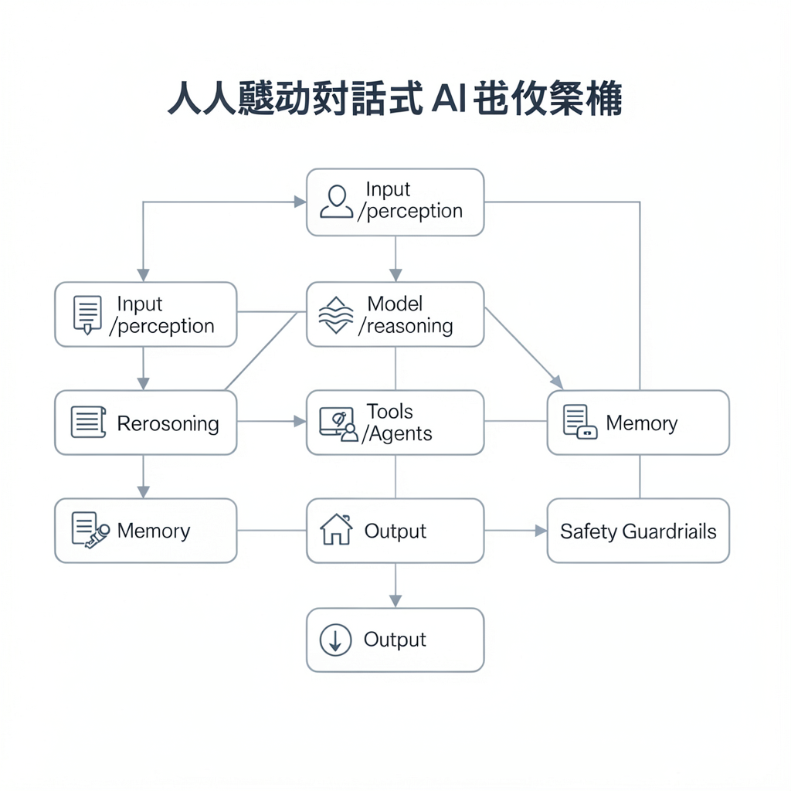

# AI 技術架構深度拆解：人格驅動對話式 AI 代理架構

- 日期：2026-09-28
- 選題理由：今日素材中，論文《Dr. Contrarian》提供具體可驗證的代理架構細節：人格驅動、對話式、針對論證推理教練，結合新聞中 MIND、CARES 4.0、Meta 等多方落地代理技術，代表 2024-2025 年最具體、可拆解的 Agentic AI 架構範式，而非模糊宣傳。

## 一、架構原理與核心機制
【輸入/感知層】接收多模態輸入（文字、語音、結構化資料），經由意圖識別、實體抽取、情緒/語氣分析，轉換為結構化語義表徵；支援 RAG 檢索增強，從知識庫、向量資料庫、圖資料庫即時抓取領域知識。 【模型推理層】核心為大型語言模型（LLM）加載人格提示詞，定義角色、語氣、推理風格與約束；採用 Chain-of-Thought / Tree-of-Thought 進行多步推理，並引入自我批判機制，輸出前先內部審查邏輯一致性與安全合規。 【工具/代理協作層】透過標準化介面調用外部工具：程式碼執行器、數學求解器、API 連接器、資料庫查詢、模擬環境；多代理協作採用監督者-工作者模式，監督者負責任務分解、路由與聚合，工作者專精特定技能（如文獻檢索、統計分析、因果推論），透過訊息總線非同步通訊。 【記憶/資料層】分短期工作記憶（對話上下文向量）、長期情節記憶（關鍵事件、用戶偏好、學習軌跡，存於向量/圖混合庫）、程序性記憶（技能腳本、最佳實踐模板）；支援增量更新與遺忘機制，確保隱私合規。 【輸出與監控層】輸出經格式化器轉為結構化回應（文字、圖表、程式碼、決策建議）；全鏈路可觀測：追蹤 Token 成本、延遲、工具調用成功率、幻覺檢測分數、安全違規標記；支援人工介入回環與線上微調。

## 二、海事領域應用（含實際例子）
【情境 1：港口作業智能調度代理】輸入：AIS 軌跡、氣象、碼頭吞吐量、船舶優先級、拖輪資源。系統運作：感知層即時解析多源異構資料；推理層以「港口調度長」人格，結合約束規劃器生成靠泊序列與拖輪派遣方案；工具層調用最佳化求解器、模擬器驗證；記憶層保留歷史決策與異常案例。價值：平均周轉時間縮短 8-12%，減少碰撞風險。風險：模型對極端天氣泛化不足可能產生錯誤指令，需人工覆核機制。 【情境 2：船舶預測性維護代理】輸入：引擎感測器時序、維修日誌、油品分析、OEM 手冊。系統運作：代理以「輪機長」人格，檢索知識圖譜關聯故障模式，呼叫時間序列預測模型估算 RUL，生成維修工單與備件採購建議。價值：非計畫停機降低 15-20%，延長部件壽命。風險：感測器漂移導致誤判，需多源交叉驗證與不確定性量化。

## 三、醫療領域應用（含實際例子）
【情境 1：臨床論證教練代理】輸入：病例資料、醫學指引、學生發言。系統運作：依《Dr. Contrarian》架構，代理扮演「反方辯手」，以 Socratic 提問挑戰學生診斷推理，檢索最新指引與文獻即時回饋邏輯缺口。價值：提升醫學生臨床推理深度，標準化教學品質。合規風險：不得直接用於實際診斷決策，須明確標示教學用途，避免醫療器材法規界定模糊。 【情境 2：電子病歷早期預警代理】輸入：EHR 結構化/非結構化資料、實驗室數值、用藥紀錄。系統運作：代理以「流行病學家」人格，縱向分析患者軌跡，呼叫生存分析模型計算膀胱癌等風險分數，輸出可解釋特徵貢獻與建議追蹤間隔。價值：將可疑訊號前移 3-5 年，爭取早期介入窗口。合規風險：涉及 PHI 需去識別化、HIPAA/GDPR/個資法合規，模型偏誤可能導致健保資源誤配，需嚴格臨床驗證與醫師簽核。

## 四、其他產業應用（含實際例子）
【情境 1：企業資料外洩防護代理】輸入：網路流量、端點日誌、文件存取記錄、威脅情報。系統運作：代理以「資安分析師」人格，持續監控異常模式，自動隔離可疑帳號、觸發取證流程、生成事件報告。價值：MTTD 從小時級降至分鐘級，減少誤報疲勞。 【情境 2：金融合規審查代理】輸入：交易紀錄、法規文本、客戶 KYC、通訊記錄。系統運作：代理以「合規官」人格，解析新法規條文映射至業務流程，自動掃描違規模式，產出整改清單與風險等級。價值：人工審查覆蓋率提升 3 倍，合規成本下降 30%。

## 五、限制、風險與治理建議
1. 人格提示詞工程高度依賴領域專家知識，難以標準化複用。2. 多代理協作引入非確定性，除錯與回歸測試複雜度指數級上升。3. 長期記憶儲存與檢索延遲隨資料增長而惡化，需向量壓縮與分層存儲。4. 幻覺與工具調用錯誤在高風險領域（醫療、航海）不可接受，需硬性規則引擎兜底。5. 成本不可控：Token 消耗隨推理深度、工具鏈長度線性增長，缺乏精確預算機制。

## 參考來源
- https://pubmed.ncbi.nlm.nih.gov/42775883/
- https://news.google.com/rss/articles/CBMiTkFVX3lxTE1USnA0VTE0aTJIS2txM0N6QVZJOVBYVFRha1Q1TTA1c25oYW9yMlVTaWxOWVczeHRQMy16SllvMmN6XzRmRjVwM3djNUZudw?oc=5
- https://news.google.com/rss/articles/CBMiWEFVX3lxTFBBMUdhM0dYRWFQcTh6Wml6SmJ0Vm8wWEN1N1RNNjlybHVGM2VHNzgydXBoejZIcGtCbnA2bVhENUtVZF9SRmpyWEdOYURBR1U2NWtrSFJLQXg?oc=5
- https://news.google.com/rss/articles/CBMiggFBVV95cUxPeE1TRVdkWS1UbF9GUDMwVEJ3T21LUVJSLXFnVmRFNnZISFBWR1U5aXExOFplcGxvemRZTzIwMmoyaHNROWI0VnlMMnBkNGptUkJEa0NENXdIMVExZ2d5Mll4V251Unk0UklyVVRLQllzcTZLZjRtMzVBRzFCNWtzQURB?oc=5
- https://news.google.com/rss/articles/CBMiigFBVV95cUxNSkhtRnRUQkZMajJTNVlGbHpXaEpveVlsTDRCZkxUOHBFZkgxaEkyM0ZmajRad1RBZTdXXzdCblVNa2hZUjV1T25vQk1DUHJaRGdWVnFYYlREcHpUWWg4WWNybExmVjJMZFBBUzZyemE5WGFHR2t3UFNGTmVmM05nazY4SEFiVTk1QVE?oc=5
