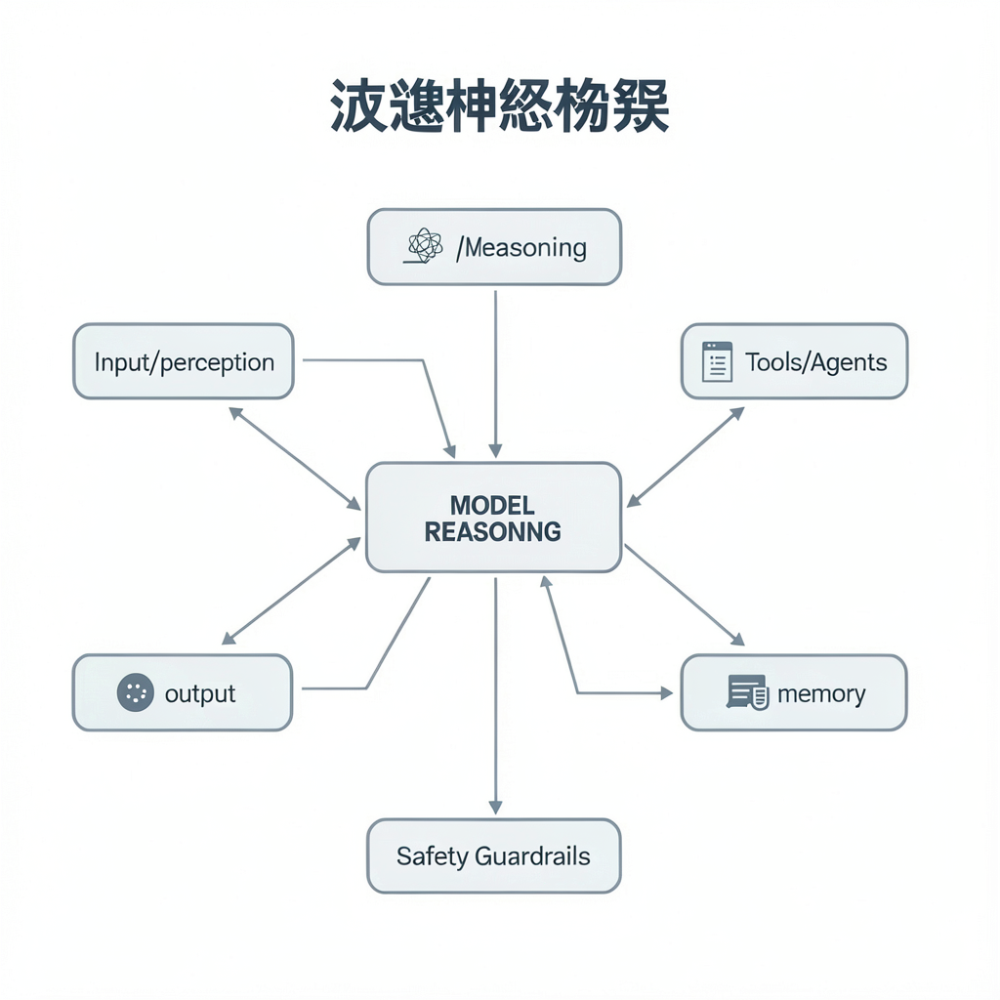

# AI 技術架構深度拆解：Liquid Neural Networks (液態神經網路) 架構

- 日期：2026-10-05
- 選題理由：今日素材中出現「Liquid AI for embodied robotics」論文，提出以液態神經網路取代傳統離散策略，具備連續時間動態與可追蹤控制，代表最新具身智慧架構趨勢，適合深度拆解。

## 一、架構原理與核心機制
輸入/感知：系統接收多模態感測器資料（視覺、慣性、力覺），經由編碼器轉為連續時間特徵向量。模型推理：核心為液態神經網路（LNN），採常微分方程（ODE）描述神經元狀態演化，參數隨輸入動態調整，實現自適應時間尺度推理，並可在線更新權重。工具或代理協作：LNN 可作為高層規劃器，輸出連續控制指令給低層 PID 或模型預測控制器（MPC），並透過訊息總線與感知、地圖、任務調度代理交換狀態。記憶/資料層：採用經驗回放緩衝區與線上統計摘要，支援長期行為一致性檢查與離線微調。輸出與監控：輸出為連續軌跡或扭矩指令，附帶不確定性估計；監控模組即時計算 Lyapunov 函數與安全邊界，若違規則觸發降級策略並記錄審計日誌。

## 二、海事領域應用（含實際例子）
情境一：自主貨櫃船航道保持。輸入資料包含雷達點雲、AIS 目標、風浪預測。LNN 即時產生舵角與推力指令，配合 MPC 執行，實現抗擾動航跡追蹤，降低油耗 5‑10%。風險：極端海況下 ODE 求解器可能發散，需硬體冗余與安全降級。情境二：港口自動化裝卸機械手臂協作。輸入為 3D 點雲與貨物姿態估計。LNN 驅動多臂協同抓取，動態調整抓取力與路徑，提升吞吐量並減少貨損。風險：通訊延遲導致多代理同步失效，需邊緣部署與確定性網路。

## 三、醫療領域應用（含實際例子）
情境一：微創手術機器人適應性力控。輸入為內視鏡影像、力覺傳感器、器械動力學模型。LNN 依組織阻力即時調整夾持力與移動速度，減少組織損傷，縮短手術時間。合規風險：醫療器材軟體屬 Class II/III，需符合 IEC 62304 與 FDA 臨床驗證，模型可解釋性與變更管理為關鍵。情境二：重症監護自動輸液調控。輸入包含血流動力學波形、實驗室即時指標。LNN 預測血管反應並輸出輸液速率曲線，維持血壓目標區間。合規風險：涉及藥物劑量決策，須通過臨床試驗並建立醫師覆核機制，避免單一 AI 決策導致醫療糾紛。

## 四、其他產業應用（含實際例子）
情境一：柔性製造機械手適應性組裝。輸入為視覺定位與力覺回授，LNN 產生連續軌跡修正，處理零件公差與工件變形，提升良率並縮短換線時間。情境二：無人機編隊協同巡檢。輸入為多機相對位置、風場估計，LNN 分配任務並輸出各機連續控制指令，實現編隊重組與避障，降低通訊頻寬需求。

## 五、限制、風險與治理建議
1. 連續時間 ODE 求解需高效能邊緣晶片，功耗與延遲對實時系統具挑戰。2. 模型參數隨輸入動態變化，導致驗證與認證流程複雜，難以滿足功能安全標準（ISO 26262、IEC 61508）。3. 訓練資料需涵蓋極端工況，否則外推風險高。4. 可解釋性較傳統控制器弱，需輔以形式化驗證或混合架構。

## 參考來源
- https://pubmed.ncbi.nlm.nih.gov/42890632/
- https://news.google.com/rss/articles/CBMiZEFVX3lxTFA2RV9idGZWQThMd204Q3lLUjZjZExsZEF2Nk1mZG5XY1Z3N1ZlVEVQZW5vT3I0RTg4UXBHbktZV0RjeWVveXhHR0JkRVpVdXF6REFocTg4VzZCYXQ3enQzZDFLWkfSAWpBVV95cUxNeWs2STBOQnlNLTRMWllYR0RWUEI1QkNWcVJFOEo5bEFhaVA5R1ZrNTZLeWw5R3JwaUZUTU5aYjM4X19kRjBNNS1VV0RvTTEyUGhxaEZLenVCR1djNHZFNkNJZnRHOHo3ODVn?oc=5
- https://news.google.com/rss/articles/CBMiUEFVX3lxTFBBUDZjUGd5N2RfZmhwTDNlOVhTZ05BR3A4QzlOalA0RGZxb2Q1NXhubHBmVkIzSy0xWVUtYUJyTmdCVFQwOENfZHc3b1hQaW9B0gFWQVVfeXFMTlJsNWFKMFdvMVozZXV1Y0stQjAyOU95aXlGNFQ3VjV4R0QzZWdhUnFla3J5Wnd3X09BZGhLQm8yU1p3TjB3ajA2NWVSWVMtcWRpa2NWcnc?oc=5
