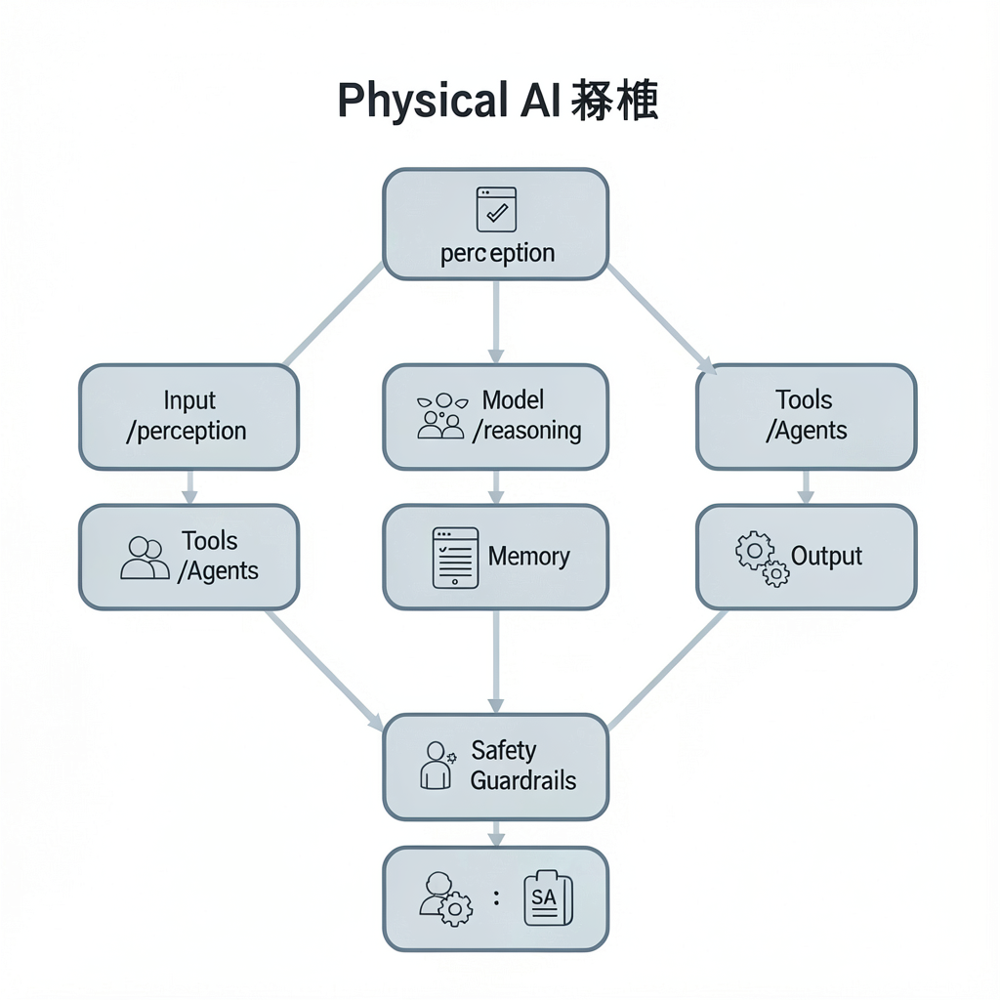

# AI 技術架構深度拆解：Physical AI 架構

- 日期：2026-10-12
- 選題理由：今日發表的 IEEE 綜述《Aligning Perception, Reasoning, Modeling and Interaction: A Survey on Physical AI》系統性定義了感知、推理、建模與互動四大支柱，代表當前具備跨領域整合潛力的最新 AI 架構範式。

## 一、架構原理與核心機制
Physical AI 將機器人或邊緣裝置視為一個閉環智能體。輸入/感知層融合多模態感測器（視覺、雷達、力覺、語音）經由統一編碼器產生語義特徵；模型推理層採用分層架構：底層為快速反應的感知‑動作策略網路，中層為任務規劃的大型語言/視覺模型，頂層為長期目標的世界模型與因果推理模組；工具或代理協作層透過標準化技能接口（Skill API）動態調度外部模組（如路徑規劃器、抓取控制器、知識圖譜查詢），並支援多代理協商協議；記憶/資料層包含短期情境緩衝區、長期經驗回放資料庫與持續學習的參數更新管線，支援線上微調與知識蒸餾；輸出與監控層將決策轉換為低階控制指令，同時輸出可解釋的推理軌跡、不確定度估計與安全檢查點，供人工介入與審計。部署考量強調異構算力協同（雲端訓練、邊緣推理）、實時性保證（硬體加速器、確定性網路）、資料隱私與模型版本管理。

## 二、海事領域應用（含實際例子）
1. 自主巡航無人艇：輸入多波束聲納、光學相機、AIS 船舶識別訊號；感知層融合生成海況語義地圖，規劃層依任務（巡邏、搜救）產生航路，技能接口調用避碰控制器與通訊協議；輸出舵機指令與狀態回報。價值在於無人化降低人員風險、提升覆蓋率；風險為惡劣海況下感知失效與通訊中斷導致決策錯誤。2. 港口智慧裝卸機器人：輸入視覺、力覺、貨櫃 RFID；推理層結合場景理解與抓取規劃，協作層調度多臂協同與 AGV 調度系統；記憶層累積作業經驗以優化抓取策略。價值為提升吞吐量與減少損壞；風險包含動態環境下的碰撞與法規合規（港口作業安全標準）。

## 三、醫療領域應用（含實際例子）
1. 手術輔助機器人：輸入內視鏡影像、力覺反饋、術前 CT/MRI；感知層進行器官分割與關鍵點追蹤，推理層結合術中導航模型與醫師意圖識別，技能接口驅動微創器械；記憶層記錄術中決策供術後複盤。價值在於提高精度、縮短學習曲線；合規風險涉及醫療器材認證（FDA/CE）、資料隱私（HIPAA）與責任歸屬。2. 遠端診療智能代理：輸入患者語音、可穿戴生理訊號、電子病歷；推理層融合多模態臨床推理模型，協作層調用藥物交互知識庫與預約系統；輸出初步診斷建議與轉診單。價值為擴大醫療觸角、分流門診；風險包括誤診責任、模型偏差對弱勢族群的影響及跨境醫療法規差異。

## 四、其他產業應用（含實際例子）
1. 智慧製造柔性生產線：輸入機器視覺、振動感測、MES 訂單資料；架構實現產線級感知‑決策‑執行閉環，動態重排工序與預測性維護。2. 城市級交通協同平台：輸入路側感測器、車聯網訊號、公共運輸時刻表；多代理協作實現路口信號優化、車隊編隊與緊急車輛優先通行。

## 五、限制、風險與治理建議
Physical AI 仍面臨跨模態對齊困難、長尾場景泛化不足、持續學習下的災難性遺忘、實時推理與功耗的權衡、以及缺乏統一的安全驗證標準。資料異質性與隱私法規增加部署複雜度，且多代理協作的不可預測行為需嚴格形式化驗證。

## 參考來源
- https://pubmed.ncbi.nlm.nih.gov/42284175/
- https://pubmed.ncbi.nlm.nih.gov/42118647/
- https://pubmed.ncbi.nlm.nih.gov/42924538/
- https://news.google.com/rss/articles/CBMiV0FVX3lxTE4xZmhuSmZlcWk3LWZkRWw2NHlNMzhWNkZqNEV0MEc1bWEzTkZaektvdXRMUUZNWW53TVRSbUlZcEo4Q1lPVHlQUy03bU12NXV0QXZ6X1NiOA
