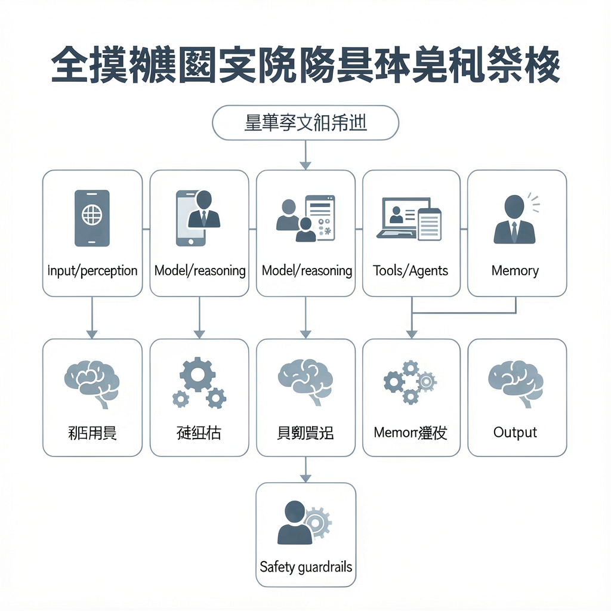

# AI 技術架構深度拆解：全模態醫學影像基礎模型架構

- 日期：2026-10-19
- 選題理由：今日素材呈現醫療 AI 三大動能：Nature Machine Intelligence 發表全模態影像基礎模型、Healthleap 獲 3800 萬美元融資解析病歷筆記、27 家醫學中心推動病歷互通與雙重同意機制。此架構代表「單一模型統一多模態、多任務」的最新範式，且具備即時臨床落地路徑。

## 一、架構原理與核心機制
【輸入/感知層】支援 CT、MRI、X 光、超音波、病理切片等異構醫學影像，透過模態專用編碼器（如 ViT-3D、Swin-UNet）將不同解析度、通道數的影像投影至統一潛在空間，並注入模態標記與解剖位置嵌入。【模型推理核心】採用統一 Transformer 骨幹，採「編碼器-解碼器」或「純解碼器」架構，以掩碼自編碼（MAE）與對比學習預訓練，學習跨模態解剖結構與病理特徵的共享表示；微調階段引入任務特定提示詞與適配器，支援去噪、超解析度、伺影校正、缺失模態合成等多重復原增強任務。【工具/代理協作】推理時可串接影像檢索系統（PACS/RIS）、放射科報告生成 LLM、臨床決策支援規則引擎，形成「影像理解→報告草稿→醫師審核→結構化入庫」閉環；多代理機制下，影像模型負責像素級重建，語言模型負責語義級摘要，經由共享記憶體交換中間表示。【記憶/資料層】採分層儲存：熱資料（近期影像、進行中案例）置於高速物件儲存配合向量索引；冷資料（歷史歸檔）置於合規冷存，並以聯邦學習節點同步模型權重而非原始影像，滿足 GDPR/HIPAA/個資法要求。【輸出與監控】輸出包含增強後影像、不確定性熱力圖、結構化發現標籤；部署端內建分布偏移偵測（OOD）、影像品質指標（PSNR/SSIM/LPIPS）即時監控，並設定臨床級閾值觸發人工複核流程。

## 二、海事領域應用（含實際例子）
1. 船殼水下檢測影像增強：情境為離岸風機或油輪定期水下巡檢，輸入為濁水、低光、背散射嚴重的 ROV 影像；系統以多模態編碼器處理聲納與光學影像融合，骨幹網路輸出去噪、超解析度影像，再由檢測頭定位腐蝕、裂紋、附著生物。價值：將人工判讀時間從小時級降至分鐘級，降低潛水員風險。風險：訓練資料缺乏極端海況樣本，可能對罕見損傷型態產生幻覺式修復。 2. 港口安檢 X 光貨櫃影像復原：情境為高吞吐量港口安檢，輸入為低劑量、高雜訊的雙能 X 光影像；模型利用預訓練的跨模態先驗知識，將低劑量影像還原至診斷級品質，並同步輸出物質有效原子數與密度圖。價值：在不提高輻射劑量前提下提升違禁品偵測率。風險：模型對未見過的遮蔽材質可能過度平滑，導致隱藏物漏判。

## 三、醫療領域應用（含實際例子）
1. 病歷筆記輔助編碼與隱藏病症發掘（Healthleap 案例）：輸入為非結構化醫師進程記錄、出院摘要；系統先以醫療 LLM 抽取實體與時序關係，再由多模態基礎模型對齊同期影像特徵，輸出 ICD-10 編碼建議與潛在併發症風險分數。價值：縮短編碼週期、減少漏報 DRG 收入。合規風險：需通過雙重同意機制取得患者授權，且模型決策需可解釋以滿足醫療器材驗證（TFDA/US FDA SaMD）要求。 2. 多模態影像統一復原增強平台（論文核心場景）：輸入為不同廠牌、不同協議的 MRI（T1/T2/FLAIR/DWI）、CT 低劑量影像；單一模型同時完成去噪、超解析度、運動伺影校正、合成缺失序列。價值：減少重複掃描、降低輻射/造影劑風險、統一影像品質標準。合規風險：合成影像若用於診斷需標註「AI 生成」，且需建立影像級追溯審計軌跡。

## 四、其他產業應用（含實際例子）
1. 工業製程缺陷檢測統一平台：半導體晶圓、面板、精密鑄件產線產生光學、電子束、X 光多模態檢測影像；單一模型替代多套專用演算法，即時輸出缺陷分類、尺寸量測、良率預警。價值：降低模型維護成本、加速新產品導入。 2. 科學研究影像資料增強與重現：材料科學、天文、單細胞顯微影像常面臨低訊雜比、稀疏採樣；基礎模型提供零樣本去噪與超解析，並輸出不確定性估計供下游統計推論使用。價值：提升實驗重現性、減少昂貴重複實驗。

## 五、限制、風險與治理建議
1. 資料異質性與領域位移：不同醫院/設備/協議的影像分布差異大，單一模型易產生「平均化」模糊輸出，需持續聯邦微調。2. 幻覺與臨床安全：生成式復原可能引入不存在的解剖結構或抹除微小病灶，必須配合不確定性量化與醫師覆核機制。3. 算力與碳排放：千億參數級骨幹需多張 H100/A100 叢集訓練與推理，部署成本高，邊緣端（如救護車、離島診所）難以直跑。4. 法規與責任歸屬：AI 生成影像若導致誤診，責任歸屬（廠商、醫院、醫師）尚無統一判例，需契約與保險機制配合。

## 參考來源
- https://doi.org/10.1038/s42256-026-01310-z
- https://news.google.com/rss/articles/CBMifEFVX3lxTE5VLVlrNUdaNm9Qa01ha1lHT0RMYVB1azRqbGVaeUEzUkp1YmIyd0wxblluUEwwbWRZS1pYRzd5aS10SWRtVEVGalVVSkdIVEJTLWhWZmtFbFk5RkNMRWVOd0JvbzA3S0VrNjhiemlTTHBHQnczbEN1ZFE2Q18?oc=5
- https://news.google.com/rss/articles/CBMiUEFVX3lxTE1TOHkyTFhwOWJpYUxkbEhjbF8ydlJ6TGxKVzRfLVZvck84YXFuRFZuUkljSHBpU0VYTHpHdm1hcng4VHNCRW5IcDhDSFlHX3F40gFWQVVfeXFMT1Bwdl9aRm13N3FmVzhTeElnWVJDclVHdnV1bFZIbnczTTZ6Tm0zeEQ4b05XN3c5MXlVblFFNDMtbW1OOFZidkdiYV9aZjVLT29hSkFaR3c?oc=5
- https://news.google.com/rss/articles/CBMiW0FVX3lxTE1WVFNFemxwOUZXempTUks5czdYVnRtMjV5ZWVqMVNORFFDa05nRXRmc2lleEtreE9mb3RiSkVfU24tR0RvWkVEOXF3NlpmQVhWMmZHNU5qdW42dWc?oc=5
