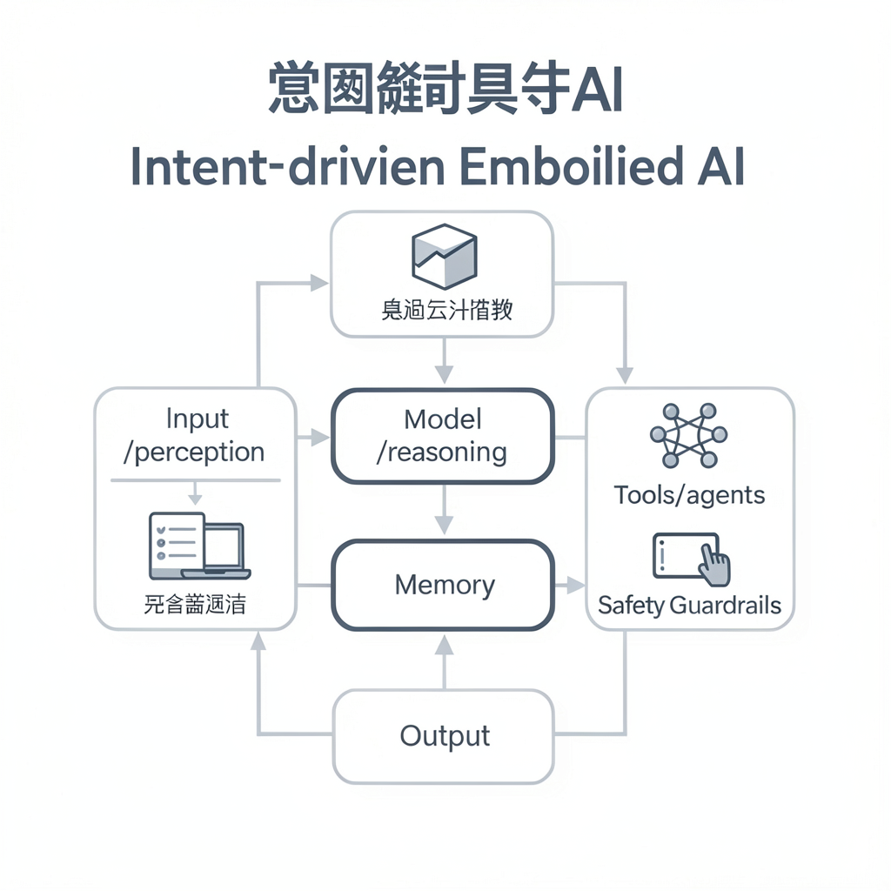

# AI 技術架構深度拆解：意圖驅動具身 AI（Intent-driven Embodied AI）

- 日期：2026-10-26
- 選題理由：今日素材中《National Science Review》發表「Intent-driven embodied artificial intelligence」與「Survey on embodied AI for industry」兩篇論文，系統定義此架構為具身智能新範式；同期 NSING 在 electronica 2026 展示 AI 機器人與馬達控制整合、新北警安芯中心實踐 AI 協作、醫療視覺檢查替代討論，均指向同一架構落地。

## 一、架構原理與核心機制
核心機制包含五層協同： 1. 輸入/感知層：多模態編碼器（視覺 ViT、語音 Whisper、觸覺/本體感受器）將物理環境轉為統一潛在空間向量，支援非同步感測器融合與時序對齊。 2. 意圖理解與規劃層：以大型語言/視覺語言模型（LLM/VLM）為核心，接收自然語言指令與感知向量，輸出結構化任務圖（Task Graph）與子目標序列；引入思維鏈與樹搜索進行長時程規劃，並以形式化驗證器檢查安全約束。 3. 工具/代理協作層：將機器人本體、末端執行器、外部 API（如倉儲 WMS、醫療 PACS）封裝為標準化技能原語；由調度器依據任務圖動態編排技能序列，支援多代理協商與衝突解決。 4. 記憶/資料層：分為情景記憶（向量資料庫存儲歷史任務軌跡）、語義記憶（知識圖譜編碼領域規範）、程序記憶（LoRA/Adapter 微調參數庫），支援線上持續學習與少樣本適應。 5. 輸出與監控層：低階控制器（MPC/RL 策略）將離散動作轉為連續馬達指令；同步遙測串流至可觀測平台，執行異常檢測、安全熔斷與審計日誌記錄，確保可追溯與人機介入介面。

## 二、海事領域應用（含實際例子）
1. 港口自動化裝卸作業：情境為岸邊集裝箱起重機與自動導引車（AGV）協同裝卸。輸入資料含雷達/鏡頭點雲、集裝箱編碼識別、船舶艙位圖、潮汐風速感測器。系統運作：VLM 解析作業指令→規劃層生成最佳吊掛序列與 AGV 路徑→技能原語調度起重機防搖控制與 AGV 車隊編隊→記憶層記錄異常貨物處理案例供下次檢索。價值：單機作業效率提升 15-20%、減少人工盲區事故；風險：惡劣天氣感知退化導致規劃錯誤、跨廠商設備介面不相容。 2. 離岸風機巡檢維護：情境為四足機器人攜帶紅外/可見光雙光譜相機巡檢葉片與塔筒。輸入資料含高解析影像序列、振動頻譜、GPS/IMU 定位。系統運作：感知層即時檢測裂紋、蝕變→意圖層判斷缺陷嚴重度並規劃修補路徑→協作層召喚無人機補拍盲區→輸出檢測報告自動同步至 CMMS。價值：人員登塔風險歸零、檢測覆蓋率達 95% 以上；風險：海上通訊延遲影響遠端介入、模型對罕見缺陷類別泛化不足。

## 三、醫療領域應用（含實際例子）
1. 手術室智能器械遞送與協助：情境為機械臂依語音指令遞送器械並協助持鏡。輸入資料含術野內視鏡影像、醫師語音、器械托盤 RFID、病患生命徵象。系統運作：VLM 理解醫師意圖（如「給我無損夾」）→規劃層檢查器械狀態與無菌區邊界→協作層驅動機械臂抓取並避開無菌區→記憶層記錄器械使用順序供術後複盤。價值：減少巡迴護理人員負擔、縮短器械尋找時間 30%；合規風險：醫療器材軟體等級（IEC 62304 Class C）驗證門檻高、術中異常需醫師即時覆寫機制。 2. 病理切片全自動掃描與輔助診斷：情境為全切片掃描儀搭配 AI 篩檢腫瘤區域。輸入資料含高解析 WSIs、患者病歷結構化資料、既往診斷標註。系統運作：感知層切片分塊並提取特徵→意圖層依臨床指引（如 WHO 分級）生成關注區域建議→協作層將熱力圖疊加至病理醫師檢視站→輸出結構化報告草稿。價值：篩檢敏感度達 98%、讀片時間縮減 40%；合規風險：誤診責任歸屬模糊、資料去識別化與跨院傳輸需符合 HIPAA/個資法。

## 四、其他產業應用（含實際例子）
1. 晶圓廠自動化物料搬運（AMHS）異常復原：情境為天軌車輛故障導致產線阻塞。輸入含車輛遙測、路徑拓撲、排程系統訂單佇列。系統：意圖層重新規劃全廠路徑與優先序→協作層調度備援車輛與維修機器人→記憶層沉澱故障模式供預測性維護。價值：平均復原時間（MTTR）縮短 50%。 2. 建築工地多機種協同施工：情境為挖掘機、吊車、攤鋪機協同作業。輸入含 BIM 模型、即時定位（RTK-GNSS）、環境噪音/粉塵感測。系統：規劃層依施工進度生成無衝突作業時序→協作層同步多機種動作→監控層即時檢測安全區侵入。價值：工期壓縮 10-15%、零重大工安事故。

## 五、限制、風險與治理建議
1. 真實世界長尾分布導致規劃幻覺與動作失效，需大量實機資料蒐集與仿真實轉移。2. 多模態對齊與低階控制延遲總和易超過 200 ms，影響高動態任務穩定性。3. 安全驗證缺乏統一標準，跨域部署（醫療/海事/工業）合規成本極高。4. 持續學習下的災難性遺忘與模型漂移需線上評估機制，目前多停留於離線評估。5. 能耗與算力需求隨模型參數量增長，邊緣部署仍受限於功耗預算與散熱。

## 參考來源
- https://pubmed.ncbi.nlm.nih.gov/43054956/
- https://pubmed.ncbi.nlm.nih.gov/43054954/
- https://www.eetimes.com/nsing-featured-cra-ai-robotics-motor-control-and-digital-energy-at-electronica-2026/
- https://www.ctwant.com/article/508103/
- https://note.com/365medical_tokyo/n/n53c043bda079?hl=en
- https://github.com/whitecircle/halo
