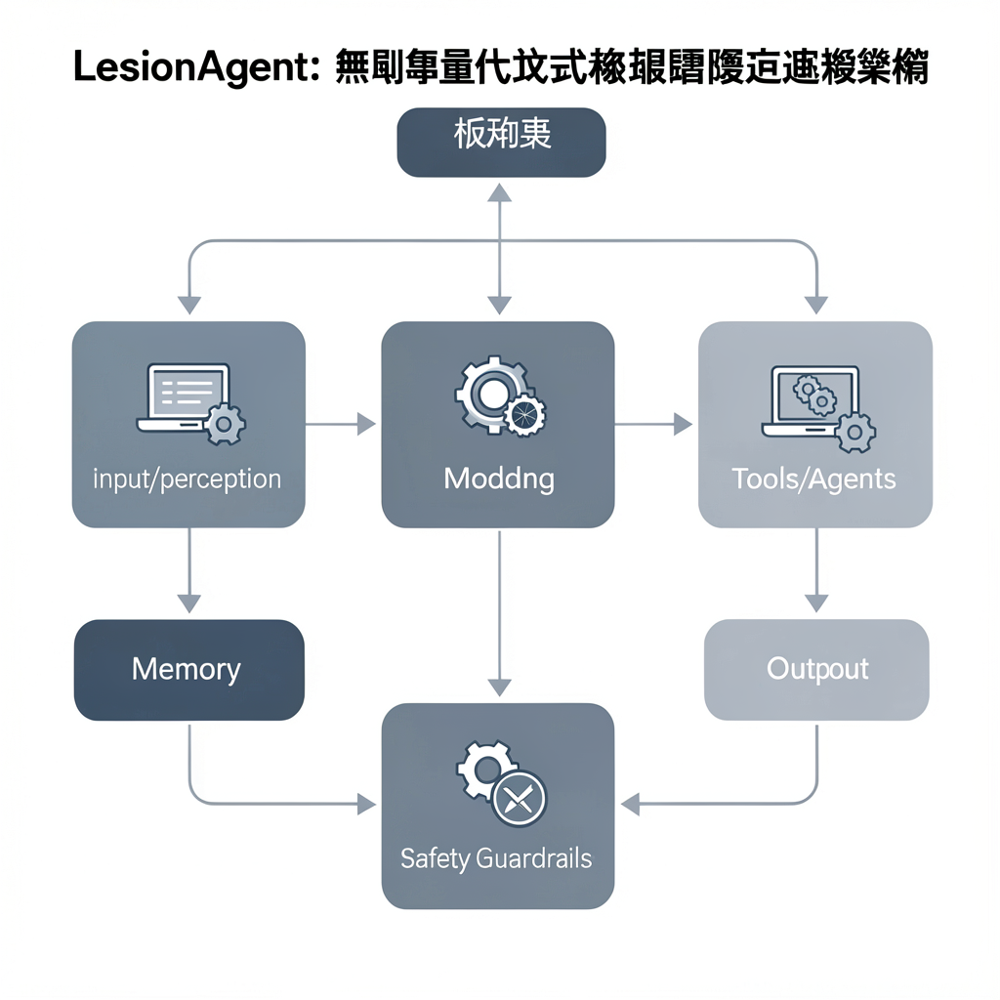

# AI 技術架構深度拆解：LesionAgent：無訓練代理式縱向影像腫瘤追蹤架構

- 日期：2026-11-02
- 選題理由：今日同時出現 arXiv 論文與 GitHub 開源專案，完整展示「無訓練代理式架構」在醫療影像縱向分析的實戰落地。該架構結合 LLM 規劃推理、視覺基礎模型工具鏈、長程記憶與自我驗證機制，無需微調即可處理跨時間點 CT 序列的腫瘤追蹤與療效評估，為專業領域代理系統提供可複製的工程範本。

## 一、架構原理與核心機制
【輸入/感知層】接收患者縱向 CT 序列（DICOM 格式），經預處理模組進行配準、去噪、器官分割，產生結構化影像特徵與時間序列元資料。 【模型推理核心】採用「大語言模型為規劃器 + 視覺基礎模型為執行器」的雙模協作：LLM（如 GPT-4o / Claude-3.5）依據臨床指引與影像特徵生成逐步追蹤計畫，決定需調用哪些視覺工具（腫瘤分割、測量、RECIST 判讀）；視覺模型（SAM-Med3D、nnU-Net 等）執行具體像素級任務並回傳結構化結果。 【工具/代理協作】內建工具鏈：影像配準器、分割器、體積測量器、RECIST 判讀器、時間序列分析器。代理以 ReAct 模式迭代：思考→行動→觀察→修正，支援多輪推理與異常檢測（如新發病灶、偽影干擾）。 【記憶/資料層】短期記憶儲存當前輪次的工具輸出與推理軌跡；長期記憶以向量資料庫索引患者歷史影像、報告、臨床指引片段，支援跨時間點一致性檢查與知識檢索增強生成（RAG）。 【輸出與監控】產出結構化 JSON 報告：腫瘤體積變化曲線、RECIST 分類、關鍵切面標註、信心度分數。監控模組記錄每步工具調用延遲、失敗率、LLM token 耗用，並提供人工複核介面供放射科醫師簽署。

## 二、海事領域應用（含實際例子）
1. 船體結構腐蝕縱向監測：輸入定期無人機/爬壁機器人拍攝的船體高解析影像序列；系統以代理規劃影像配準→腐蝕區域分割→厚度損失量測→趨勢預測，輸出維修優先級報表。價值：將人工目檢週期從月縮至週，降低乾塢停靠成本。風險：海洋環境光照/鹽霧干擾導致分割誤判，需引入領域適應增強。 2. 港口堆場貨櫃堆疊狀態追蹤：輸入定時衛星/定點攝影機影像序列；代理協作物體偵測、姿態估計、時空關聯工具，重建貨櫃進出時間軸與堆疊高度變化。價值：即時掌握堆場利用率、異常堆疊預警。風險：遮擋與解析度限制導致身份關聯錯誤，需融合 RFID/閘口資料校驗。

## 三、醫療領域應用（含實際例子）
1. 多發性轉移瘤療效追蹤：輸入患者每 8 週一次的全身 CT；代理自動對應基線與追蹤病灶、計算目標/非目標病灶體積和、判定 RECIST 1.1 分類。價值：標準化判讀、減少醫師間變異、加速臨床試驗數據鎖定。合規風險：屬醫療器材軟體（SaMD），需 FDA 510(k)/MDR CE 認證；資料隱私須符合 HIPAA/GDPR，模型版本變更需變更管理。 2. 肺結節長期隨診管理：輸入低劑量 CT 年度序列；代理執行結節匹配、體積倍增時間計算、Lung-RADS 分級建議。價值：輔助基層醫院缺乏胸腔放射科專長的情境，降低漏診率。合規風險：臨床決策支援（CDS）若提供具體處置建議可能觸發醫療器材分級，需明確定位為「輔助判讀」而非診斷。

## 四、其他產業應用（含實際例子）
1. 工業設備裂紋演進監測：輸入管線/壓力容器定期超音波相控陣或 CT 掃描序列；代理協作缺陷分割、尺寸量測、疲勞增長模型推演，輸出剩餘壽命預測與檢修排程建議。 2. 農作物長程生長表型分析：輸入無人機多光譜/雷達時序影像；代理規劃田塊分割、株高/冠層覆蓋率提取、異常生長區域偵測，產出品種表現比較報告供育種決策。

## 五、限制、風險與治理建議
1. 依賴視覺基礎模型在特定醫療/工業影像域的零樣本泛化能力，罕見病灶或極端成像條件下易產生幻覺分割。2. LLM 規劃推理的不可確定性導致同一輸入可能產生不同工具調用路徑，難以通過傳統驗證流程。3. 長程記憶向量檢索在海量影像嵌入下延遲與成本顯著，需邊緣緩存與增量索引優化。4. 缺乏統一的代理軌跡審計標準，監管機構對「黑盒推理過程」的可解釋性要求尚未明確。

## 參考來源
- http://arxiv.org/abs/2611.27876v1
- https://github.com/MIC-DKFZ/LesionAgent
- https://pubmed.ncbi.nlm.nih.gov/43054956/
- https://pubmed.ncbi.nlm.nih.gov/43054954/
