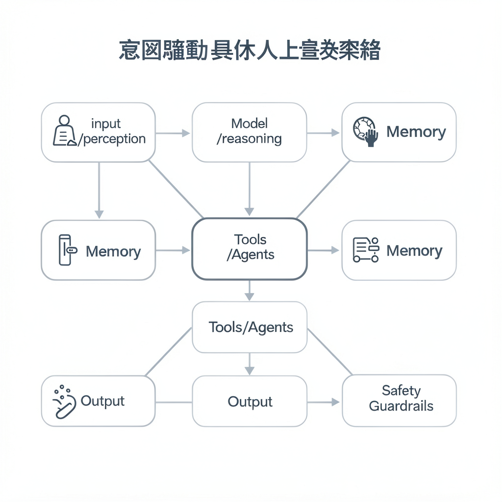

# AI 技術架構深度拆解：意圖驅動具身人工智慧架構

- 日期：2026-11-09
- 選題理由：今日（2026-11-09）在《National Science Review》發表的「Intent-driven embodied artificial intelligence」論文，系統性定義了具身 AI 的意圖驅動架構，整合多模態感知、意圖編碼、分層規劃與實時控制，並針對邊緣部署與安全性提出設計原則，是當前具身智能最具代表性的最新架構，值得深度拆解。

## 一、架構原理與核心機制
架構包含五大核心層： 1. 輸入/感知層：融合視覺、激光雷達、本體感測器等多模態數據，經由統一編碼器輸出語義特徵向量。 2. 意圖推理層：採用大型語言模型結合領域知識圖譜，將自然語言指令或高層任務轉換為結構化意圖表示（目標、約束、優先級）。 3. 模型推理與規劃層：分為長期任務規劃器（基於圖搜索或強化學習）與短期運動規劃器（模型預測控制、軌跡優化），兩者透過意圖條件化機制協同。 4. 工具/代理協作層：定義標準化技能接口（抓取、導航、檢測），支援多代理協商與動態技能組合，透過訊息總線實現非同步調度。 5. 記憶/資料層：包含情景記憶（經驗回放緩衝區）、語義知識庫（向量資料庫）與線上學習模組，支援持續適應與少樣本微調。 輸出與監控：執行器接收控制指令，同時將狀態、不確定性指標回傳至監控儀表板，支援異常檢測、安全熔斷與人工介入。部署考量強調邊緣推理延遲<50ms、模型量化至INT8、安全隔離容器與OTA更新機制。

## 二、海事領域應用（含實際例子）
1. 自主航行貨櫃船：輸入為雷達、AIS、光學相機與氣象數據；系統感知周圍船舶與障礙，意圖層解析「保持航道、避碰、進港」等高層指令，規劃層產生避碰軌跡並下發至舵機與推進控制器；價值在於降低人為錯誤與燃油消耗，風險為感知失效導致碰撞及法規合規驗證。 2. 港口自動化堆高機群：輸入為場站管理系統下發的作業清單、視覺定位與貨櫃識別資料；意圖層將「搬運第3排第5列貨櫃至碼頭」轉為具體抓取與路徑任務，多代理協作層協調多台堆高機避免衝突；價值提升吞吐量與夜間無人作業，風險包含通訊延遲造成死鎖與貨物損壞責任歸屬。

## 三、醫療領域應用（含實際例子）
1. 微創手術輔助機器人：輸入為內視鏡影像、力覺回饋與醫師語音指令；意圖層將「切除腫瘤邊緣 2mm」轉為精細運動意圖，規劃層產生亞毫米級軌跡並經安全檢核後下發至機械臂；價值提高手術精度與縮短學習曲線，合規風險涉及醫療器材認證（TFDA/CE）與術中異常處理責任。 2. 康復外骨骼系統：輸入為患者步態 IMU、肌電訊號與治療師設定的訓練目標；意圖層解析「輔助右腿屈伸 30 度」並根據疲勞度動態調整阻抗，控制層即時輸出扭矩指令；價值實現個人化居家康復並減少照護人力，風險為長期穿戴舒適度、資料隱私（健康資料保護法）與跌倒安全機制。

## 四、其他產業應用（含實際例子）
1. 智慧倉儲揀選機器人：輸入為 WMS 訂單、貨架視覺標記與 AGV 定位；意圖層將「揀選 SKU‑A 10 件」轉為抓取序列與路徑，多代理協作層動態分配任務給多台機械臂與搬運車；價值降低人力成本 30% 並支援 24h 運作。 2. 彈性製造產線重組：輸入為 MES 生產排程、機台狀態與品檢影像；意圖層依訂單變更產生新工藝流程意圖，規劃層自動生成機台參數與物流路徑，支援快速換線；價值縮短換線時間至 15 分鐘並提升良率。

## 五、限制、風險與治理建議
架構高度依賴大型語言模型進行意圖解析，推理延遲與幻覺風險在實時控制環境仍具挑戰；多模態感知融合需大量標註資料，領域遷移成本高；邊緣部署受限於算力與功耗，模型壓縮可能損失精度；安全驗證缺乏統一標準，跨域（海事、醫療）法規差異導致合規部署複雜；長期自適應學習可能引發災難性遺忘與不可預測行為。

## 參考來源
- https://pubmed.ncbi.nlm.nih.gov/43054956/
- https://pubmed.ncbi.nlm.nih.gov/43054954/
