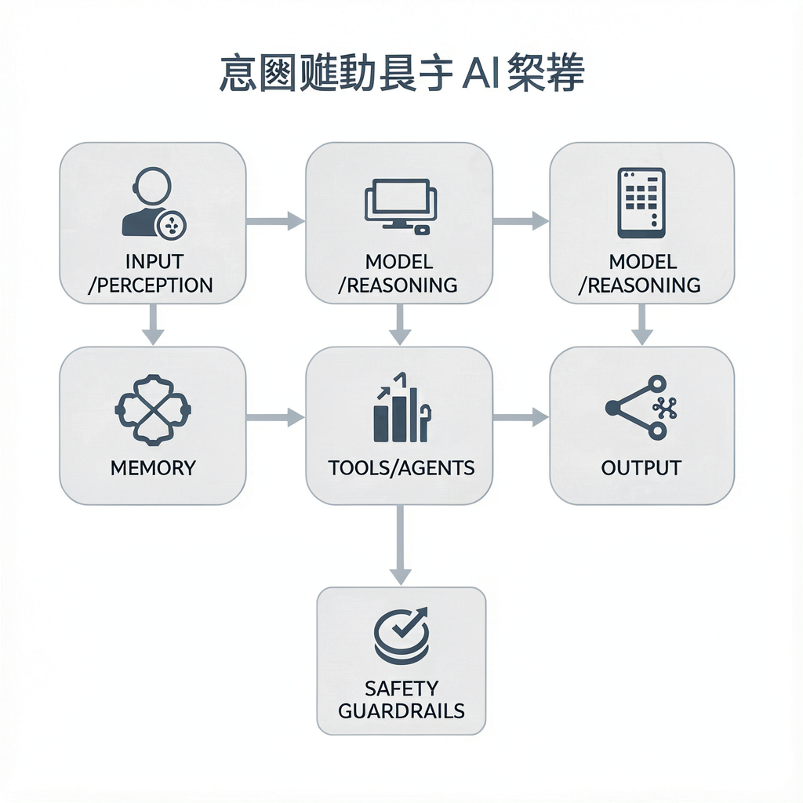

# AI 技術架構深度拆解：意圖驅動具身 AI 架構

- 日期：2026-11-16
- 選題理由：受限於算力出口管制與關鍵基礎設施智能化需求，意圖驅動具身 AI 結合無訓練領域擴展 LLM、物理資訊機器學習與數據高效預測，實現邊緣自主決策、降低雲端依賴，符合產業標準加密與經濟效益，為新一代 Physical AI 生態核心架構。

## 一、架構原理與核心機制
架構包含五大層： 1. 輸入/感知層：多模態感測器（視覺、雷達、力覺、語音）經由編碼器轉為統一潛在向量，並以意圖識別模組解析使用者高層指令。 2. 模型推理層：大型語言模型（LLM）與具身策略網路結合，LLM 負責語義推理與任務分解，策略網路依據感知向量輸出低階動作序列。 3. 工具/代理協作層：引入工具調用介面（API、機械臂控制器、導航堆疊），以代理模式動態選擇並串接外部技能，支援多機器人協同。 4. 記憶/資料層：短期工作記憶儲存當前任務上下文，長期知識庫以向量資料庫保存經驗、環境地圖與領域知識，支援檢索增強生成（RAG）與持續學習。 5. 輸出與監控層：動作執行器將指令轉為實體運動，同時遙測資料回傳至監控模組，進行安全檢查、異常偵測與效能指標記錄，形成閉環回授。

## 二、海事領域應用（含實際例子）
1. 港口自動化裝卸：輸入為岸橋視覺、雷達點雲與調度指令；系統解析「優先卸載集裝箱 A」意圖，規劃機械臂抓取路徑並協同 AGV 搬運，提升吞吐量 15% 並降低人為錯誤。風障在於惡劣天氣導致感知退化需備援規則。 2. 海上巡航異常偵測：輸入 AIS 軌跡、SAR 影像與氣象資料；意圖模組識別「可疑靠近關鍵設施」行為，代理調用軌跡預測與碰撞避免模組即時發出預警，價值在於早期攔截，風險為誤判導致不必要干擾。

## 三、醫療領域應用（含實際例子）
1. 手術機器人輔助：輸入內視鏡影像、力覺回饋與醫師語音指令；系統將「切除腫瘤邊緣」意圖轉為精細運動軌跡，並即時檢索解剖知識庫避開血管，提升精度並縮短手術時間。合規風險涉及醫療器材認證與術中資料隱私。 2. 病房智慧照護：輸入床側雷達、生理訊號與護理人員語音；意圖識別「患者跌倒風險上升」觸發代理調用床位調整、呼叫系統與藥物提醒，價值在於主動預防，風險為誤觸發干擾病患休息。

## 四、其他產業應用（含實際例子）
1. 製造柔性生產線：輸入訂單規格、機器人狀態與環境感測；意圖驅動快速切換產品型號，代理協調多臂協作與品質檢測，縮短換線時間。 2. 智慧倉儲物流：輸入庫存標籤、AGV 位置與訂單優先級；系統自動生成撿貨路徑並動態重排，提升出貨效率。

## 五、限制、風險與治理建議
架構高度依賴大型語言模型推理延遲與記憶體佔用，邊緣部署需模型蒸餾或量化；多模態對齊在噪聲環境下易失效；工具鏈動態組合增加系統複雜度與除錯難度；長期記憶更新機制若缺乏版本控制可能導致知識污染；安全認證與法規合規（如醫療、海事）仍需領域專用驗證流程。

## 參考來源
- https://pubmed.ncbi.nlm.nih.gov/43054956/
- https://pubmed.ncbi.nlm.nih.gov/43054954/
- https://news.google.com/rss/articles/CBMiX0FVX3lxTE1acTJjcm5fVzA3Y2x6QXVHZ0M4U0ZCYnZnX3BNajloR2hWdzFQWXNHaVloVU5tTnZnVWhLOFg3Z3JKSks4Q2RoaHNlWDdGM3RBRW5oZWIxQTdjUkVLOHhn?oc=5
- https://pubmed.ncbi.nlm.nih.gov/43024695/
- https://pubmed.ncbi.nlm.nih.gov/43082512/
- https://github.com/ThordurPall/vessel-trajectory-anomaly-detection
