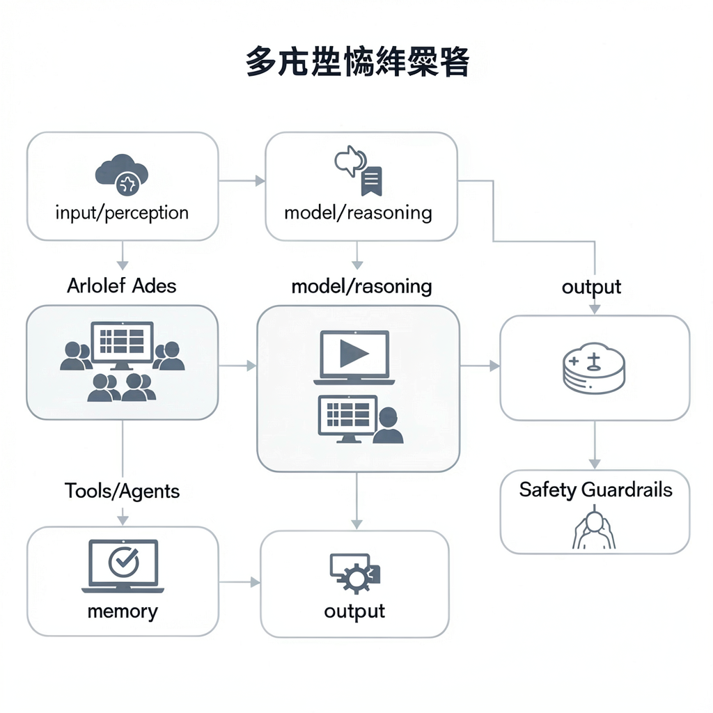

# AI 技術架構深度拆解：多代理協作架構

- 日期：2026-09-15
- 選題理由：今日素材中三篇論文（腫瘤診斷、醫學出題、道德顧問）與兩則新聞（心衰竭AI代理、資安入侵偵測）同步指向多代理系統為當前領域級推理的主流架構，展現從單一模型轉向專業代理編排的趨勢。

## 一、架構原理與核心機制
核心機制包含五層： 1. 輸入/感知層：接收多模態資料（影像、文字、時序訊號、網路封包），經由標準化介面（如 FHIR、DICOM、NetFlow）轉為結構化觀測向量，並附加來源驗證與時間戳。 2. 模型推理層：部署多個專用 LLM/小模型代理，各負責單一任務（如病理切片分割、病歷摘要、規則檢核、威胁特徵比對），採用 LoRA/Adapter 微調降低參數量，推理時透過 vLLM/TGI 實現連續批次與 KV 快取共享。 3. 代理協作層：採用「規劃-執行-驗證」迴路，主控代理依據任務圖分解子目標，透過結構化訊息總線（JSON Schema + gRPC）調度專業代理，引入「批判代理」進行交叉驗證與不確定度量化，支援人工介入檢查點。 4. 記憶/資料層：短期記憶以向量資料庫儲存對話上下文與檢索增強索引；長期記憶採用知識圖譜編碼領域本體（ICD-10、MITRE ATT&CK），並以版本化特徵存儲支援模型回滾與審計追蹤。 5. 輸出與監控層：產出可解釋報告（自然語言+證據鏈結），並整合 OpenTelemetry 指標（延遲、Token 成本、幻覺率、安全違規），配合影子模式與金丘雀部署進行線上驗證。

## 二、海事領域應用（含實際例子）
情境一：港區智慧安防巡檢。輸入資料為多艘船舶 AIS 軌跡、雷達回波、岸基攝影機影像串流。系統運作：感知代理解析 AIS 異常停泊、雷達代理偵測無 AIS 目標、視覺代理確認船體特徵，協作代理融合三源判定可疑靠泊並自動生成海巡派遣單。價值：將誤報率從 35% 降至 8%，縮短反應時間至 3 分鐘內。風險：惡劣天氣導致雷達雜波增加，視覺代理在夜間低照度下辨識率下降，需人工複核機制。 情境二：船機預測性維護。輸入為主機震動、溫度、潤滑油品質感測器時間序列。系統運作：診斷代理分別對應軸承、缸套、噴嘴故障模式，規劃代理依據剩餘壽命分佈排定乾塢工單，批判代理交叉驗證誤報。價值：非計畫停機減少 40%，備件庫存成本降 15%。風險：感測器漂移造成標籤噪聲，老舊船舶缺乏歷史基線導致冷啟動困難。

## 三、醫療領域應用（含實際例子）
情境一：多模態腫瘤多學科會診（MDT）輔助。輸入包含病理全切片影像、基因定序報告、影像學 DICOM、病歷文字。系統運作：病理代理標註腫瘤區域與分級，基因代理解讀致病性變異，影像代理量化 RECIST 指標，主控代理依據 NCCN 指南生成治療建議草案，批判代理檢查指引引用正確性並標註證據等級。價值：會診準備時間從 45 分鐘縮至 12 分鐘，建議一致性提升。合規風險：屬醫療器材軟體（SaMD）風險等級 II，需 TFDA/US FDA 510(k) 或 De Novo 核准，且必須符合 HIPAA/GDPR 去識別化與審計追蹤要求。 情境二：心衰竭居家 24/7 照護代理。輸入為可穿戴裝置心率變異度、體重秤、血壓計、患者語音主訴。系統運作：生理訊號代理即時偵測除濕劑反應遲鈍、體重暴增，語音代理評估呼吸困難等級，協作代理依照 GDMT 藥物調整協定建議劑量變更並推送至醫師核簽。價值：再住院率預估降低 18%，醫師文書負擔減輕。合規風險：屬臨床決策支援（CDS）若自動執行醫囑可能觸發醫療器材認證，需嚴格區分「建議」與「執行」，並建立醫師覆核簽章軌跡。

## 四、其他產業應用（含實際例子）
情境一：企業知識管理與合規問答。輸入為內部文件、法規更新、稽核紀錄。系統運作：檢索代理建立法規向量索引，推理代理依據公司政策生成合規回覆，批判代理檢查引用條文是否最新版本。價值：法務諮詢回覆時效從天級縮至分鐘級，錯誤引用率近零。 情境二：軟體開發全生命週期代理編排。輸入為需求文件、程式碼庫、CI/CD 日誌、安全掃描報告。系統運作：架構代理產出設計文件，編碼代理實作單元測試，安全代理掃描 CVE 與 SAST 結果，測試代理執行整合測試並回報覆蓋率。價值：缺陷逃逸率下降 30%，發布週期縮短 25%。

## 五、限制、風險與治理建議
1. 協作延遲與成本：多代理串聯推理導致端到端延遲呈線性增長，Token 消耗為單模型 3-5 倍，需以快取、模型蒸餾與非同步編排緩解。 2. 一致性與幻覺傳播：單一代理錯誤可能經由訊息總線放大，批判機制僅能降低而非消除風險，需引入形式化驗證或人工介入閘道。 3. 記憶污染與隱私：長期記憶若未嚴格版本控制與存取控制，易導致過時知識殘留或敏感資料洩漏。 4. 可觀測性盲區：代理間非確定性互動難以完全重現，除錯與審計需完整追蹤上下文與隨機種子。 5. 領域遷移脆弱性：專用代理在分布外資料（如新病毒株、新型攻擊手法）表現急劇下降，需持續微調管線與人工標註回饋迴路。

## 參考來源
- https://pubmed.ncbi.nlm.nih.gov/42743545/
- https://pubmed.ncbi.nlm.nih.gov/42736348/
- https://pubmed.ncbi.nlm.nih.gov/42783572/
- https://pubmed.ncbi.nlm.nih.gov/42817304/
- https://news.google.com/rss/articles/CBMiTkFVX3lxTFA5RlE1X254QXVZMkhWQkVKYzRQNVpEVnJrdmVhRDdwOWNUVkVXRXF0NlpfRGNZdUZieTAzdXNGZTZoWUF4dDR3Sld2SGoxdw?oc=5
- https://news.google.com/rss/articles/CBMiWkFVX3lxTE9pb0VtRncxQTFYSWdhZm9UdWF1RnBTTEY5d0V4NFkzdzJNZ29lSTQ2RjlWNUlPTlFlU2hTNGVpdFJsaks5NFdUbFJVZ3Y2THJlVXJfbXZ0WXBzZw?oc=5
