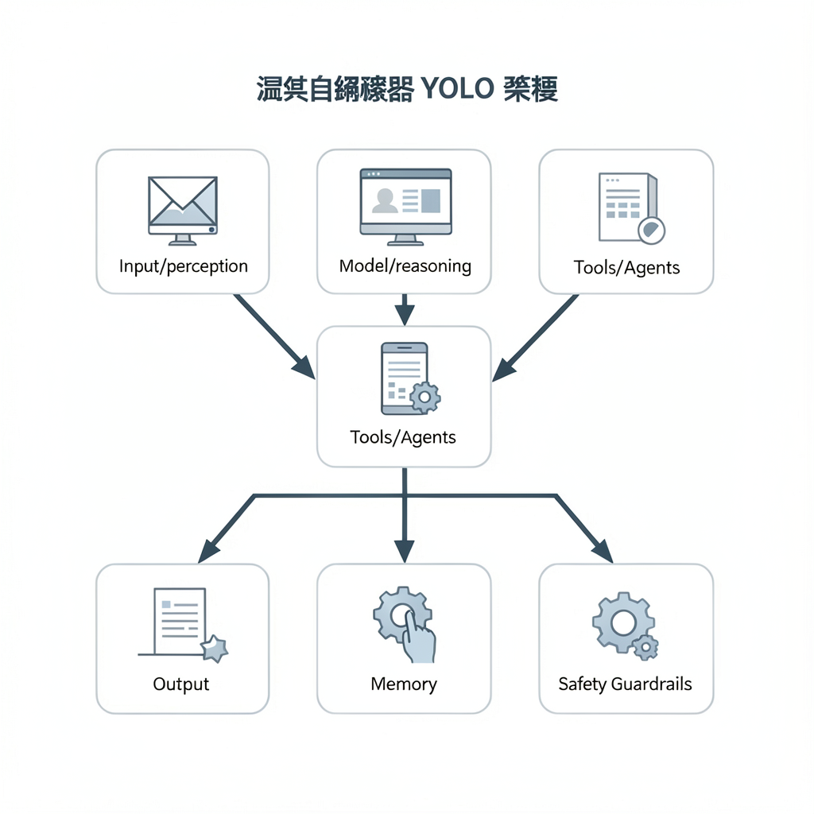

# AI 技術架構深度拆解：混合自編碼器 YOLO 架構 (Hybrid Autoencoder YOLO Framework)

- 日期：2026-09-22
- 選題理由：今日發表的《A Hybrid Autoencoder YOLO Framework with Spatial Regularization for Rapid Small Maritime Object Detection》結合自編碼器特徵重建與 YOLO 即時檢測，並引入空間正則化，針對海事小目標檢測提出完整端到端架構，具代表性且可延伸至醫療影像與通用邊緣部署。

## 一、架構原理與核心機制
架構包含五大核心模組： 1. 輸入/感知層：接收 SAR 或光學影像，經去噪、歸一化、切片後送入網路。 2. 自編碼器編碼器：多層卷積下採樣將高維影像壓縮為潛在向量，保留結構與紋理資訊；解碼器對稱上採樣重建影像，重建損失強制學習具判別力的特徵。 3. 空間正則化模組：在潛在空間加入空間一致性約束（如全變分或鄰域相關性），抑制背景雜訊並增強小目標區域的特徵響應。 4. YOLO 檢測頭：將編碼器輸出的特徵圖直接餵入 YOLOv5/v8 風格的多尺度檢測頭，輸出邊界框、類別與置信度；損失函數融合重建損失、檢測損失（CIoU + 分類）與空間正則化項。 5. 記憶/資料層與監控：訓練階段使用混合資料集（真實標註 + 自監督重建樣本），採用線上難例挖掘；推理階段部署於邊緣 GPU（如 Jetson Orin），支援 INT8 量化、TensorRT 加速，並內建推理延遲、檢測召回率監控指標，支援模型熱更新。 資料流：原始影像 → 前處理 → 編碼器 → 潛在向量 → 解碼器（重建）與空間正則化 → 特徵圖 → YOLO 頭 → 檢測結果。控制流：訓練時交替優化重建與檢測損失，驗證集觸發早停；推理時單向前向傳播，若置信度低於閾值則觸發人工複核流程。

## 二、海事領域應用（含實際例子）
1. 港口智慧監控：輸入碼頭高解析度 SAR 影像，系統即時偵測小型漁船、無人艇與貨櫃落水物件；輸出邊界框供 VTS（船舶交通服務）自動預警，價值在提升 24/7 無人值守覆蓋率，風險為惡劣海況導致誤報率上升。 2. 海上搜救任務：無人機搭載邊緣裝置執行即時推理，輸入多光譜影像，系統快速定位落海人員或救生筏；輸出座標傳回指揮中心縮短搜救時間，價值在秒級反應，風險為模型在極端光照下特徵退化。

## 三、醫療領域應用（含實際例子）
1. 乳房超音波微鈣化檢測：輸入高頻超音波影像，自編碼器學習正常組織紋理，空間正則化抑制斑點噪聲，YOLO 頭輸出微鈣化候選區；價值在提高放射科醫師閱讀效率，合規風險為需符合 FDA/CE 醫療器材軟體驗證流程。 2. 病理切片轉移瘤篩選：輸入全切片掃描影像，架構於切片級別進行快速區域建議，輸出疑似轉移灶坐標供病理醫師複核；價值在大幅減少人工掃描時間，合規風險涉及患者資料去識別化與模型解釋性要求。

## 四、其他產業應用（含實際例子）
1. 工業缺陷檢測：製造線上相機串流影像進入系統，自編碼器捕捉正常表面紋理，YOLO 偵測微小劃痕與氣泡，支援即時剔除不良品。 2. 智慧交通號誌優化：路側攝影機影像經模型偵測行人、機車與車輛密度，輸出計數供號誌控制器動態調整綠燈時長，提升路口通行效率。

## 五、限制、風險與治理建議
模型對極端海況（強浪、濃霧）與醫療影像低對比度場景的泛化能力仍待大規模多域驗證；空間正則化超參數敏感，需領域專家調整；邊緣部署時 INT8 量化可能導致小目標召回率下降；資料標註成本高，自監督重建雖緩解但無法完全替代精確標註；隱私法規（GDPR、個資法）限制醫療影像跨境訓練。

## 參考來源
- https://pubmed.ncbi.nlm.nih.gov/42783857/
- https://github.com/ThordurPall/vessel-trajectory-anomaly-detection
- https://news.google.com/rss/articles/CBMiVEFVX3lxTE9RMHp0bnJGN2FfQnE0WmpFSms0cXdhd3FEdjRWOGdVRVpxLXFuSnQ0OTBVOEJZSkdOenExb0IxMUdaOUpKS3Y2YVhNWHdxMWVJdFc4dA?oc=5
