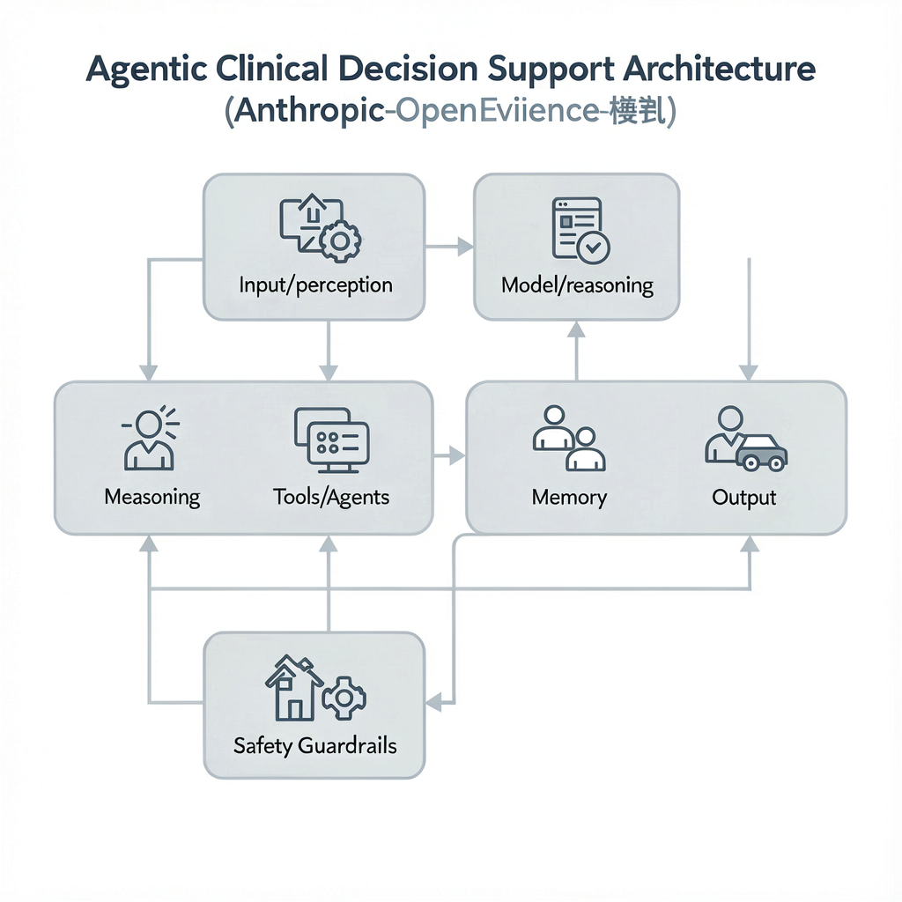

# AI 技術架構深度拆解：Agentic Clinical Decision Support Architecture (Anthropic-OpenEvidence 模式)

- 日期：2026-09-29
- 選題理由：今日素材中 Anthropic 攜手 OpenEvidence 向百國醫護免費提供 AI 臨床決策工具，展示了具備工具調用、檢索增強、長期記憶與安全護欄的 Agentic 架構已進入大規模實務部署。此架構同時呼應微軟揭露的 JadePuffer 攻擊代理與 ISO 27090 治理標準，代表當前「可信任、可審計、可擴展」的代理型 AI 範式，且可自然延伸至海事決策支援與其他高風險領域。

## 一、架構原理與核心機制
【輸入/感知層】接收結構化（電子病歷 FHIR、檢驗數值、用藥清單）與非結構化（醫師筆記、影像報告、指引 PDF）輸入；透過文件解析器、實體抽取器與術語標準化（SNOMED-CT、LOINC、ICD-10）轉為統一語義表示。 【模型推理層】以 Claude 系列大型語言模型為核心推理引擎，採用 Chain-of-Thought 與 ReAct 模式：先分解臨床問題、檢索相關指引與文獻、推理鑑別診斷與治療選項、再綜合生成建議。推理過程可被外部驗證器攔截，強制引用來源。 【工具/代理協作層】編排多工具鏈：(1) 向量檢索器（PubMed、UpToDate、機構指引）；(2) 結構化查詢引擎（藥物交互作用資料庫、劑量計算器）；(3) 知識圖譜查詢（疾病-症狀-治療關係）；(4) 外部 API（基因解讀、臨床試驗匹配）。工具調用由規劃器動態排程，支援並行與回溯。 【記憶/資料層】分三級：(a) 短期工作記憶（對話輪次、中間推理步驟）；(b) 長期情景記憶（患者縱向病程、歷次建議與採納記錄，加密儲存於合規資料湖）；(c) 知識庫版本化（指引版本、模型權重、提示詞模板皆以 GitOps 管理，支援回滾與審計）。 【輸出與監控層】輸出結構化建議物件：診斷機率分布、推薦治療方案、引用證據鏈、不確定性標記、醫師覆核清單。所有輸出經過安全護欄（幻覺偵測、禁忌藥物檢查、合規規則引擎）並寫入不可竄改審計日誌（WORM 儲存）。即時監控指標涵蓋：引用覆蓋率、醫師採納率、延遲 P95、安全攔截次數、模型漂移偵測（嵌入空間位移）。部署採藍綠發布與影子模式，逐步放行流量。

## 二、海事領域應用（含實際例子）
【情境 1：港區智慧調度決策支援】輸入資料：AIS 軌跡、氣象海象預報、碼頭作業狀態、船舶載重與優先級、拖輪/領港員排班。系統運作：代理接收調度請求 → 檢索港區作業 SOP、歷史最優解案例 → 呼叫優化求解器（混合整數規劃/強化學習）生成候選方案 → 以 LLM 解釋權衡（準班率 vs 燃油 vs 安全緩衝） → 輸出含風險標記的調度建議供值班長覆核。價值：減少船舶錨泊等待 15-25%，降低碰撞風險。風險：模型對極端天氣泛化不足、資料延遲導致決策過期、單一點故障癱瘓調度。 【情境 2：船舶機電系統預測性維護代理】輸入資料：主機缸壓、潤滑油鐵屑、震動頻譜、燃油消耗率、維修紀錄。系統運作：代理持續串流感知 → 時序異常檢測器觸發 → 自動檢索 OEM 服務公告、同型船隊失效模式庫 → 推理可能失效模式與剩餘壽命 → 生成維修工單草稿含備件、工時、風險等級。價值：非計畫停機降低 30%，備件庫存優化。風險：感測器漂移造成誤判、跨廠牌資料異質性、責任歸屬模糊（船東 vs 管理公司 vs AI 廠商）。

## 三、醫療領域應用（含實際例子）
【情境 1：急診部敗血症早期辨識與抗生素建議】輸入資料：生命徵象串流、血液培養初步結果、合併症、過敏史、腎功能。系統運作：代理偵測 qSOFA ≥2 → 即時檢索最新 SSC 指引、院內抗生素藥敏監測報告 → 以藥物基因組學工具檢查代謝酵素型別 → 推薦初始抗生素組合、劑量、給藥途徑與重新評估時間點。價值：縮短給藥時間、降低廣效抗生素濫用。合規風險：屬醫療器材軟體（SaMD）須符合 TFDA/US FDA CDS 免審豁免條件、離線模式下指引版本過舊、醫師自動化偏誤導致過度信賴。 【情境 2：腫瘤多學科團會（MDT）準備代理】輸入資料：影像報告（RECIST）、病理分子分型、既往治療史、臨床試驗資格庫。系統運作：代理為每位病患生成「MDT 速讀包」：分期確認、標準療法、可用試驗、基因檢測缺口、支持性照護建議 → 會議中即時回答醫師提問（如「KRAS G12C 抑制劑在二線療法的證據等級」）。價值：縮短會議 40%，減少遺漏試驗機會。合規風險：試驗資格判讀錯誤導致患者錯失機會、跨境資料傳輸違反 GDPR/個資法、模型未納入最新 NCCN 版本造成建議過時。

## 四、其他產業應用（含實際例子）
【情境 1：金融機構反洗錢（AML）調查代理】輸入：交易流水、客戶 KYC、制裁名單、負面新聞。代理自動建構實體關係圖、檢索類型學模式、生成可疑活動報告（SAR）草稿含證據鏈，合規人員僅需覆核簽署，人力成本降低 60%。 【情境 2：半導體製程良率異常根因分析代理】輸入：設備感測器時序、量測數據、維護紀錄、製程參數。代理關聯異常時窗與工程變更、檢索知識庫中的失效機制、提出前三大疑似根因與驗證實驗建議，加速良率爬坡。

## 五、限制、風險與治理建議
1. 幻覺與引用錯誤：RAG 檢索不完整或嵌入空間錯位仍可能產生似是而非的引用，需人工覆核機制。2. 長尾知識更新滯後：指引、藥物標籤、法規變更需經人工策展管線才能進入知識庫，存在數天至數週窗口期。3. 責任歸屬模糊：臨床/航運決策最終由人類負責，但自動化偏誤可能削弱批判性審查。4. 資料主權與隱私：跨國部署需符合當地資料在地化（如中國《數據安全法》、歐盟 GDPR、台灣個資法），增加架構複雜度。5. 對抗性攻擊：提示詞注入、工具鏈劫持、模型提取等風險需持續紅隊演練與 ISO 27090 認證。

## 參考來源
- https://news.google.com/rss/articles/CBMimAFBVV95cUxNcWUteXJrWm85N3dndmZSdkxuX3h5UVZFSHUtUllqMFNTSVdJUEdPb3VHcWdZSUJDRWs3QjNIT2ZIVHBYRkl6ZWlRUDlzVHBFRVhuVU05QTRkMEt4OVVRZEFySkxOVHI0enNjU0FJMFhCTnoteUFiVFMtV3ZhZzBSLWVVLWlsTTNZNDdvQXlLZnYzNHFTSGJfRA?oc=5
- https://news.google.com/rss/articles/CBMiggFBVV95cUxPQks5YnlsZ1hFdVNiaUhyU1hKejhMTWt6WjM0bEU3YkVhVVZIRjFxTWIyTkVWSzlFMWx1RUxGNlo0LTYzZm5LdzJCcFNBZXB4cHVSRDF1UVJhdXVRUm01Qy0xNFVGVlhCelV3aGhaS0l0WDE1VjgtRklORms0MHBMcmVn?oc=5
- https://news.google.com/rss/articles/CBMiWkFVX3lxTE1vaTdHM0JuQndqVlo1YTR3RmN4ZjQ5enhraFVEU2FEay1IRmxkQVdSS0wwYUFHVHptT1UyQXhWNDNJQnVjYkRHNUkyV2pEVF9wRzA1WDFCM0ZKQQ?oc=5
- https://pubmed.ncbi.nlm.nih.gov/42775883/
- https://github.com/XIAOJIE0519/E2E
