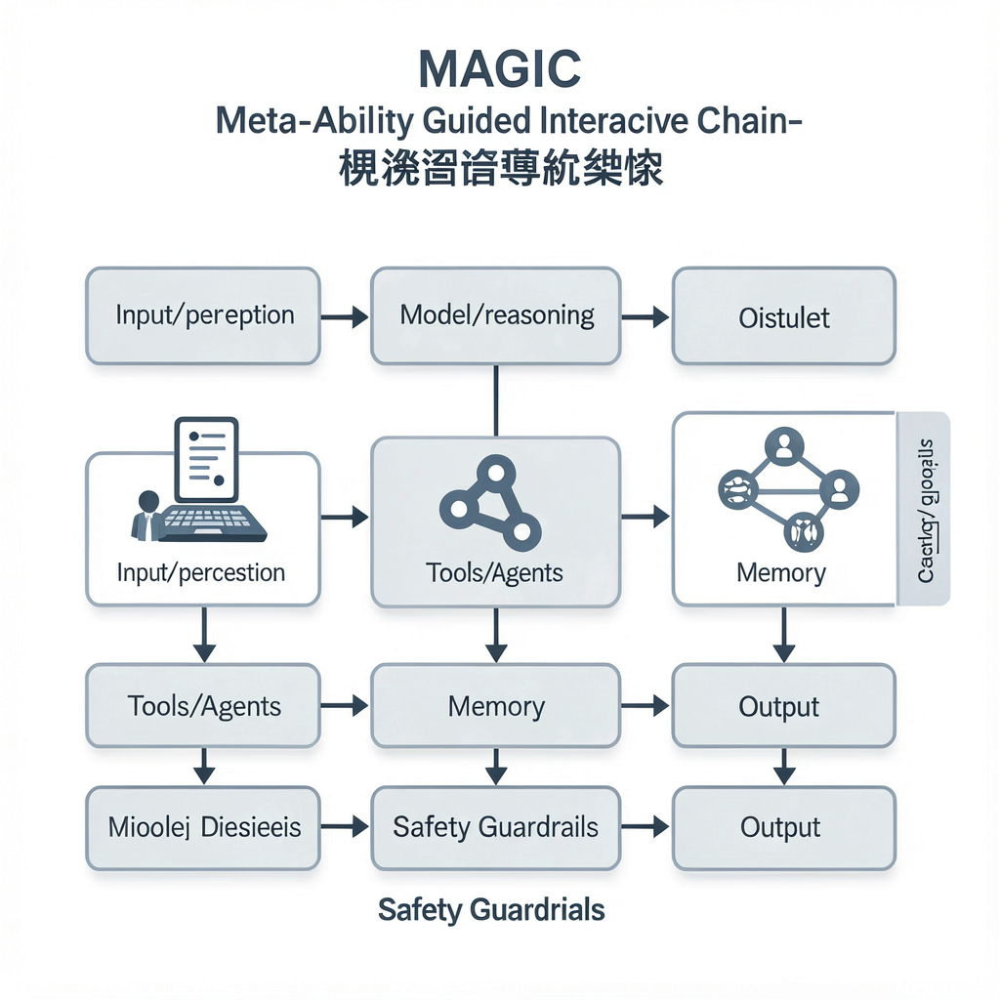

# AI 技術架構深度拆解：MAGIC：Meta-Ability Guided Interactive Chain-of-Distillation 視覺語言導航架構

- 日期：2026-10-06
- 選題理由：今日發表的 IEEE TPAMI 論文提出 MAGIC，結合元能力引導與互動式鏈式蒸餾，針對視覺語言導航實現高效推理與泛化，屬於近期最具代表性的端到端多模態代理架構。

## 一、架構原理與核心機制
MAGIC 架構包含五大核心層： 1. 輸入/感知層：接收 RGB 影像、深度圖與自然語言指令，透過預訓練視覺編碼器（如 CLIP-ViT）與語言編碼器產生多模態嵌入。 2. 模型推理層：採用雙流 Transformer，分別處理視覺與語言流，並透過跨模態注意力融合生成動作分佈。 3. 工具/代理協作層：引入「元能力模組」動態選擇導航技能（如避障、目標搜尋、路徑規劃），並以互動式鏈式蒸餾方式將教師模型的多步推理蒸餾至學生模型，減少推理步數。 4. 記憶/資料層：維護情景記憶緩衝區，儲存歷史觀測、動作與獎勵，支援線上微調與長時程一致性。 5. 輸出與監控層：輸出離散動作（前進、轉向、停止）並同步記錄不確定性分數、注意力熱力圖與蒸餾損失，供線上監控與離線分析。整體資料流為：感知→融合→元能力選擇→鏈式蒸餾推理→動作輸出→記憶更新，控制流由元能力調度器根據環境反饋動態切換技能。部署時採用 ONNX Runtime + TensorRT 加速，支援邊緣 GPU（Jetson AGX）與雲端推理雙模式。

## 二、海事領域應用（含實際例子）
1. 自駕運輸船航道導航：輸入船首攝影機影像、雷達點雲與語音指令（如「靠泊碼頭 3 號」），MAGIC 透過視覺語言融合生成避障與靠泊動作序列，元能力模組動態切換「航道保持」與「碼頭對齊」技能，價值在於減少人工駕駛員疲勞並提升夜間/惡劣天氣下的安全性；風險為感知器故障導致錯誤動作，需冗餘感測器與人工接管機制。 2. 離岸風機巡檢無人艇：輸入多光譜影像與維護手冊語句，系統自動規劃巡檢路徑並識別損傷標記，記憶層記錄歷史缺陷位置以利趨勢分析，價值為提升巡檢效率 40% 以上；風險包含通訊中斷導致任務中止，需離線推理能力。

## 三、醫療領域應用（含實際例子）
1. 手術機器人語音導航：輸入內視鏡影像與醫師口語指令（如「向左移動 5 公釐」），MAGIC 將視覺特徵與語言映射至精細動作空間，元能力選擇「精細操作」與「組織避讓」技能，記憶層保存術中關鍵幀供術後複盤，價值為降低醫師認知負荷並提升微創精度；合規風險涉及醫療器材軟體驗證（IEC 62304）與資料隱私（HIPAA/GDPR）。 2. 急診分流語音助理：輸入病患描述語音、生命徵象數據與醫院資源狀態，系統輸出分流建議與建議檢查清單，元能力動態切換「分流邏輯」與「資源調度」模組，記憶層記錄歷史分流結果供品質稽核，價值為縮短分流決策時間；風險為模型誤判導致延誤治療，需人工複核機制與持續監測。

## 四、其他產業應用（含實際例子）
1. 倉儲機器人語音導引：輸入倉庫攝影機串流與語音指令（如「取貨區 A3」），MAGIC 實現視覺語言導航與貨架識別，元能力切換「路徑規劃」與「避障」技能，提升揀貨效率並減少人工干預。 2. 智慧家庭服務機器人：輸入居家環境影像與自然語言請求（如「幫我拿水」），系統融合視覺語義與物件檢測，輸出抓取與遞送動作，記憶層記錄家庭佈局變化以適應長期部署。

## 五、限制、風險與治理建議
MAGIC 依賴大規模預訓練視覺語言模型，部署需高算力 GPU，邊緣裝置若無 TensorRT 加速將難以達即時要求；鏈式蒸餾雖減少推理步數，但教師模型品質直接影響學生模型上限，若教師存在偏見將傳遞至部署端；元能力模組的動態切換邏輯目前以規則為主，缺乏形式化驗證，可能在極端場景產生不可預期行為；資料層記憶增長需定期清理，否則記憶體壓力與隱私風險上升。

## 參考來源
- https://pubmed.ncbi.nlm.nih.gov/42118647/
- https://news.google.com/rss/articles/CBMiXEFVX3lxTE52eXQzclNkTjRPbWdXV0dLamZlTjlLbGhPOUpZUzRzWlpiTnJhX3dqSkRaVjN0VWdqUDd3Q2pXd2V2dE14bzdkTy13NEszOGRWbTRJUkRINE5qYk9p0gFiQVVfeXFMUEgtUkc2aXc3Z2JWOEVhM1pEM3dIWDZMY3JPZHVQdk5TcVRxQUhtNUNmOUlzbGZDMXBrVnBQbmJJWFlGVWI5ZWlQT3l1ZkpIbC1WYncxcDZJQ3JFT2pDdWhJUnc?oc=5
- https://news.google.com/rss/articles/CBMiiAFBVV95cUxNeS1ndFlTdnMwa1I5aVBNTnk0NGpXVFZNbzQzNmRRUXhxdXg5MS12ZFlvcDNCU1lyYnZ6WXAwS09CZ29TUHJsMzRlQ0pXYXhEdlMyN3ZJN09yQjAwdUJOODd2cndxYlRZTnZlNFNGT0c1bVFTT2xQUmtrWnpqOVFQVFZ3aktBMTNq?oc=5
- https://news.google.com/rss/articles/CBMie0FVX3lxTFBsNTdQZWl3SkRSbE8wRjY4YTRMS0pUYUplSjhfcUdmbmR1RTV2YVdDdk0xdU5GTDVLSXVZdVNjT0FxVFVBNGdtR0NLUUxHNjBlZDFYMzRVRG93SGU5MDc5Q2UxbWQyakZqYTd3V3RLM0g5enlFc25VTEpWMA?oc=5
