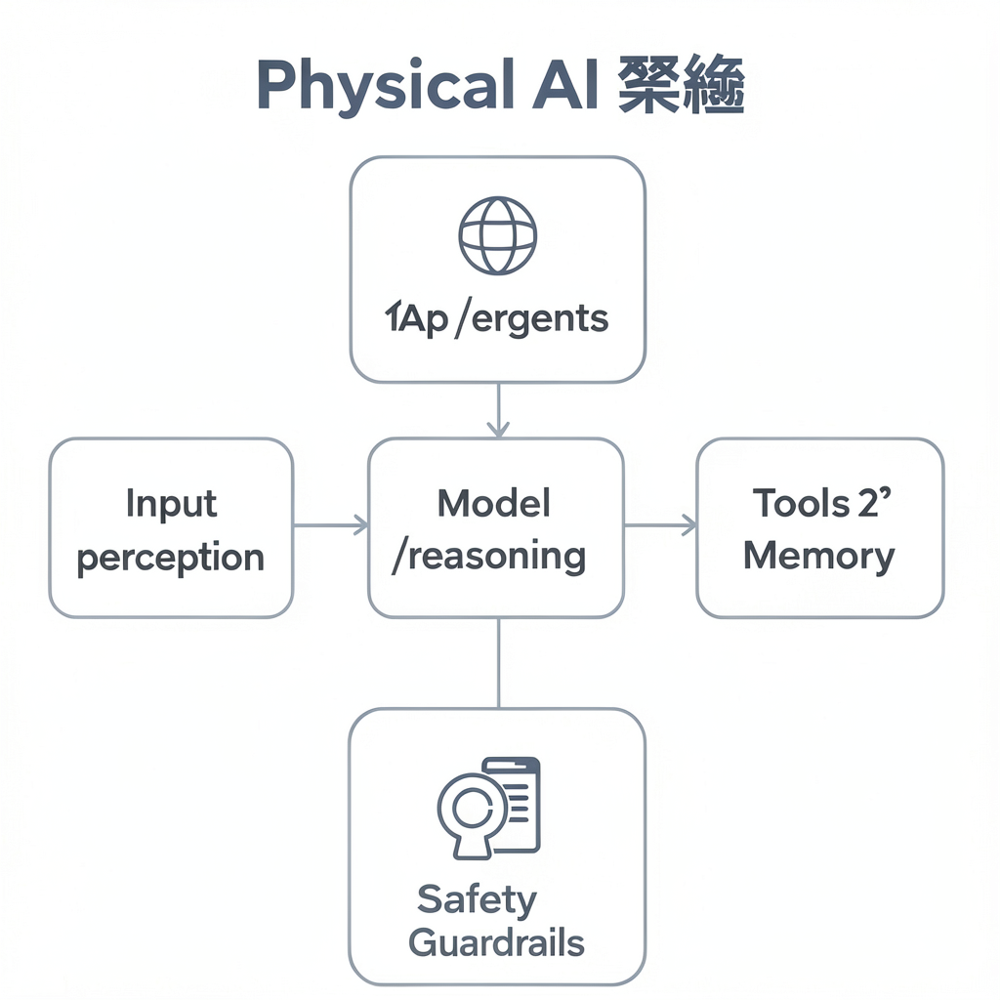

# AI 技術架構深度拆解：Physical AI 架構

- 日期：2026-10-13
- 選題理由：今日素材中 IEEE TPAMI 發表的《Aligning Perception, Reasoning, Modeling and Interaction: A Survey on Physical AI》系統性定義了 Physical AI 為下一代 AI 架構範式，整合感知、推理、建模與交互四大核心模組，並強調與物理世界的閉環耦合。此架構直接回應海事自主航行、醫療手術機器人、工業具身智能等高風障領域對即時性、安全性與可解釋性的嚴格需求，且與 Orbius StarEDGE 邊緣雲端、AI 資料中心下海等基礎設施趨勢形成軟硬協同，具備最強代表性與跨域延伸性。

## 一、架構原理與核心機制
Physical AI 架構以「感知—推理—建模—交互」四層閉環為核心，並引入世界模型與安全治理層。 1. 輸入/感知層：融合多模態感測器（視覺、雷達、力覺、本體感受器），採用時空對齊與不確定性量化編碼器，輸出帶信心區間的語義特徵圖與物理狀態估計。邊緣端採用異構加速（GPU/NPU/FPGA）完成前處理與特徵蒸餾，延迟 <20 ms。 2. 模型推理層：採用分層推理架構——快速反射網路處理毫秒級避障與力控；慢速規劃網路（LLM/VLM + 符號規劃器）執行任務分解、長時程推理與反事實模擬。推理引擎支援動態量化、投機解碼與知識蒸餾，適配雲邊端算力差異。 3. 工具/代理協作層：定義標準化技能介面，封裝運動基元、感知驗證、外部 API（氣象、海圖、醫療影像 PACS）為可組合技能。多代理協作採用契約式協商機制，透過共享世界模型同步意圖與狀態，支援人機混合決策與授權切換。 4. 記憶/資料層：分為情景記憶（向量資料庫存儲任務軌跡）、語義記憶（知識圖譜編碼領域法規、操作手冊）、程序記憶（技能庫與參數化策略）。採用增量學習與聯邦學習機制，在隱私與合規前提下持續更新世界模型。 5. 輸出與監控層：輸出軌跡指令、控制參數與自然語言解釋。運行時監控包含：安全防護罩（形式化驗證的不變量檢查）、異常檢測器（分佈偏移與對抗樣本）、審計日誌（不可篡改區塊鏈存證），支援即時熔斷與人工介入。

## 二、海事領域應用（含實際例子）
情境一：港口自主駁引作業。輸入資料：多船雷達/ AIS/ 條碼辨識/ 風浪感測器/ 引擎遙測。系統運作：感知層融合生成港區動態數位孿生；推理層快速反射網路處理防撞避障，慢速規劃器優化編隊順序與拖輪分配；技能代理呼叫港口作業系統 API 鎖定泊位；記憶層調取歷史潮流模型修正世界模型。價值：單班次效率提升 15%、油耗降低 8%。風險：感測器失效導致世界模型偏差、跨廠商 API 介面不相容、惡劣天氣下形式化驗證覆蓋率不足。 情境二：遠洋自主航行決策支援。輸入資料：衛星氣象/ 海圖更新/ 船體應力光纖/ 機艙振動頻譜。系統運作：邊緣端推理層持續評估結構疲勞與航線風險；規劃器結合氣象路由演算法生成替代航案；協作層向岸基遠程操作中心推送決策依據與信心度；監控層對照 SOLAS 公約規則檢查合規性。價值：年省燃料成本 3-5%、減少人為錯誤事故。風險：衛星通訊斷聯時自主決策法律責任歸屬不明、模型對極端海況泛化能力未經充分驗證。

## 三、醫療領域應用（含實際例子）
情境一：腹腔鏡手術機器人輔助。輸入資料：立體內視鏡影像/ 力覺反饋/ 術中超音波/ 病患生理訊號。系統運作：感知層即時分割器官與血管、估計組織變形；快速反射網路執行力控防護（限制夾持力 <2N）；慢速規劃器依解剖結構推薦切割路徑；技能代理呼叫導航系統註冊術前 CT；記憶層記錄術中異常事件供術後複盤。價值：縮短手術時間 20%、減少併發症。合規風險：FDA/ TFDA 要求鎖定版本模型與完整追溯記錄、患者資料跨境傳輸需符合 HIPAA/ GDPR、離線模式下模型漂移無法即時修補。 情境二：ICU 多模態持續監測與早期預警。輸入資料：床邊監護儀波形/ 穿戴式光電容積脈搏波/ 護理記錄文本/ 影像辨識體動。系統運作：感知層多模態對齊提取敗血症早期生理標記；推理層結合臨床指南知識圖譜進行多步推理；協作層以自然語言生成護理建議並推送至護理站；監控層記錄所有警報與臨床決策供事後審查。價值：敗血症早期識別提前 4-6 小時、減少警報疲勞。合規風險：醫療器材軟體分類可能屬 Class II/III 需完整驗證確認、模型偏誤對特定族群漏報風險、資料主權與二次使用同意機制。

## 四、其他產業應用（含實際例子）
情境一：半導體晶圓廠自主物流搬運（AMR 編隊）。輸入：激光雷達/ 視覺標記/ MES 調度指令/ 電梯/ 門禁系統介面。系統運作：感知層構建動態語義地圖；規劃器協同多機器人無衝突路徑與電池管理；技能代理呼叫 MES API 確認載具優先序；記憶層累積路徑經驗優化通行時間。價值：搬運效率提升 25%、人力成本降低 30%。風險：動態環境下長尾場景（施工圍籬、濕地板）導致規劃失效、跨廠區網路分割時協調機制降級。 情境二：再生能源風電場巡檢無人機編隊。輸入：多光譜/ 熱紅外/ 雷達風場/ SCADA 狀態。系統運作：感知層即時檢測葉片裂紋、螺栓鬆動、結冰；推理層結合結構力學模型評估損傷嚴重度；規劃器動態調整巡檢路徑避開強亂流；協作層向維運系統自動生成工單與風險等級。價值：巡檢覆蓋率 100%、故障預測準確率 >90%。風險：離岸通訊不穩導致邊緣決策與雲端模型版本不一致、極端天氣下感測器退化未被及時發現。

## 五、限制、風險與治理建議
1. 世界模型建構成本高：需大量真實物理交互資料，仿真到實機遷移仍存現實差距。2. 形式化驗證擴展性受限：高維連續狀態空間的不變量證明在複雜任務下計算不可行，常需退化為抽象模型。3. 異構硬體部署碎片化：邊緣晶片工具鏈不一，模型壓縮與算子支援需逐平台調優。4. 法規與責任歸屬灰地帶：自主決策導致事故時，模型開發者、系統整合商、操作單位責任劃分缺乏國際共識。5. 長尾安全案例覆蓋不足：極端環境、對抗性干擾、感測器退化等情境難以在測試階段窮盡。6. 持續學習與認證衝突：模型線上更新需重新認證，現行醫療/海事法規架構不支援敏捷迭代。

## 參考來源
- https://pubmed.ncbi.nlm.nih.gov/42284175/
- https://news.google.com/rss/articles/CBMiwAJBVV95cUxPY21XQVBEd0FhTWhJWjRkVHU3djNGMk9TNVZRb1MwZElfX0NNdkJSMkMza0h6eDd3aFRFZE1jMDd6N3plY0tWdWdScjBXQUlnWENMS1JFNWRaYkltTHBDUkRqaVFYT3hfa3AwMHJGU3RaVktvUWFNYXViZGhuamNhekpBelpELTJxUURFZDVkMzJ1T3IyZDdVMmZMNWFDcmgzdHFPajl2XzQ3VFIwanZiaDdlMTlmNEFJYVVWQWpSaUtnWnZLd2NoOC1FTkpEdEptSzNSTEY0YkpFM3JwalVpN21TNnFfdld4ZVhZQzM0MXlNbXA2M1dIZzQzc0hPWW9fQXpFY2F2V3U4cVlydzhrbnVUakJQYlk0eHU5cldYVHRkbkZ4dTg3RFRLQjI4OXRNU1VCYkx4VUM5UmlreWNMMA?oc=5
- https://news.google.com/rss/articles/CBMimgFBVV95cUxOdlJRQW5ZNC1WNDNuVVV0Yl93alBzRVBYNkc0N0I4dWRvOE1fUi1wTk8tUDJuM213UHBiV1FnR3J6VHZPOFBXRVpyS3gxcDg3Sm9nOXJreEJFYXIwMlpwQlVvanVCU1J0UEpHd2dPRnJoenNEc0E0TWJTY3ExVEg4UFNKeHJKZ0RTRk1IRmxXV0VhN2NYbDRmdF93?oc=5
- https://news.google.com/rss/articles/CBMiTkFVX3lxTE1ES1BhaEpfMmlHMzNHc0w3d1lnTmo0bXoxTFA0N3BndGR2U3U5SDRXYVpvT1VmNGlRdFBRZndLTE9TRXZ1V3VISURiaHVIUQ?oc=5
- https://pubmed.ncbi.nlm.nih.gov/42118647/
- https://news.google.com/rss/articles/CBMiREFVX3lxTFByVG1ZOUNIRE0zUFNxOUY0Ml9KSUpXaXV6QUhLSDlXdTF5NVUzdEhNN29CMWV6d2Q3eGMxbUctVFd1UEVx?oc=5
