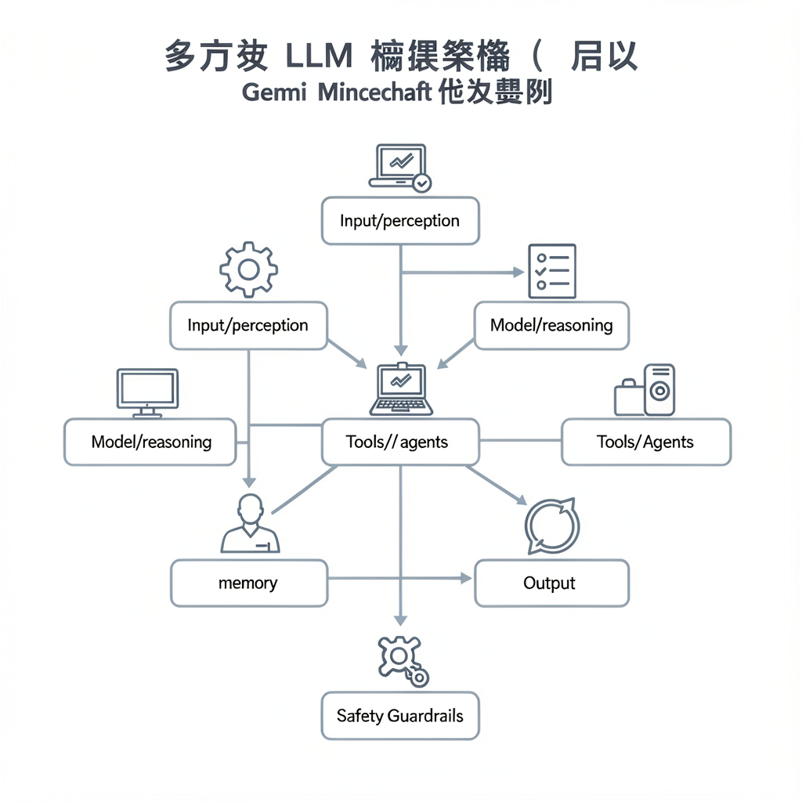

# AI 技術架構深度拆解：多代理 LLM 協作架構（以 Gemini Minecraft 代理為例）

- 日期：2026-10-20
- 選題理由：今日新聞報導四個 Gemini 代理在 27 小時內合作通關 Minecraft，並有論文探討 LLM 代理網路的涌現行為，展示多代理、工具調用與共享記憶的最新架構範式。

## 一、架構原理與核心機制
架構包含五大層： 1. 輸入/感知層：各代理接收環境觀測（如遊戲狀態、API 回傳）、使用者指令與其他代理的訊息，統一編碼為向量表示。 2. 模型推理層：每個代理擁有獨立的大型語言模型實例（Gemini），負責理解任務、規劃子目標、生成動作序列與程式碼。 3. 工具/代理協作層：透過標準化工具介面（Minecraft API、程式執行環境）讓代理執行動作；代理間以訊息總線交換意圖、狀態與結果，支援動態角色分工（探險、建築、資源收集）。 4. 記憶/資料層：短期工作記憶儲存當前任務上下文；長期向量資料庫保存歷史經驗、技能庫與環境地圖，供所有代理檢索與微調。 5. 輸出與監控層：聚合各代理產出的動作、日誌與效能指標，經由監控儀表板即時顯示成功率、資源消耗與異常行為，並支援人工介入與策略調整。 控制流採用事件驅動：環境事件觸發感知 → 模型推理 → 工具調用 → 狀態更新 → 廣播至其他代理 → 循環。部署時採容器化微服務，模型推理以 GPU 叢集服務，工具層以無狀態函式執行，記憶層使用分散式向量資料庫，確保擴展性與容錯。

## 二、海事領域應用（含實際例子）
1. 自主船隊編隊巡航：輸入雷達、AIS、氣象衛星資料；多代理分別負責航線規劃、避碰決策、燃油優化與通訊協調，共享海域地圖與歷史航跡記憶，實現無人協同巡航，提升覆蓋率並降低人力成本，風險在於模型誤判導致碰撞或違規進入禁區。 2. 港口智慧調度：輸入貨櫃堆場影像、碼頭作業排程、拖輪狀態；代理群協作進行泊位分配、裝卸序列優化與即時異常處理，利用長期記憶學習高峰期模式，提升吞吐量 15% 以上，合規風險包含資料隱私與作業安全標準（如 IMO 船舶資訊交換規範）。

## 三、醫療領域應用（含實際例子）
1. 多模態影像診斷協作：輸入 CT、MRI、病理切片影像；影像分割代理、病灶分類代理、報告生成代理並行處理，共享醫學知識圖譜與歷程病例記憶，輸出結構化診斷報告，價值在縮短讀片時間並提高一致性，合規風險需符合 HIPAA、GDPR 及醫療器材軟體驗證（IEC 62304）。 2. 臨床試驗患者匹配：輸入電子病歷、基因體資料、試驗納入標準；篩選代理、風險評估代理、溝通代理協作，利用長期記憶追蹤患者狀態變化，自動推薦合適試驗並生成知情同意草稿，提升招募效率，風險在於演算法偏差導致特定族群被排除。

## 四、其他產業應用（含實際例子）
1. 軟體工程自動化團隊：需求分析代理、架構設計代理、程式撰寫代理、測試代理組成管線，輸入需求文件與程式碼庫，共享設計決策記憶與測試結果，自動產出可部署微服務，縮短交付週期。 2. 智慧製造柔性生產線：感測器資料、訂單排程輸入；排程代理、品質檢測代理、機械臂控制代理協作，利用長期記憶學習設備退化模式，動態調整工藝參數，提升良率與設備利用率。

## 五、限制、風險與治理建議
• 多代理協作引入通訊延遲與一致性挑戰，需精心設計訊息協定與衝突解決機制。 • 模型幻覺在工具調用時可能產生不可逆動作，需嚴格的沙箱與人工核准閘道。 • 長期記憶儲存與檢索成本隨資料增長呈非線性增長，需資料淘汰與壓縮策略。 • 法規合規（醫療、海事）要求可追溯性與解釋性，現有黑盒 LLM 難以完全滿足。 • 安全性風險：惡意提示或代理被劫持可能導致連鎖性錯誤，需零信任網路與行為審計。

## 參考來源
- https://news.google.com/rss/articles/CBMijgFBVV95cUxQRnhxNVl4ejd6V1RjMzRia3lqVXVyNERZcVk3MXFyb3NsdWhieldzaHdlcll4cUJhTHo0NE5xcml2dUN4Y0kwMEVRaFVPcjZCS3EycnFpbU0xdGRiX05wX3p5UHRZU3hlQWgyRFgwYW04MUZUZ21zeGtERjBmdzZ6V0c0Vkhla2xzNEFtSGhB?oc=5
- https://news.google.com/rss/articles/CBMidEFVX3lxTE5rOUNkbWZCY3R0aV85MmZEeWFqcEFWa0xGMllVdnNNOXh4MDRYcTdLTTlaQ1RLWEU5ckZISUVXM3ZwUEdHaGI0UE0xS05oNHJrTE1sZkZReVdkZk8wVnVVVlVUWjBDSjZ1S0xNN3czYzJma2ZX?oc=5
- https://doi.org/10.1038/s41467-026-78228-y
- https://doi.org/10.1038/s42256-026-01310-z
