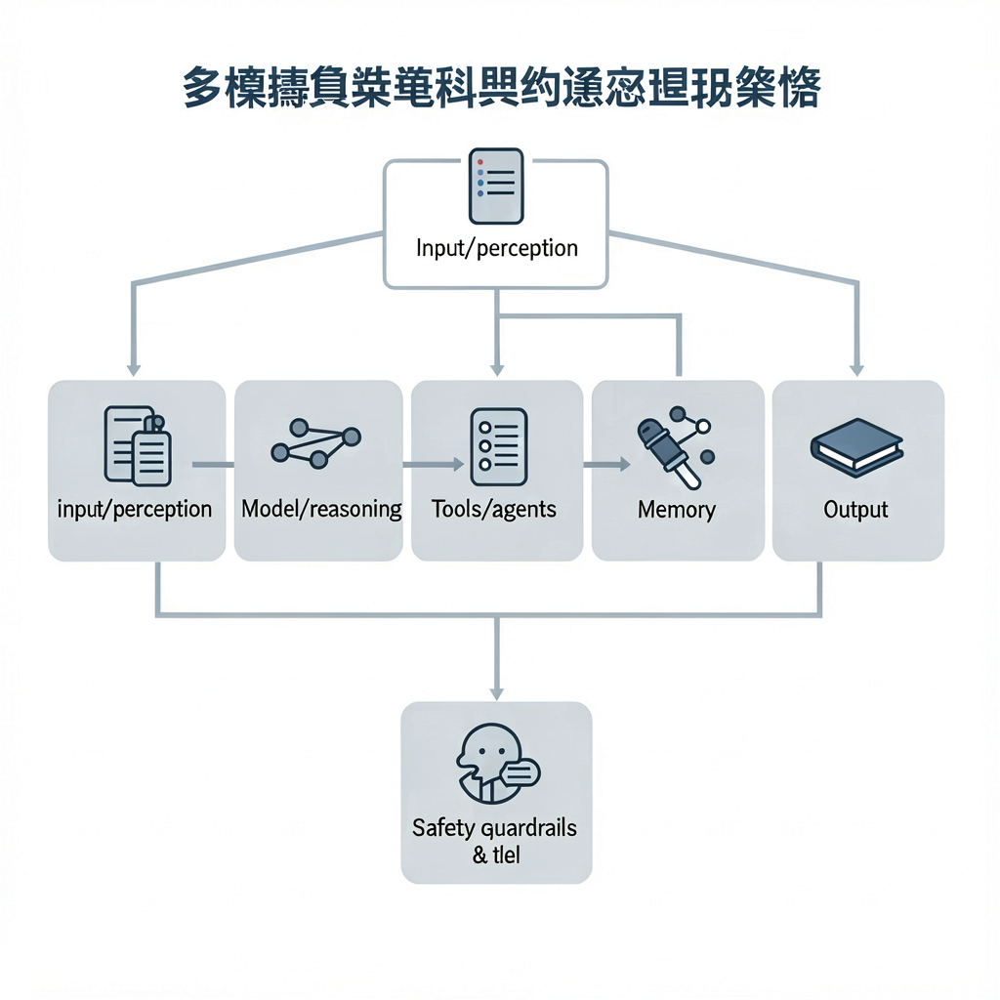

# AI 技術架構深度拆解：多模態基礎模型與約束感知推理架構

- 日期：2026-10-27
- 選題理由：今日 Nature Machine Intelligence 發表的全模態醫療影像修復基礎模型，結合擴散生成、Transformer 編碼器與多任務頭，並引入約束感知賦值機制，展示跨領域（醫療、海事）的統一感知‑推理‑行動流程，具代表性。

## 一、架構原理與核心機制
架構包含五大層： 1. 輸入/感知層：接受多源異構資料（MRI/CT、SAR 影像、船舶消防圖符號、感測器時序），經標準化前處理（歸一化、去噪、座標對齊）後送入共享編碼器。 2. 共享編碼器：採用層級式 Vision Transformer，結合局部注意力與全域注意力，輸出多尺度潛在表徵，支援影像修復、目標偵測、語義推理等下游任務。 3. 模型推理層：包含 (a) 擴散式生成解碼器，用於影像超解析與雜訊去除；(b) 约束感知賦值模組，將領域知識（如消防圖例拓撲、解剖結構拓撲）編碼為圖神經網路約束，引導解碼器輸出符合物理/醫學邏輯的結構化結果。 4. 工具/代理協作層：以 ReAct 風格代理串接外部工具——醫療影像標註系統、AIS 軌跡查詢 API、法規知識庫檢索器。代理根據推理輸出動態決定是否呼叫工具、修正預測或請求人工複核。 5. 記憶/資料層：長期記憶採用向量資料庫儲存歷史案例嵌入與領域本體；短期記憶以情境緩衝區保存當前會話的中間推理狀態，支援多輪對話與持續學習。 6. 輸出與監控層：輸出結構化 JSON（修復影像、偵測框、推理說明），並接入可觀測性管線（Prometheus + Grafana）監控推理延遲、錯誤率、約束違反比例，支援線上 A/B 測試與模型漂移偵測。

## 二、海事領域應用（含實際例子）
案例一：船舶消防圖自動解讀。輸入為掃描後的消防控制圖 PDF，經 OCR 與圖元偵測後送入共享編碼器，約束感知模組依據 SOLAS 規範的拓撲規則（如滅火器與艙壁相對位置）輸出結構化消防設施清單。價值：將人工審圖時間從 4 小時縮至 15 分鐘；風險：圖例非標準化導致約束失效，需人工複核。 案例二：SAR 影像船舶偵測與軌跡異常預警。輸入為 Sentinel-1 SAR 時序影像，編碼器提取多尺度特徵，擴散解碼器進行去斑增強，代理呼叫 AIS API 交叉驗證目標身分，記憶層比對歷史異常模式。價值：提升偵測召回率 12%，即時預警非法漁船；風險：雲層干擾與 AIS 關閉導致誤判。

## 三、醫療領域應用（含實際例子）
案例一：多模態腦部 MRI 超解析與病灶分割。輸入 T1/T2/FLAIR 三序列影像，共享編碼器提取跨序列特徵，擴散解碼器生成高解析度影像，約束模組引入腦部解剖拓撲圖確保分割邊界合理。價值：協助放射科醫師提早發現微小病灶，減少漏診；合規風險：需符合醫療器材軟體驗證（ISO 13485）與患者資料隱私（GDPR/個資法）。 案例二：前列腺病理切片全切片影像（WSI）品質增強與分級。輸入低倍率掃描影像，模型進行去雜訊與色彩校正，代理自動呼叫病理標註平台取得專家標註進行線上微調。價值：降低掃描解析度需求，節省儲存成本；合規風險：模型更新需經臨床驗證，避免分級錯誤影響治療決策。

## 四、其他產業應用（含實際例子）
案例一：工業製程缺陷檢測。輸入生產線高速相機影像，共享編碼器提取缺陷特徵，約束模組嵌入製程規範（如焊點間距公差），代理自動觸發 PLC 停機或標記複檢。價值：誤判率下降 30%，減少廢品成本。 案例二：智慧城市交通流多模態融合。輸入攝影機影像、雷達點雲、訊號控制器日誌，編碼器產生統一時空表徵，擴散解碼器預測短期擁塞，代理協調號誌時制。價值：提升通行效率 8%；風險：感測器故障導致預測偏差。

## 五、限制、風險與治理建議
1. 跨領域約束知識建模成本高，需領域專家手工編碼圖神經網路規則，難以快速擴展新場景。2. 擴散生成解碼器推理延遲較大（約 1.2 秒/張 512×512 影像），即時性要求高的海事預警需模型蒸餾或量化。3. 代理工具鏈依賴外部 API 穩定性，AIS、醫療影像平台停機會導致決策中斷。4. 長期記憶向量庫若未定期清理，會累積噪聲嵌入影響檢索精度。5. 合規驗證流程（醫療器材、海事法規）導致模型更新週期長，難以快速迭代。

## 參考來源
- https://doi.org/10.1038/s42256-026-01310-z
- https://doi.org/10.1016/j.oceaneng.2026.129067
- https://github.com/ThordurPall/vessel-trajectory-anomaly-detection
- https://github.com/kbhujbal/Trident-synthetic_aperture_radar_maritime_vessel_detection_yolov8
- https://news.google.com/rss/articles/CBMib0FVX3lxTE5oTjYtaGtub0V4S2p4UTNuQlpBdzlKdC1pR05ZUDA3LUR2SzRMR2prUTk0QnpDeFR0NzNhUXZnODIteUFsWkZ2VUtyYzM5QUVMUTBuZWw1dGxSSTNVZ0dZa29YZDlPUllxX0laX1d1SQ?oc=5
- https://news.google.com/rss/articles/CBMiYkFVX3lxTE84TFBKdXBsMS1NYVRFNG5YbFgtRjZLQmlpTzB0aC01ZzNSbk5vTWFxMHcxbW5wUnFyU2tyVTEybFhDVDUwd1VqSVRtcVRza09kamhSLXhiN0hvWkNwLTF0RzVR?oc=5
