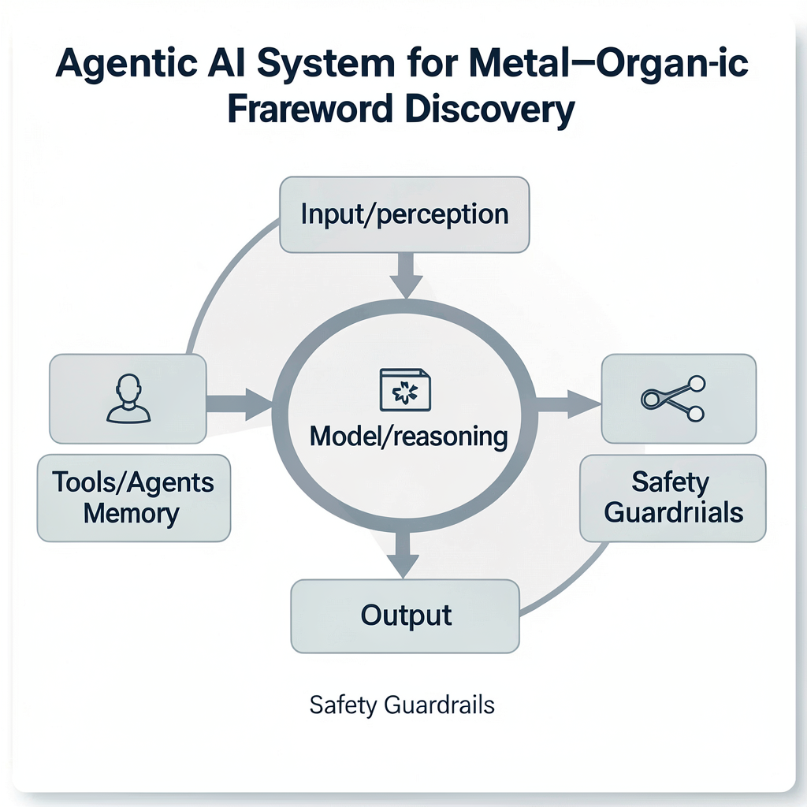

# AI 技術架構深度拆解：Agentic AI System for Metal‑Organic Framework Discovery

- 日期：2026-11-03
- 選題理由：今日 Nature Computational Science 發表的論文展示一套完整的代理式 AI 架構，結合大型語言模型規劃、工具調用與知識圖譜，自動化從文獻檢索到候選 MOF 產出與驗證的全流程，具代表性且可跨域移植。

## 一、架構原理與核心機制
架構包含五大層： 1. 輸入/感知層：自動爬取化學文獻、專利、結構資料庫（CSD、MOFdb），並以向量嵌入建立語義索引，支援自然語言查詢與子結構檢索。 2. 模型推理層：以 LLM 為核心規劃器，解析研究目標（如「高吸附 CO₂、水穩定」），拆解為子任務（文獻綜述、前驅體篩選、合成路徑預測、屬性模擬）。 3. 工具/代理協作層：規劃器調度多個專用代理——文獻摘要代理、逆合成規劃代理、分子動力學模擬代理、屬性預測代理（GNN）、合成可行性評估代理。各代理透過標準化 API 交換結構化 JSON，並由評論代理對輸出打分、發現衝突並回饋規劃器迭代。 4. 記憶/資料層：長期記憶採用知識圖譜（實體：金屬節點、配體、拓撲；關係：配位、合成條件、屬性），短期記憶以向量資料庫儲存本輪對話與中間結果，支援斷點續跑與版本控制。 5. 輸出與監控層：產出候選 MOF 清單（結構檔、預測屬性、合成步驟、信心分數），自動觸發實驗室 LIMS 建立實驗任務，並將所有決策日誌、模型版本、資料血統寫入審計追蹤系統，支援事後複核與合規報告。

## 二、海事領域應用（含實際例子）
1. 抗腐蝕塗層材料設計：輸入海洋環境參數（鹽度、溫度、流速）、現有塗層失效案例、船體鋼材成分。系統規劃代理檢索耐鹽配體、模擬金屬節點在海水中的溶出行為，產出具高附著力、低滲透率的 MOF 塗層候選，經模擬驗證後移交實驗室合成。價值：延長船體維護週期、降低全生命週期成本。風險：模擬條件與實際海況差異可能導致現場表現不符預期。 2. 水下感測器功能材料開發：輸入目標檢測物種（如重金屬、油污）、感測機制（螢光淬滅、電化學）、壓力/溫度範圍。代理協作完成配體篩選、孔道尺寸優化、選擇性模擬，輸出可在深海高壓下穩定運作的 MOF 感測材料。價值：提升海洋監測網靈敏度與壽命。風險：深海實驗驗證成本高、法規對新材料投放海洋有嚴格環評要求。

## 三、醫療領域應用（含實際例子）
1. 靶向化療藥物載體 MOF 設計：輸入腫瘤微環境 pH、過表達受體、藥物理化性質。規劃器分解為配體功能化、載藥量預測、釋放動力學模擬、生物相容性評估等子任務，多代理並行產出具 pH 響應釋放、主動靶向配體修飾的 MOF 候選。價值：提高藥物腫瘤聚集、降低全身毒性。合規風險：屬於醫療器材/藥物組合產品，需符合 FDA/EMA 的 CMC、非臨床毒理與 IND 申請要求，AI 生成資料需完整追溯。 2. 影像造影劑新材料發掘：輸入 MRI/CT 造影機制、生物分布需求、腎臟清除閾值。系統利用知識圖譜快速鎖定高弛緩率 Gd/Fe 基 MOF，模擬水溶性、穩定性、螯合強度，輸出候選結構與合成路徑。價值：開發低劑量、高對比度造影劑。合規風險：重金屬殘留風險需嚴格毒理評估，AI 預測結果不可直接替代動物實驗。

## 四、其他產業應用（含實際例子）
1. 綠氫電解催化劑篩選：輸入操作電壓、電解質組成、成本上限。代理自動檢索非貴金屬 MOF、模擬氫析反應能壘、穩定性測試，輸出具高活性、低成本的催化劑候選，加速實驗室驗證。 2. 碳捕集吸附材料優化：輸入煙道氣成分、溫度/壓力循環、再生能耗目標。系統結合分子模擬與機器學習預測，快速生成高 CO₂/CHO 選擇性、低再生熱的 MOF 結構，支援工廠級試驗規劃。

## 五、限制、風險與治理建議
資料層高度依賴公開結構資料庫與文獻品質，缺乏實驗驗證的負樣本易導致模型過度樂觀；分子動力學與量子化學模擬計算成本高，難以在大規模篩選中即時完成；LLM 規劃可能產生幻覺合成路徑，需人工專家審核；跨域部署時知識圖譜建構與本體對齊工作量大；醫療與海洋應用涉及嚴格法規，AI 生成證據鏈需完整可追溯，否則難以通過審查。

## 參考來源
- https://pubmed.ncbi.nlm.nih.gov/43064736/
- https://news.google.com/rss/articles/CBMiX0FVX3lxTE5wTGpJR3VoTnNTV2M2WTNwaEtYNFpKTUZmajA4TC1XcmV4TXNkXzVQSjlmWkhzQldLclFCY01FU0JTaU5wLVBMOV91QTluNFo2X1lzN3p1V0YwdEwybDFR
- https://news.google.com/rss/articles/CBMikgFBVV95cUxQZlZsTjlPazFEM25mby1TVmpldkYwbTZQY2lVNTdOY0RjSzRHZ1kzMU91RjN3aHVXSjlSdDhUbXl1RDlXVkJRcV80cjNEcmVHblhqLU52RkpmVzhPem4zTE5scTY3MG5hbjRMalJJclNnRWpfbjJ6X2VuUS1lOE53ZmFvMlhrMk1tQjBjN1lnek82dw
- https://news.google.com/rss/articles/CBMiqwFBVV95cUxOUzdId0E1VWNLS0JYUW5ZdWE2ZXVBSlRuRXctamxVN0xtNVJFZWo1bU5EUDRWQl9vYWNjaG43a3FKX3VmbUJxQWlMLWN2b0lyYjU5SkVteGF4NGR1RGlBZ2I3SG1xSzlrZW1QVHRUbTVZclpXY3hsUDVtSmIzMW1SczFVMTQtdGZkdGtLUU9MNy1RT2pLX0IzWGhLV0VCRVdFekVNd0FLaUtINDg
- https://news.google.com/rss/articles/CBMirAFBVV95cUxOaVFhUzZHSzBkeEZEc3dmRXFCNjBiTEp5R2JYWVRTSGpLYnBXV3M2Y0JsWktmQnFxOVBXSXE4cXM1VUxVSVZXNlVJbE5fTjdTeDl4NWRKQ2lEbndSS1ljbFgzbWJwckZLaHEzMHoxWV9LLTVEUnJIN081SU03eDNIMHVEZU1GT09CY1Y3QVhUclVKM0wtVE82SjVhSW1kLUtvejVJRml2Z2E3cjZU
