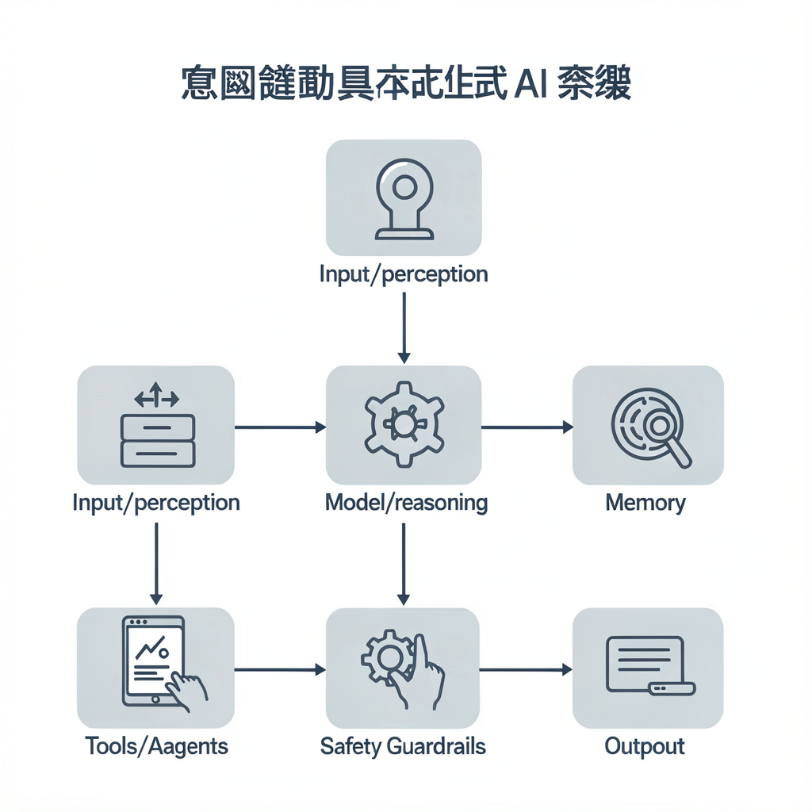

# AI 技術架構深度拆解：意圖驅動具身代理式 AI 架構

- 日期：2026-11-10
- 選題理由：今日素材呈現三大趨勢交會：(1) AMD EPYC Venice 解決記憶體與功耗瓶頸，為大模型代理推理提供硬體基座；(2) 衛福部與韓國公共醫療均將 AI 從生成式轉向自主行動，並啟動 Agent 治理；(3) 《National Science Review》發表「Intent-driven embodied AI」與產業具身 AI 綜述，確立意圖理解、規劃、工具調用、環境交互為核心架構範式。此架構整合 LLM 推理、多模態感知、長期記憶、工具鏈與安全治理，具代表性。

## 一、架構原理與核心機制
【輸入/感知層】多模態編碼器（視覺 ViT、語音 Whisper、雷達/聲納專用編碼器）將環境觀測映射為統一語義嵌入；語義對齊模組對齊跨模態表示，輸出結構化觀測向量。【意圖理解與規劃層】基於指令微調的基座 LLM（如 Llama-3-70B/DeepSeek-V3 等）接收觀測與用戶指令，輸出高層任務圖（DAG）與子意圖序列；引入思維鏈與自我反思機制，支援動態重規劃。【工具與代理協作層】工具註冊表管理可調用 API（航海圖服務、醫療資訊系統、機械臂控制器、資料庫查詢）；代理調度器依據任務圖動態組合工具鏈，支援並行/串行執行、異常重試與補償事務。【記憶/資料層】短期工作記憶以向量資料庫（Milvus/Pinecone）存儲近期觀測與中間推理；長期情景記憶採用知識圖譜（Neo4j）編碼實體關係與程序知識；RAG 檢索器融合稠密/稀疏檢索，支援領域知識注入。【輸出與監控層】動作解碼器將離散動作轉為連續控制指令（機械臂軌跡、航向調整、醫囑生成）；治理總線實時記錄決策軌跡、工具調用鏈、Token 消耗與延遲，支援事後審計、偏差檢測與人工介入熔斷。

## 二、海事領域應用（含實際例子）
情境一：智慧港區無人駁船編隊調度。輸入：AIS 軌跡、雷達/光學影像、氣象海況、港區作業計畫。系統運作：感知層融合多源數據生成港區數位孿生；意圖層解析「優化吞吐量且避碰」高層指令，規劃多船協同路徑；工具層調用碰撞風險模型、潮汐預測 API、VHF 通訊介面；記憶層檢索歷史擁塞模式與應急預案。價值：單班次周轉時間縮減 15-20%，人力調度員負載降低 60%。風險：感知盲區導致碰撞誤判、對抗性干擾 AIS 偽造、模型幻覺產生違規航向。 情境二：海上風機巡檢具身機器人。輸入：四足機器人視覺/力覺/IMU、風機 SCADA 數據、維護手冊知識庫。系統運作：意圖層將「檢測葉片裂紋」分解為導航、定位、缺陷分類、報告生成子任務；工具層調用 YOLOv8-OBB 檢測器、SAR 影像比對、結構健康診斷模型；記憶層累積歷次巡檢缺陷演變趨勢。價值：巡檢效率提升 3 倍，人員登塔風險歸零。風險：惡劣海況導致機器人失穩、通訊中斷時自主決策失效、缺陷漏檢責任歸屬不清。

## 三、醫療領域應用（含實際例子）
情境一：急診分流與轉診自主代理（參考韓國江原道公共醫療 AI 高速公路）。輸入：病患主訴語音、生命徵象串流、電子病歷結構化資料、醫療資源即時床位。系統運作：意圖層解析「判斷轉診必要性並完成轉診委託書」；工具層調用分流模型（XGBoost/LightGBM）、ICD-10 編碼器、醫院資訊系統（HIS）API、電子簽章服務；記憶層檢索同質病例歷史轉診結果與臨床指引。價值：轉診委託書撰寫從 10 分鐘縮至 1 分鐘，分流準確率達 92% 以上。合規風險：醫療決策最終責任歸屬醫師、個資跨院傳輸需符合《個資法》與《醫療法》、模型偏差導致弱勢族群分流不公。 情境二：手術室認知輔助代理。輸入：內視鏡 4K 影像串流、手術機器人運動學數據、術前影像配準結果、醫師語音指令。系統運作：意圖層理解「協助膽囊三角解剖識別與關鍵結構保護」；工具層調用解剖分割模型（nnU-Net）、出血風險預測、手術機器人運動規劃器；記憶層載入醫師個人化操作偏好與並發症案例庫。價值：關鍵結構識別召回率提升至 98%，手術時間平均縮短 12 分鐘。合規風險：即時干預屬醫療器材軟體（SaMD）需 TFDA/US FDA 核准、術中決策干擾醫師自主性、資料異質性導致模型泛化失效。

## 四、其他產業應用（含實際例子）
情境一：半導體晶圓廠異常檢測與根因追溯代理。輸入：設備感測器時序（數萬通道）、製程參數日誌、缺陷檢測影像、維護知識庫。系統運作：意圖層將「良率異常根因分析」分解為異常檢測、相關性挖掘、因果推論、報告生成；工具層調用隔離森林/Transformer 異常檢測器、知識圖譜推理引擎、製程模擬器；記憶層沉澱歷次異常處理案例與專家經驗。價值：根因分析時間從天級縮至小時級，誤報率降低 40%。 情境二：金融合規自動審計代理。輸入：交易流水、法規文本（洗錢防制法、證交法）、客戶 KYC 檔案、歷史稽核底稿。系統運作：意圖層解析「依最新法規檢核可疑交易」；工具層調用法規 RAG 檢索、規則引擎、圖神經網路洗錢模式檢測、自然語言生成審計報告；記憶層維護法規變更歷史與稽核員判斷邏輯。價值：審計覆蓋率提升至 100%，人工複核工時減少 70%。風險：法規解讀幻覺導致誤判、模型不可解釋性難以滿足監理機關說明義務。

## 五、限制、風險與治理建議
1. 意圖理解脆弱性：複雜指令歧義、長上下文遺忘、對抗性提示注入易導致規劃偏離。2. 工具調用可靠性：外部 API 版本漂移、率限制、非冪等操作缺乏補償機制。3. 記憶一致性：向量檢索語義漂移、知識圖譜更新滯後、隱私資料殘留風險。4. 具身執行差距：Sim-to-real 差異、感知噪聲累積、實時控制環路延遲超過安全閾值。5. 治理與合規：決策可解釋性不足、責任鏈模糊、跨域資料流合法性驗證困難、紅隊測試覆蓋率低。6. 基礎設施成本：萬億參數模型推理需高頻寬記憶體（HBM3E）與液冷機櫃，邊緣部署功耗與成本仍為瓶頸。

## 參考來源
- https://pubmed.ncbi.nlm.nih.gov/43054956/
- https://pubmed.ncbi.nlm.nih.gov/43054954/
- https://news.google.com/rss/articles/CBMickFVX3lxTE9waFpLeGNKNFlZc1lzVHpQamtsREgzcEJGN3pYa3F1amJrSVgyenlUWVV5d21CeE9KSUdEZnlWRnBKampuU3UtWGt4bjhudGxrUzVYWUdZQjdObEVRY1J6d1hDU0h6TzZES242WWxfVW0tQQ?oc=5
- https://news.google.com/rss/articles/CBMiTkFVX3lxTE8tcXZrdGdTWmtLU1p6X1BWV3VucTVPMHN6QnZCNGhrcDVHM1B2Q3FFbkpmUUszcnNlT0FZTzZzdUI0QXdxLWtqdk9rUzBIUQ?oc=5
- https://news.google.com/rss/articles/CBMiekFVX3lxTE92U1RHaGJ1cGd6bVBiSjlxNHhTZ2o0dmhMUnVsWUlnQ0dTUjN5UDVGWGhRZFEzUWpjMEh1MWRCLTg5aG5KWHB4SGFmbVJKbk5YYlpQNXlxQU9UNS1abHhIMGY0R2R3T1BvanVSdWNFRmhYZjFtMXpvWEln?oc=5
- https://github.com/ThordurPall/vessel-trajectory-anomaly-detection
