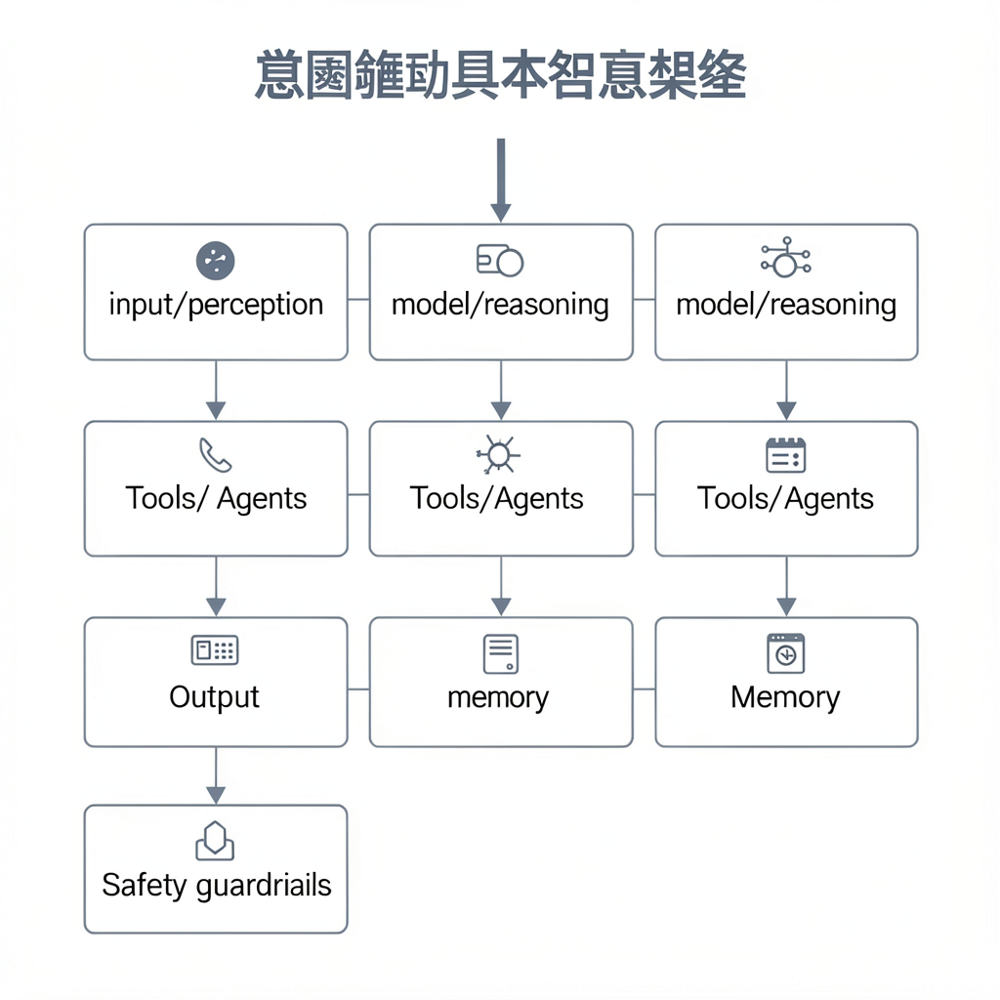

# AI 技術架構深度拆解：意圖驅動具身智慧架構

- 日期：2026-11-17
- 選題理由：今日素材包含《Intent-driven embodied artificial intelligence》與《Survey on embodied AI for industry》兩篇核心論文，並對應 snapllm 等邊緣部署專案，完整涵蓋從意圖理解、多模態感知、工具協作到邊緣推理的完整技術棧，具代表性且可落地。

## 一、架構原理與核心機制
【輸入/感知層】多模態編碼器並行處理視覺（RGB-D、點雲）、本體感覺（關節角度、力矩）、語言指令與環境地圖，輸出統一潛在空間表徵。【模型推理層】採用「意圖解析器→任務規劃器→動作解碼器」三級架構：大語言模型（LLM）解析自然語言為結構化意圖圖；層級任務網路（HTN）或蒙地卡羅樹搜尋（MCTS）生成長時程子目標序列；擴散策略或 VQ-VAE 動作解碼器輸出高頻連續控制指令。【工具/代理協作】引入技能庫與工具註冊表，每個技能封裝前置條件、效果、安全約束；執行期由協調代理動態編排技能、調用外部 API（如地圖服務、知識圖譜）、並在失敗時觸發重新規劃。【記憶/資料層】分三層：情景記憶（向量資料庫存儲歷史軌跡與結果）、語義記憶（知識圖譜存儲物件關係與操作知識）、程序記憶（技能參數與優化歷程），支援檢索增強生成（RAG）與線上微調。【輸出與監控】輸出低階馬達指令與高層狀態報告；監控模組即時計算安全指標（碰撞距離、力矩上限）、任務完成度、意圖一致性，並提供人機介面進行干預與審計。

## 二、海事領域應用（含實際例子）
1. 自主船體檢測機器人：情境為貨輪在港口需定期檢查艙壁腐蝕。輸入：ROV 視頻流、超音波測厚儀讀數、CAD 船體模型、檢測規範文本。系統運作：LLM 將「依 IACS 標準檢查 3 號貨艙」轉為意圖圖，規劃器生成覆蓋路徑，動作解碼器控制磁吸爬壁機器人繞過筋板；技能庫調用腐蝕分割模型與測厚融合演算法，結果寫入情景記憶。價值：減少人員進入密閉空間風險、縮短檢測 40% 時間。風險：海況導致通訊中斷需離線自主決策、模型對罕見腐蝕型態泛化不足。2. 智慧港口集裝箱搬運編隊：情境為多 AGV 協同裝卸。輸入：調度系統下發任務清單、激光雷達 SLAM 地圖、AGV 狀態廣播。系統運作：意圖解析器將「優先處理冷藏箱」轉為優先級約束，多代理協調器以圖神經網路預測衝突並重規劃路徑，動作層輸出差速驅動指令。價值：提升吞吐量 15%、降低能耗。風險：異構廠牌 AGV 介面不一致、網路延遲導致編隊同步失效。

## 三、醫療領域應用（含實際例子）
1. 手術輔助機械臂：情境為腹腔鏡膽囊切除。輸入：內視鏡 4K 影像、力回饋數據、術前 CT 分割標註、醫師語音指令。系統運作：LLM 將「分離 Calot 三角」解析為子步驟，規劃器結合解剖知識圖譜生成避開血管路徑，擴散策略輸出 7-DOF 運動指令；技能庫提供「止血夾夾持」「電凝」等原語，失敗觸發重新規劃。價值：降低醫師疲勞、提升操作精度至亞毫米級。合規風險：屬 FDA Class III 醫療器材，需完整驗證確認（V&V）、軟體物料清單（SBOM）與術中異常事件報告機制。2. 病房巡護機器人：情境為 ICU 夜間自主巡視。輸入：RGB-D 影像、床邊監護儀 HL7 數據、護理紀錄 FHIR 資源。系統運作：意圖解析器將「檢查導管固定狀態」轉為視覺問答任務，規劃器生成繞床路徑並避開醫療線纜，動作層控制全向輪底盤與雙臂輕度觸診；異常（如導管鬆動）觸發警報並推送至護理站。價值：緩解護理師短缺、提供 24/7 連續監測。合規風險：涉及患者隱私（HIPAA/GDPR）、醫療決策責任歸屬不明、需通過 IEC 62304 生命週期認證。

## 四、其他產業應用（含實際例子）
1. 晶圓廠自主物流 AMMR：情境為 300mm 晶圓盒跨區搬運。輸入：MES 調度指令、激光 SLAM 地圖、OHT 軌道狀態、晶圓盒 RFID。系統運作：意圖層解析「優先送達 Lot B 至光刻區」，多代理協調器與 OHT 系統協商路權，動作層控制雙臂機器人進行 FOUP 夾取與對位。價值：減少人為污染、提升產線彈性。2. 建築工地鋼筋綁扎機器人：情境為基樁籠鋼筋自動綁扎。輸入：BIM 模型、鋼筋堆場視覺掃描、施工進度表。系統運作：LLM 將 BIM 轉為綁扎順序意圖，規劃器優化雙臂協同無碰撞路徑，技能庫調用「繞絲、扭緊、切斷」原語，力控確保扭矩達規範。價值：解決熟練工短缺、品質一致性提升。

## 五、限制、風險與治理建議
1. 長時程任務下意圖漂移與誤差累積，需頻繁重新規劃增加算力。2. 真實世界長尾分佈（罕見障礙、材質變異）導致模型泛化失效，資料收集成本高。3. 多代理協調在弱網、異構介面下一致性難保證。4. 安全關鍵場景缺乏形式化驗證工具，難以滿足功能安全（ISO 13849/IEC 61508）認證。5. 邊緣端算力限制大模型參數量，蒸餾後推理精度下降。

## 參考來源
- https://pubmed.ncbi.nlm.nih.gov/43054956/
- https://pubmed.ncbi.nlm.nih.gov/43054954/
- https://github.com/maheshvaikri-code/snapllm
- https://github.com/notsodubeyous/IoT-Network-Intrusion-Detection-System-UNSW-NB15
- https://github.com/evelyyyyynnnnn/2.0-Healthcare-Ai-Systems
