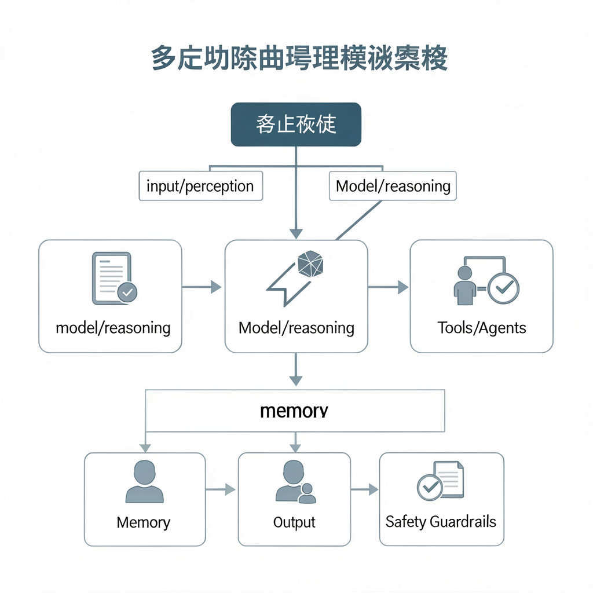

# AI 技術架構深度拆解：多代理臨床推理模擬架構

- 日期：2026-09-16
- 選題理由：今日發表的《Early evidence for a multi-agent AI simulator for clinical reasoning practice》展示以多代理協作模擬醫師決策流程，結合大型語言模型、知識圖譜與情境引擎，屬於當前最具代表性的新型 AI 系統架構。

## 一、架構原理與核心機制
架構包含五大層： 1. 輸入/感知層：接收病歷文本、檢驗數值、影像報告等多模態資料，經由預處理模組進行實體識別、標準化編碼（如 SNOMED-CT、LOINC），並轉換為結構化觀察向量供後續代理使用。 2. 代理協作層：部署多個專用代理，包含「病患代理」模擬主訴演變、「醫師代理」執行假設生成與驗證、「知識代理」查詢醫學知識圖譜與指南、「評估代理」依據臨床路徑打分、「協調代理」管理對話輪次與資訊流向。代理間透過訊息總線（Message Bus）以結構化 JSON 交換意圖、證據與決策。 3. 模型推理層：每個代理內嵌微調後的大型語言模型（LLM）作為推理核心，採用 Chain-of-Thought 提示與工具調用（如藥物交互查詢 API）產生推理步驟；知識代理另接圖神經網路進行子圖檢索。 4. 記憶/資料層：包含短期工作記憶（當前案例的對話歷程）、長期情節記憶（歷史模擬案例庫）、向量資料庫（文獻嵌入）與關係型資料庫（病患畫像、指南版本）。記憶讀寫由協調代理依策略控制，確保一致性與可追溯。 5. 輸出與監控層：產出結構化診斷建議、推理鏈結、信心分數與風險標記；同時記錄完整代理互動日誌供事後審計、模型漂移偵測與強化學習回饋。部署時採容器化微服務，透過 Kubernetes 編排，支援 GPU 節點自動擴縮、藍綠發布與資料加密傳輸，滿足醫療資安與合規需求。

## 二、海事領域應用（含實際例子）
1. 航行路徑異常偵測模擬：輸入 AIS 軌跡、氣象、海圖資料；系統啟動「船舶代理」、「環境代理」、「規則代理」與「決策代理」共同推演航行意圖，若偵測到偏離預期航道或進入敏感區域，即時輸出預警與建議替代航向。價值在提升海域感知自動化；風險為 AIS 資料缺口導致誤判。 2. SAR 船舶偵測協同判讀：輸入合成孔徑雷達影像、多頻段回波；「影像代理」提取候選目標，「知識代理」查詢船舶註冊資料庫，「評估代理」依據信心門檻輸出偵測報表。價值為縮短人工判讀時間；風險在於雜訊環境下假陽性率上升。

## 三、醫療領域應用（含實際例子）
1. 臨床推理訓練平台：輸入虛擬病例（主訴、生命徵象、檢驗），多代理模擬醫師詢問、體檢、訂單、解釋流程，輸出完整推理鏈供學生比對。價值為提供可重複、可審計的教學環境；合規風險在於學生資料隱私與模型輸出錯誤可能誤導教學。 2. 輔助診斷決策支援：真實病歷經去識別化後輸入，「醫師代理」生成鑑別診斷、「知識代理」引用最新指南、「評估代理」給出建議等級與引用來源。價值為降低診斷錯誤、加速決策；合規風險包含醫療器材認證（如 FDA SaMD）、責任歸屬與資料安全。

## 四、其他產業應用（含實際例子）
1. 客服情境模擬訓練：輸入產品知識庫與歷史對話，「顧客代理」模擬多樣投訴，「客服代理」依政策回應，「評估代理」打分服務品質。價值為大規模訓練與品質稽核。 2. 供應鏈中斷推演：輸入廠商產能、物流時效、突發事件資訊，「供應商代理」、「物流代理」、「風險代理」協同模擬缺貨傳播，輸出緩衝策略與成本估算。價值為提升韌性規劃能力。

## 五、限制、風險與治理建議
架構高度依賴 LLM 推理品質，若基礎模型出現幻覺或知識過時，將傳播至所有代理；多代理協作增加系統複雜度與延遲，需精細調度與監控；醫療與海事領域法規嚴格，部署需通過嚴格驗證與審計，資料主權與跨境傳輸亦為挑戰。

## 參考來源
- https://pubmed.ncbi.nlm.nih.gov/42740524/
- https://pubmed.ncbi.nlm.nih.gov/42783857/
- https://pubmed.ncbi.nlm.nih.gov/42721178/
- https://github.com/ThordurPall/vessel-trajectory-anomaly-detection
