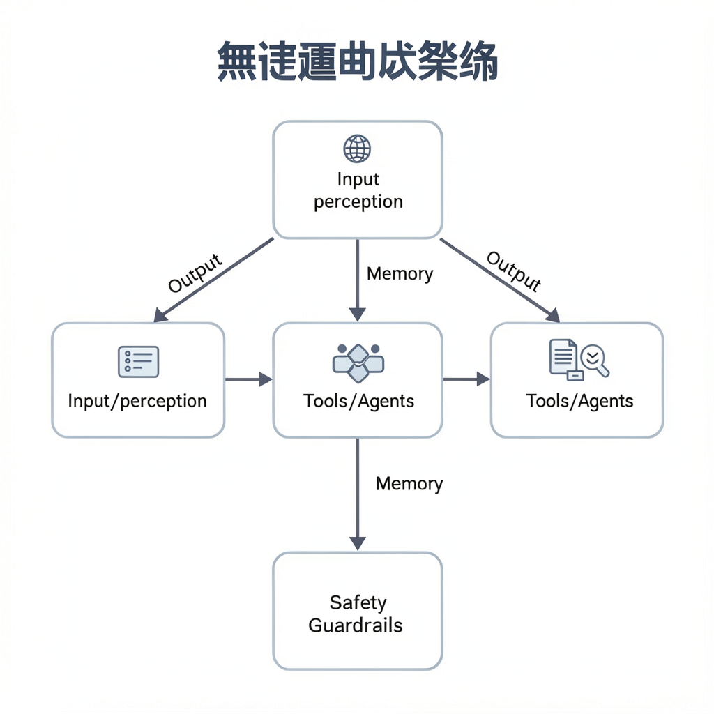

# AI 技術架構深度拆解：無訓練代理架構

- 日期：2026-09-23
- 選題理由：今日素材中 LesionAgent（arXiv:2611.27876）提出「無訓練代理」在縱向 CT 腫瘤追蹤與療效評估的完整實作，結合意圖驅動具身 AI（National Science Review）與工業具身 AI 綜述，且 snapllm 專案展示邊緣端亞毫秒級模型切換與 CPU-only 20B 推理，三者共同指向：以「規劃＋工具＋記憶」取代微調的代理架構，正成為醫療、海事與邊緣部署的主流範式。

## 一、架構原理與核心機制
【輸入/感知】多模態編碼器（影像 ViT、文本 LLM、感測器流）將異構資料投影至共享潛空間，輸出結構化觀測向量。【模型推理】核心為凍結的基座 LLM（如 Llama-3-70B 或 Qwen2.5-72B），透過「思維鏈＋外部工具調用」進行零樣本規劃，不更新權重。【工具/代理協作】工具登記表註冊影像分割、配準、測量、知識檢索、模擬器等可執行單元；代理依據任務圖動態編排工具鏈，支援並行與重試。【記憶/資料層】短期工作記憶以向量資料庫（如 Milvus）儲存近期觀測與工具結果；長期情景記憶以知識圖譜記錄病例演進、船舶狀態或生產參數，支援 RAG 與反思。【輸出與監控】結構化 JSON 輸出含決策、證據鏈、不確定度分佈；監控層採 OpenTelemetry 追蹤延遲、Token 成本、工具成功率與幻覺檢測分數，支援線上 A/B 與人工介入閘道。

## 二、海事領域應用（含實際例子）
1. 智慧船隊狀態感知與航線優化：情境為國際航運公司管理 200+ 艘船；輸入資料含 AIS 軌跡、引擎感測器時間序列、氣象預報、港口擁塞 API。系統運作：代理每 15 分鐘擷取多模態觀測，呼叫航行模擬器與燃油優化工具生成候選航線，經風險評估模組（碰撞機率、ECA 合規）輸出決策建議。價值：年省燃油 3-5%、減少延誤罰款；風險：模擬器與實際海流偏差導致次優解、衛星通訊中斷造成觀測缺口。2. 港口自動化碼頭調度：情境為智慧港口整合岸橋、AGV、堆場；輸入含 3D 雷達點雲、作業管理系統訂單、設備遙測。系統運作：具身代理感知場站狀態，調用路徑規劃與衝突解析工具即時重排任務，透過長期記憶學習尖峰模式。價值：吞吐量提升 12%、能耗下降 8%；風險：感測器故障導致錯誤指令、多代理協作死鎖。

## 三、醫療領域應用（含實際例子）
1. 縱向腫瘤追蹤與療效報告（LesionAgent 直擊場景）：情境為放射腫瘤科每月追蹤 500+ 病例；輸入為不同時期 CT 序列、放療劑量圖、病理報告文本。系統運作：代理呼叫分割工具提取病灶、配準工具對齊時序、RECIST 計算工具量化變化，結合文獻檢索生成結構化報告草稿供醫師簽署。價值：報告撰寫時間從 20 分鐘降至 3 分鐘、測量變異係數下降 40%；合規風險：屬 FDA SaMD Class II，需 510(k) 清關與持續效能監測，幻覺導致誤判療效風險須人工把關。2. 糖尿病視網膜病變自主篩檢（ACCESS2 研究延伸）：情境為社區診所無眼科醫師；輸入為非散瞳眼底照相、患者 EHR。系統運作：代理串接分級模型、病變定位工具、轉診規則引擎，輸出分級結果與轉診建議。價值：篩檢覆蓋率提升 35%、健康不平等緩解；合規風險：自主診斷屬高風險 AI，需嚴格臨床驗證、偏差稽核與患者知情同意機制。

## 四、其他產業應用（含實際例子）
1. 客戶體驗代理平台（Sierra 架構映射）：情境為電商處理百萬級工單；輸入含對話歷程、訂單資料庫、知識庫、退貨政策 API。系統運作：代理理解意圖→檢索政策→呼叫退貨/換貨/物流查詢工具→生成回覆與動作確認，長期記憶記錄客戶偏好。價值：首聯解決率提升至 78%、人工客服負載降低 60%。2. 邊緣工業檢測與預測性維護（snapllm 部署模式）：情境為製造廠百台 CNC 機台；輸入為震動、聲音、電流高頻感測器流。系統運作：邊緣節點載入多專家模型（異常檢測、剩餘壽命預測），代理依據信心度動態切換模型，本地推理延遲 <5ms，僅上傳異常摘要至雲端。價值：非計畫停機減少 45%、頻寬成本降低 90%。

## 五、限制、風險與治理建議
1. 幻覺與工具誤調用：凍結基座模型缺乏領域微調，複雜多步推理易產生邏輯斷層或呼叫錯誤工具，需嚴格輸出驗證層。2. 長期記憶一致性：向量檢索與知識圖譜同步延遲可能導致決策依據過時，尤其在高頻更新場景（如港口調度）。3. 邊緣算力與模型大小權衡：CPU-only 20B 推理雖可行，但量化損失可能影響醫療級精度；動態模型切換引入冷啟動延遲。4. 安全與合規：提示注入、工具鏈供應鏈攻擊（Dragos 報告）、醫療/海事法規認證成本高，部署週期長。5. 可解釋性不足：代理決策路徑雖可追蹤，但基座模型內部注意力機制仍為黑箱，難滿足高風險領域審計需求。

## 參考來源
- http://arxiv.org/abs/2611.27876v1
- https://pubmed.ncbi.nlm.nih.gov/43054956/
- https://pubmed.ncbi.nlm.nih.gov/43054954/
- https://pubmed.ncbi.nlm.nih.gov/43069285/
- https://github.com/maheshvaikri-code/snapllm
- https://techcrunch.com/2026/11/23/sierra-doubles-valuation-to-30b-within-six-months-as-demand-for-ai-in-cx-takes-off/
