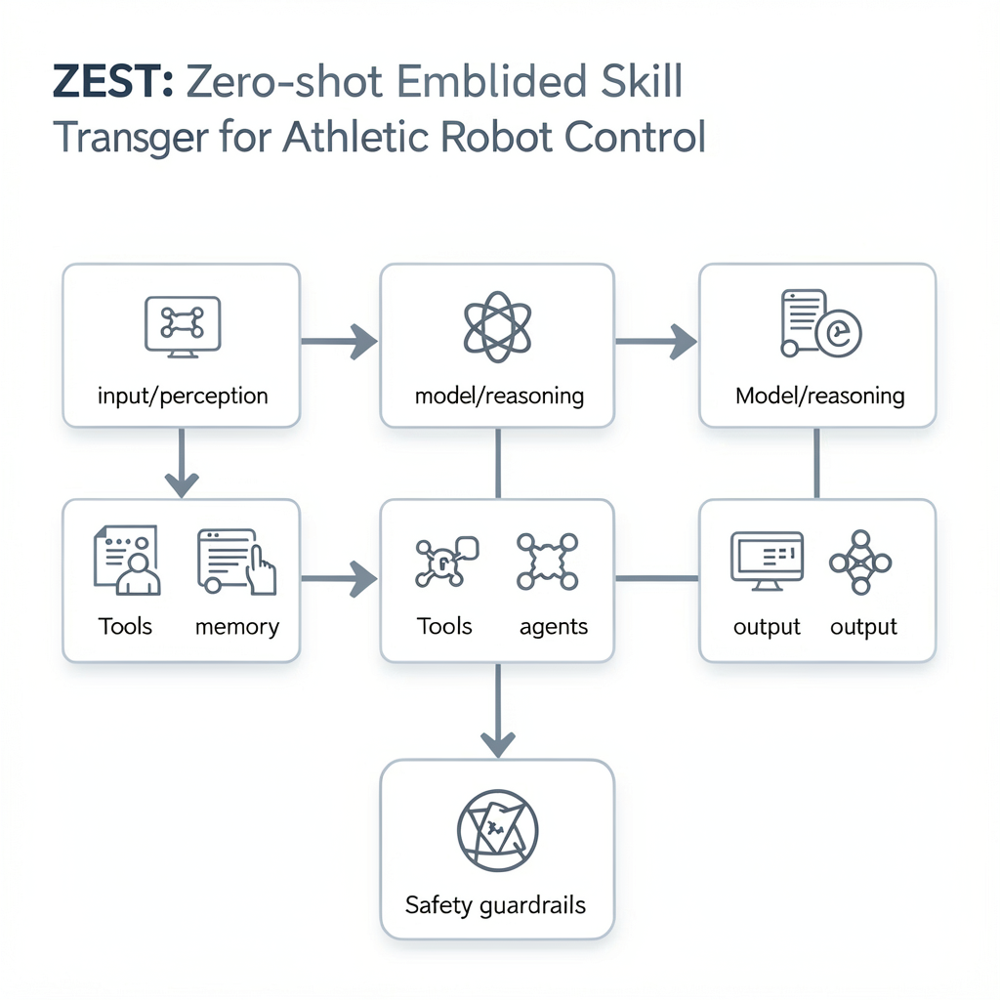

# AI 技術架構深度拆解：ZEST: Zero-shot Embodied Skill Transfer for Athletic Robot Control

- 日期：2026-09-30
- 選題理由：選擇 ZEST，因其為首個實現零樣本跨技能轉移的具身機器人控制架構，結合語言條件策略與模擬到實體的泛化，代表具身 AI 從專用控制邁向通用技能複用的關鍵里程碑。

## 一、架構原理與核心機制
ZEST 架構包含五大核心層： 1. 感知層：多模態感測器（RGB‑D 相機、本體感測器、力/觸覺陣列）即時編碼環境狀態與機器人本體狀態，輸出統一的觀測向量。 2. 語言條件編碼器：預訓練的大型語言模型將自然語言指令（如「做後空翻」）轉換為技能嵌入向量，作為策略網路的條件輸入。 3. 技能庫與零樣本策略網路：在大規模模擬環境中以強化學習訓練一組基礎動作原語（跳躍、翻滾、平衡），並學習一個條件策略 π(a|o, z) 能根據技能嵌入 z 直接輸出動作，無需針對新任務微調。 4. 記憶/資料層：線上維護經驗緩衝區與技能嵌入索引，支援快速檢索相似技能、進行模擬到實體的域適應微調，並記錄執行軌跡供事後分析。 5. 輸出與監控層：實時動作指令送往低階控制器（PD/MPC），同步推送狀態估計、安全檢查（關節限位、碰撞預測）與效能指標（完成率、能量消耗）至監控儀表板，支援人工介入與自動熔斷。 資料流：感測器 → 觀測編碼 → 與語言嵌入拼接 → 條件策略推理 → 動作解碼 → 低階控制 → 環境回饋 → 經驗存儲。控制流採用分層迴路：高層技能選擇（語言指令）以 10‑20 Hz 更新，低層運動控制以 1‑2 kHz 閉環，確保運動敏捷與安全。部署考量：模擬訓練需大規模 GPU 叢集，實體部署需邊緣推理加速器（如 Jetson Orin）與確定性實時作業系統，並建立模擬‑實體域隨機化管線以縮小 Sim2Real 差距。

## 二、海事領域應用（含實際例子）
1. 港口自動化裝卸機器人：輸入為貨櫃識別影像、堆疊高度感測、作業指令（語音/文字）。系統以 ZEST 將「抓取 20 呎貨櫃並堆疊至第 3 層」轉為技能嵌入，零樣本調用抓取、搬運、精準放置原語，實時監控力回饋防止傾倒。價值：減少專用程式開發、快速適應新貨櫃規格；風障：海洋環境濕鹹導致感測器漂移、通訊延遲影響高頻控制迴路。 2. 海上風機巡檢無人機：輸入為多光譜影像、風速/姿態數據、巡檢任務描述。ZEST 將「沿葉片前緣飛行並拍攝裂紋」轉為飛行技能序列，零樣本組合懸停、定點拍照、避障原語。價值：單一架構支援多種巡檢任務、降低訓練成本；風障：強風干擾動力學模型、GPS 拒止區域下定位誤差可能觸發安全熔斷。

## 三、醫療領域應用（含實際例子）
1. 手術輔助機械臂：輸入為內視鏡影像、力覺反饋、醫師語音指令（如「縫合血管」）。ZEST 將指令映射為縫合、結紮、組織操作等技能嵌入，零樣本組合基礎動作原語，實時監控力幅值避免組織損傷。價值：縮短新手術流程開發週期、提升術中適應性；合規風險：醫療器材法規要求完整驗證與可追溯性，零樣本行為需經嚴格臨床試驗才能上線。 2. 復健外骨骼機器人：輸入為患者步態 IMU、肌電訊號、治療師設定目標（如「上樓梯」）。架構將目標轉為步態技能嵌入，零樣本調用平衡、抬腿、著地原語，並依即時生理訊號調整阻抗。價值：個性化訓練無需重新訓練模型；合規風險：需符合 ISO 13482 服務機器人安全標準，且患者資料隱私須符合 HIPAA/個資法。

## 四、其他產業應用（含實際例子）
1. 倉儲物流分揀機器人：輸入為貨品條碼掃描、貨架地圖、語音指令「將 SKU‑A 移至 B 區」。ZEST 零樣本組合抓取、導航、放置技能，快速切換不同 SKU 與貨架配置，降低系統整合成本。 2. 家庭服務機器人：輸入為環境 RGB‑D、語音指令「倒咖啡」。架構將任務分解為導航、開啟咖啡機、倒水、避障等原語，零樣本執行多樣家務，支援多語言指令與即時安全監控。

## 五、限制、風險與治理建議
ZEST 仍依賴大規模模擬預訓練，Sim2Real 差距在高動態、非結構化環境（如海浪、手術出血）可能導致策略失效；零樣本泛化能力受限於技能庫覆蓋度，罕見動作仍需微調；語言條件編碼器若理解錯誤會直接傳遞錯誤技能嵌入，缺乏語義驗證機制；邊緣部署需高算力與確定性延遲，成本較高；資料隱私與醫療/海事法規合規需額外工程投入。

## 參考來源
- https://www.semanticscholar.org/paper/5882a4d872551a31775bad801a239bac08e99b1d
- https://news.google.com/rss/articles/CBMie0FVX3lxTE53M0NDQ1VqeGowSzN1bmJ1Qk5IMlc0ZVp1QW9WU0h1SGJIWUdxOHczYXJDM0hUNTNYTjM2b0RoQ25Id2d1R183T1N4dEE5WDRxaXJ4RENfNURrM0xaUFl1clJndGNLNmU2UGFMcDFLNlRWdXFJaWxNeUctWQ?oc=5
