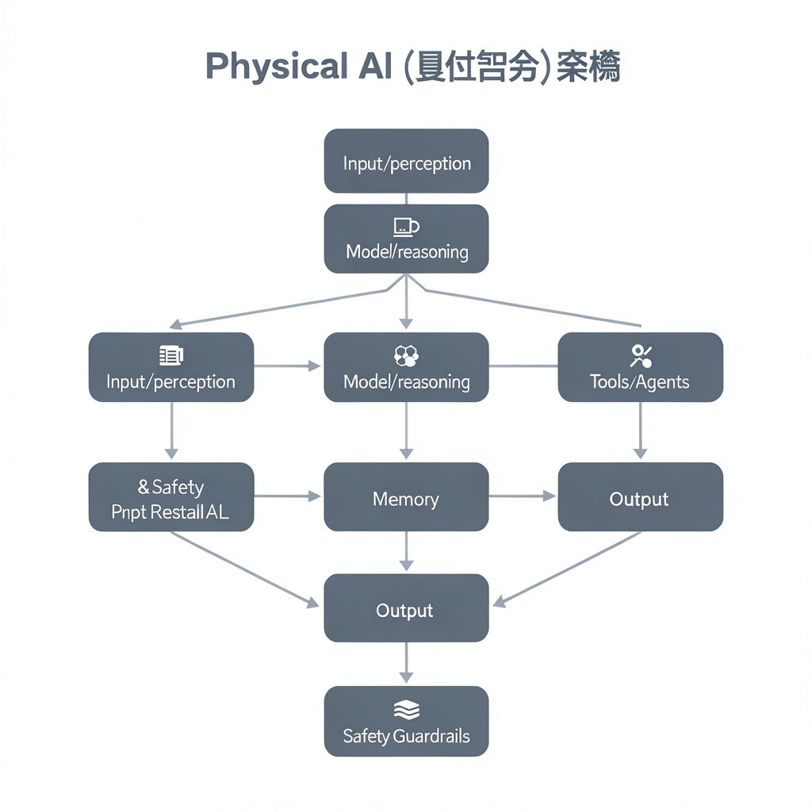

# AI 技術架構深度拆解：Physical AI（具身智慧）架構

- 日期：2026-10-07
- 選題理由：今日素材中多處指向 Physical AI：新聞提及「從大語言模型到具身智慧」、HSC 十週年年會強調 Physical AI 跨國落實醫療、IEEE TPAMI 發表最新綜述《Aligning Perception, Reasoning, Modeling and Interaction: A Survey on Physical AI》。此架構整合感知、推理、建模與互動，為當前 AI 從虛擬邁向實體部署的關鍵範式，且與海事自主航行、醫療機器人、防衛無人機高度相關。

## 一、架構原理與核心機制
Physical AI 架構以「感知—推理—建模—互動」四層閉環為核心，強調多模態感知與實體世界的幾何/物理一致性。 1. 輸入/感知層：融合視覺（RGB、深度、SAR、事件相機）、本體感覺（關節編碼器、IMU）、觸覺/力覺、語音與環境傳感器（雷達、AIS、海圖、醫療影像）。採用多模態對齊編碼器（如 Trans-MMVAE 風格的多模態 VAE 或 CLIP-like 對比學習），將異構資料映射至共享潛在空間，保留幾何一致性與語義對齊。 2. 模型推理層：採用「世界模型 + 任務規劃器」雙軌架構。世界模型（World Model）以潛在空間預測下一幀狀態、物理參數（摩擦、浮力、組織彈性）與不確定性；任務規劃器結合大語言模型（LLM）的語義推理與符號化任務圖，輸出高層技能序列。MAGIC 的 Chain-of-Distillation 機制將專家導航策略蒸餾至輕量化學生網路，實現高效視覺-語言導航。 3. 工具/代理協作層：引入技能庫與工具調用介面。技能為可組合的原子動作（如「避障靠泊」、「縫合組織」），每個技能具備前置條件、效果描述與安全守門條件。多代理協作透過共享世界模型與意圖廣播機制（如 V2X、手術室設備總線）實現協同規劃，支援異構機器人編隊（無人機+無人船、手術機械臂+內視鏡機器人）。 4. 記憶/資料層：分為情景記憶（向量資料庫存儲歷史軌跡、手術案例）、語義記憶（知識圖譜編碼海事法規、醫療指引）、程序記憶（技能參數與適應性微調權重）。採用持續學習機制（E2E ensemble 風格的增量集成），在線更新世界模型與技能庫，並以資料溯源與版本控制滿足合規需求。 5. 輸出與監控層：輸出低階控制指令（關節力矩、推進器推力）經由安全濾波器（CBF/MPC）驗證後送往執行器。監控模組即時計算感知不確定性、規劃偏差、物理約束違反率，並透過數位雙生體同步至雲端進行離線複盤與模型蒸餾。部署端雲協同：邊緣端執行毫秒級控制迴路，雲端負責長時程規劃、艦隊/醫院級資產優化與持續訓練。

## 二、海事領域應用（含實際例子）
情境一：智慧環保船舶動態管理（陽明案例）。輸入資料：多波束聲納、SAR 影像、AIS 軌跡、氣象海流場、船體感測器（吃水、艙位壓力）。系統運作：感知層融合 SAR 與 AIS 偵測小型目標（PGNet 高斯幾何一致性指派提升複雜海況偵測率）；世界模型預測 6-DOF 船體運動與遇浪載荷；規劃器依 IMO CII 指標與港口時間窗產生最省油航線與轉速指令；技能庫執行「避碰讓航」、「靠泊輔助」。價值：年省燃油 3-5%、降低碳排、減少人為錯誤。風險：感知盲區導致碰撞、模型對極端海況外推失效、網路延遲影響遠端接管。 情境二：港區無人駁船編隊協同作業。輸入資料：岸基雷達、無人機正射影像、V2X 通訊封包、電子海圖。系統運作：多代理共享世界模型，透過意圖廣播協商通航優先權；Chain-of-Distillation 將專家領航員經驗蒸餾至輕量化導航網路部署於邊緣 GPU；情景記憶儲存歷史編隊軌跡供離線優化。價值：提升吞吐量 15%、降低人力成本。風險：通訊中斷導致協同失效、對抗性干擾（GPS 欺騙）、責任歸屬法律灰地帶。

## 三、醫療領域應用（含實際例子）
情境一：重症照護智慧監護與早期預警（HSC 年會強調降低重症死亡率）。輸入資料：床邊多參數生理波形（ECG、ABP、SpO2）、呼吸機波形、電子病歷結構化資料、床邊攝影機影像。系統運作：多模態 VAE（Trans-MMVAE 風格）對齊時序生理訊號與影像特徵，世界模型預測 6-12 小時敗血症/器官衰竭風險；LLM 規劃器依照 SSCM 指引生成干預建議（輸液、升壓劑劑調、體位變換）；技能庫執行「自動體位翻身」、「藥劑微調建議」。輸出經醫師確認後寫入醫囑。價值：ICU 死亡率下降、醫護負擔減輕。合規風險：醫療器材軟體分類（TFDA/FDA SaMD）、資料隱私（HIPAA/個資法）、演算法偏見導致弱勢族群誤診、醫師過度依賴自動化。 情境二：微創手術機器人輔助縫合與組織操作。輸入資料：內視鏡 4K/3D 影像、力覺回饋、機械臂關節狀態、術前 CT/MRI 配準模型。系統運作：感知層即時分割血管、神經與目標組織；世界模型估計組織變形與彈性參數；規劃器生成無碰撞縫合路徑；技能庫執行「自主縫合」、「組織牽引」。力覺回饋閉環確保張力安全區間。價值：縮短手術時間、降低醫師疲勞、標準化技術品質。合規風險：即時控制迴路延遲導致組織損傷、術中異常狀況轉交機制不明確、術後併發症責任歸屬、跨國遠端手術的執照與管轄權問題。

## 四、其他產業應用（含實際例子）
情境一：低軌衛星-無人機協同偵察與災害評估（國防科技論壇）。輸入：衛星多光譜/SAR、無人機高解析影像、地面感測器網。系統：衛星提供廣域語義分割（災區範圍），無人機執行細節巡檢與 3D 重建；世界模型融合多時相資料預測災情演進；多代理協作動態分配觀測任務。價值：縮短災情掌握時間至分鐘級、減少人員進入危險區。 情境二：製造業柔性生產線機器人技能快速部署。輸入：3D 視覺定位、力覺組裝回饋、MES 工單資料。系統：技能庫以「抓取-對齊-壓入」原子技能組合；LLM 規劃器依工單自動生成技能序列；持續學習從失敗案例微調抓取姿態分布。價值：換線時間從天縮至小時、良率提升。風險：邊緣算力限制模型大小、非結構化環境泛化能力不足、安全認證（ISO 10218/TS 15066）成本高。

## 五、限制、風險與治理建議
1. 真實世界長尾分布：極端海況、罕見病理、對抗性環境導致世界模型外推失效，需大量高品質實體資料蒐集與仿真實轉移。2. 即時性與算力博弈：毫秒級控制迴路要求邊緣端高算力（GPU/NPU），功耗與散熱限制部署形態。3. 安全驗證缺口：缺乏通用的 Physical AI 形式化驗證框架，CBF/MPC 僅能處理局部約束，系統級安全論證仍依賴大量測試。4. 多模態對齊脆弱性：感知器故障、領域偏移（如不同海域 SAR 特性、不同醫院影像協定）易導致潛在空間錯位。5. 法規與責任未定：自主船舶國際公約（IMO MASS Code）、醫療 AI 器材分級、跨國遠端操作法律管轄權尚在演進，部署合規成本高。6. 資料治理與隱私：70 億筆健保資料、船舶 AIS 軌跡涉及國家安全與個資，聯邦學習與隱私計算落地複雜度高。

## 參考來源
- https://pubmed.ncbi.nlm.nih.gov/42284175/
- https://news.google.com/rss/articles/CBMiVkFVX3lxTE96bEpCR2VEWG5qVlhoT2wyOFNqUG5KSzJ4bjI5a21WSWZVajQwemxhTFFkMG0wN3RrRGdBTWNPcEh2SGwxZlVUUU9pWW92WmxKMlBrZ3BB
- https://news.google.com/rss/articles/CBMiUkFVX3lxTE5rSEZlU2o2ajNtUmt5anVzazVDQkU5aHFPM3o0eFUzTWhtM044SnNFS2tFNkdweDB5N2wzcGpLcTdxbDN0OFlNREdheHhVOXE1bFHSAVBBVV95cUxONHRpakRyUXVpM3VwZ1ZURnBuNE9waTVmUnJsbXd6enpnMlJPUVJxdFlGNHBUTnJxSTdKbjY5Y0pNSDdvaklkUkhScnFuWGVhYQ
- https://pubmed.ncbi.nlm.nih.gov/42118647/
- https://pubmed.ncbi.nlm.nih.gov/42924538/
- https://github.com/ThordurPall/vessel-trajectory-anomaly-detection
