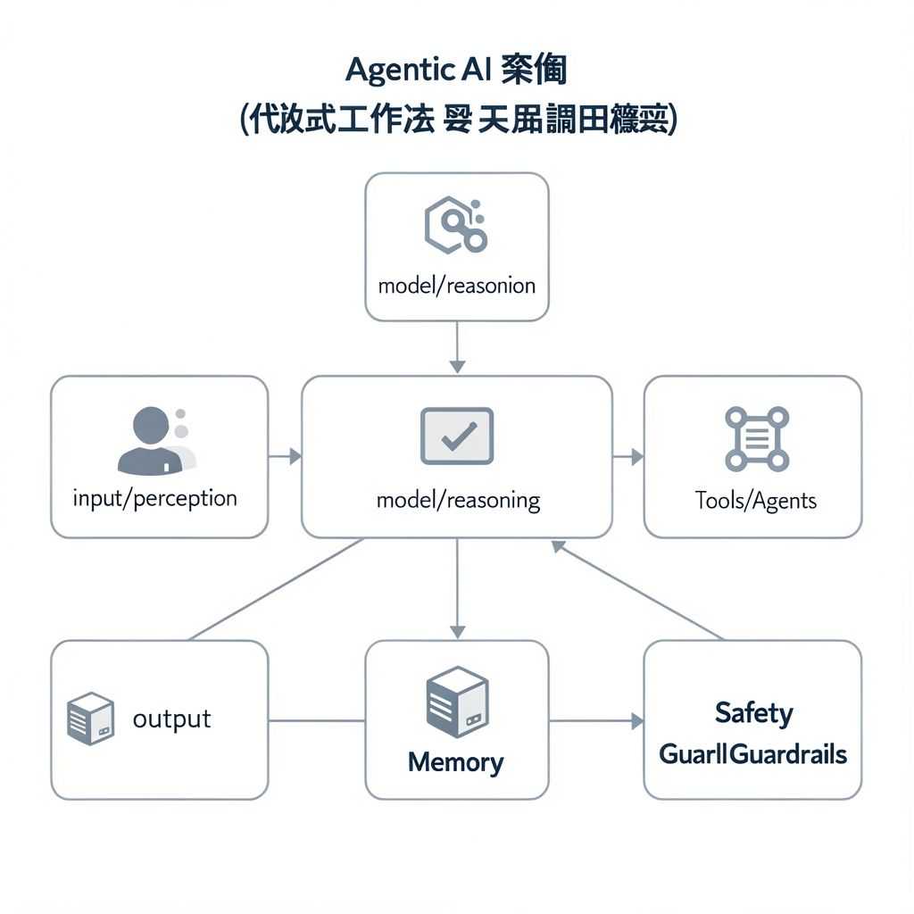

# AI 技術架構深度拆解：Agentic AI 架構（代理式工作流與工具調用範式）

- 日期：2026-10-14
- 選題理由：今日多篇素材同步指向 Agentic AI 架構：LesionAgent 論文展示無訓練代理追蹤腫瘤、Google AI Mode 整合 Drive/Wallet 工具調用、Sierra 代理客服估值倍增、具身 AI 綜述與意圖驅動論文確立代理為核心範式，跨醫療、搜尋、機器人、航運決策皆可複用。

## 一、架構原理與核心機制
【輸入/感知】多模態輸入（文本、影像、感測器串流、結構化日誌）經由感知編碼器標準化為向量表示，並附加任務意圖標籤與上下文視窗。【模型推理】核心採用大型語言/多模態模型作為「規劃器」，以 Chain-of-Thought 或 ReAct 模式分解目標為子任務序列，動態決定是否調用工具、查詢知識庫或請求人工介入。【工具/代理協作】標準化工具介面（Function Calling / MCP）封裝領域 API（航運氣象、醫療影像 PACS、ERP/CRM）、程式碼執行環境、檢索引擎；多代理協作透過訊息總線與共享工作記憶體交換狀態，支援階層式委派與並行執行。【記憶/資料層】分三層：短期工作記憶（上下文視窗+KV Cache）、長期情景記憶（向量資料庫儲存過往軌跡與決策依據）、領域知識圖譜（靜態規範、法規、設備手冊）。寫入採用追加式日誌確保可審計。【輸出與監控】輸出包含結構化決策建議、執行計畫、信心分數與解釋鏈；監控層即時記錄 Token 成本、工具延遲、錯誤率、幻覺檢測指標，並提供人工覆核介面與自動回滾機制。

## 二、海事領域應用（含實際例子）
1. 航次優化代理：輸入 AIS 軌跡、衛星氣象、港口作業窗口、船舶性能曲線；系統以規劃器分解為航線分段、速度剖面、加油港選擇等子任務，並行調用氣象 API、港口擁擠度模型、燃油消耗模擬器，輸出多目標 Pareto 最優航案供調度員覆核。價值：單航次省油 3-5%、準時率提升；風險：模型對極端天氣外推不準、工具回傳延遲導致決策滯後。2. 船機設備預測性維護代理：輸入引擎震動頻譜、潤滑油分析報告、維修紀錄；代理檢索知識圖譜比對故障模式，自動產生檢修工單並向 ERP 申請備件。價值：非計畫停機減少 20%；風險：感測器雜訊導致誤報、舊船數據缺口造成訓練分布偏移。

## 三、醫療領域應用（含實際例子）
1. 縱向 CT 腫瘤追蹤代理（LesionAgent）：輸入多期 CT 序列、放射科報告、RECIST 準則知識庫；代理無需微調即可自動對齊病灶、量測長短軸、判定反應類別（CR/PR/SD/PD），並產生含關鍵切片與測量依據的結構化報告草稿。價值：放射科醫師閱片時間縮短 40%、量測變異係數下降；合規風險：屬醫療器材軟體（SaMD）需 FDA/TPA 核准、訓練資料若缺乏特定族群可能產生系統性偏差。2. 糖尿病視網膜病變自主篩檢代理（ACCESS2）：輸入眼底照相、患者病史、社經指標；代理依照分級標準輸出轉診建議，並自動排程複查提醒、寫入電子病歷。價值：偏鄉篩檢覆蓋率提升、健康不平等緩解；合規風險：自主診斷責任歸屬未明、資料隱私需符合 HIPAA/個資法、演算法偏差可能導致特定族群漏診。

## 四、其他產業應用（含實際例子）
1. 客戶體驗代理（Sierra 模式）：輸入客戶對話歷程、訂單狀態、知識庫、退換貨政策；代理自主判斷意圖、查詢物流 API、發起退款流程、生成回覆草稿並轉人工複核。價值：首次聯繫解決率提升、人力成本降低 30%。2. 具身工業機器人代理：輸入視覺伺服影像、力覺回授、生產排程；意圖驅動規劃器分解組裝動作，調用運動控制器與夾爪 API，失敗時自動重規劃路徑。價值：換線時間縮短、小批量柔性生產可行。

## 五、限制、風險與治理建議
1. 推理鏈長導致延遲與成本難以預測，生產環境需設硬性 Token/時間預算。2. 工具調用失敗率隨介面數增長，需完善熔斷與降級機制。3. 長期記憶檢索易引入舊資訊污染，需版本化與遺忘策略。4. 多代理協作出現涌現行為難以形式化驗證，高風險域仍需人在迴路。5. 監管框架（EU AI Act、台灣 AI 基本法草案）對自主決策透明度、責任歸屬要求趨嚴，合規成本高。

## 參考來源
- https://tw.news.yahoo.com/ai%E7%B5%90%E5%90%88%E6%B5%B7%E4%BA%8B%E5%B0%88%E6%A5%AD%E9%96%8B%E5%89%B5%E8%88%AA%E9%81%8B%E6%96%B0%E5%B1%80-%E5%BC%B7%E5%8C%96%E7%87%9F%E9%81%8B%E6%B1%BA%E7%AD%96-%E5%AE%89%E5%85%A8%E7%AE%A1%E7%90%86%E8%88%87%E6%B8%9B%E7%A2%B3%E6%95%88%E7%9B%8F-100359130.html
- http://arxiv.org/abs/2611.27876v1
- https://techcrunch.com/2026/11/23/google-searchs-ai-mode-can-now-tap-into-drive-and-wallet-for-more-personalized-responses/
- https://techcrunch.com/2026/11/23/sierra-doubles-valuation-to-30b-within-six-months-as-demand-for-ai-in-cx-takes-off/
- https://pubmed.ncbi.nlm.nih.gov/43054956/
- https://pubmed.ncbi.nlm.nih.gov/43069285/
