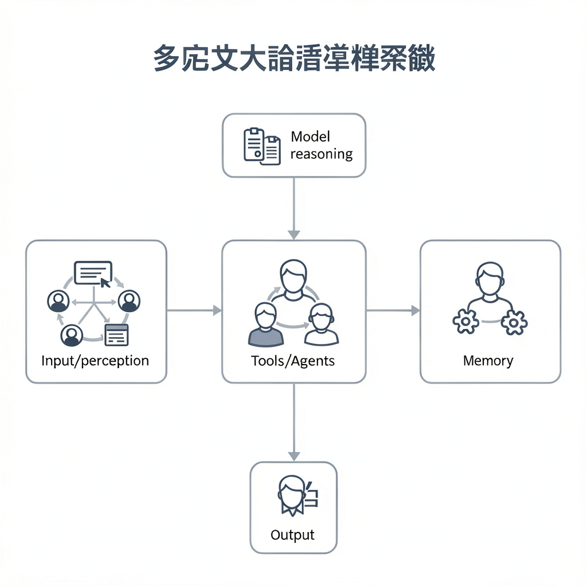

# AI 技術架構深度拆解：多代理大語言模型架構

- 日期：2026-10-21
- 選題理由：今日 Nature Communications 發表「大語言模型代理網路中的極化涌現」實證研究，揭示多代理系統在無中心協調下產生的集體行為模式；同期新聞顯示 AI 代理已滲透網安防禦、海事物流機器人、醫療影像標準化等實戰場域，標誌著架構範式從單一模型推理轉向多代理協作與工具鏈編排，具代表性與前瞻性。

## 一、架構原理與核心機制
【輸入/感知層】異構資料源（AIS 船舶訊號、醫療影像 DICOM、系統日誌、感測器串流）經由標準化介面（MCP、OpenAPI）接入，支援多模態編碼器將文本、影像、時序資料投影至共享潛在空間。【模型推理層】採用「專家混合 + 路由器」架構：輕量級路由模型依任務語意分派至領域專用 LLM（航運知識、醫學推理、程式碼生成），推理過程支援思維鏈與自我修正。【工具/代理協作層】每個代理封裝專用工具集（航線規劃引擎、DICOM 處理庫、滲透測試腳本），透過 ReAct 循環執行「思考-行動-觀察」；代理間採用發布/訂閱訊息總線交換結構化意圖與中間產物，支援動態組隊與委派。【記憶/資料層】分三級：短期工作記憶（上下文視窗 + KV Cache）、長期情節記憶（向量資料庫存儲任務軌跡與決策依據）、知識圖譜（領域本體與規範條文）。寫入採用事件溯源確保可審計。【輸出與監控層】聚合器將多代理產出融合為結構化報告（JSON/ FHIR/ EDIFACT），並接入可觀測性堆疊：延遲、Token 成本、工具呼叫成功率、幻覺偵測分數即時寫入時序資料庫，觸發人工介入閾值與自動回滾機制。

## 二、海事領域應用（含實際例子）
1. 港區智慧調度：輸入 AIS 即時軌跡、氣象預報、碼頭作業狀態、貨櫃優先級；代理群分工為「交通流預測」「泊位分配」「拖輪調度」「異常預警」，經訊息總線協商輸出 15 分鐘滾動作業計畫，下發至 TOS 與 VTS。價值：提升吞吐量 8-12%、減少錨地等待；風險：模型對極端天氣泛化不足可能產生衝突指令，需保留人工覆核閘道。2. 船隊綠能航線優化：輸入船舶性能曲線、燃油價格、碳稅試算、海流模型；「航線代理」生成候選路徑，「合規代理」檢核 IMO CII/EEXI、「商務代理」試算 TCE，多輪博弈輸出帕累托最優組合。價值：單航次省油 3-5% 並滿足綠色走廊認證；風險：即時海流資料延遲導致局部最優解偏離全域最優。

## 三、醫療領域應用（含實際例子）
1. 急診 EEG 自動結構化：輸入非結構化 EEG 報告文本、原始波形片段；「神經科專家代理」提取癲癇發作型態、背景活動異常度、「術語標準化代理」映射至 HPO/SCD 標準描述符，「品質代理」交叉驗譱一致性。輸出 FHIR Observation 資源直寫 EMR。價值：報告撰寫時間從 20 分鐘降至 2 分鐘，術語一致性提升至 95%+；合規風險：屬醫療器材軟體 (SaMD) 需 TFDA/ FDA 510(k) 驗證，訓練資料需去識別化並通過 IRB。2. 多模態醫療影像修復增強：基於 Nature Machine Intelligence 全能基礎模型，輸入低劑量 CT、動態伺影 MRI、欠掃掃 k-space；「影像重建代理」執行去噪超解、「臨床解讀代理」標註病灶並生成結構化報告、「劑量優化代理」回推最低可接受劑量。價值：輻射劑量降低 40-60% 且診斷信心度不降；合規風險：生成式幻覺可能引入偽影，需雙盲讀片驗證與責任歸屬契約。

## 四、其他產業應用（含實際例子）
1. 具身物流機器人車隊：X Square Robot × Pos Malaysia 場景，輸入倉庫地圖、訂單流、機器人電量/位置；「導航代理」規劃無衝突路徑、「拣貨代理」優化批次、「異常處理代理」處理卡貨/跌落。代理間以 ROS 2 DDS 交換意圖，邊緣端部署 snapllm 實現 20B 參數模型亞毫秒切換。價值：單倉日處理單量提升 30%、人力成本降低 45%。2. 主動式網安防禦：OpenAI × Cisco 架構，輸入 Linux 核心原始碼、CVE 資料庫、即時流量封包；「靜態分析代理」掃描潛在漏洞、「動態模擬代理」在沙箱觸發利用、「修補代理」生成 eBPF 規則與熱修補補丁。價值：零時差漏洞緩解時間從天級壓縮至分鐘級；風險：自動修補可能引入新 Bug，需分級部署與金絲雀驗證。

## 五、限制、風險與治理建議
1. 涌現極化風險：Nature Communications 實證顯示代理網路在無外部約束下自發形成極化觀點，導致協作決策脆斷；需引入憲法式約束與多樣性獎勵機制緩解。2. 攻擊面擴大：工具鏈、訊息總線、記憶庫均成注入目標（如 MONAI Label 零時差被代理利用），需採用零信任微隔離與提示注入偵測器。3. 評估困難：端到端指標（任務完成率）與單元指標（單代理準確率）常背離，缺乏標準化基準。4. 算力與成本：多輪推理與工具呼叫使 Token 消耗呈指數增長，邊緣部署需模型蒸餾與量化權衡。5. 責任歸屬模糊：多代理決策鏈長，錯誤溯源需完整審計日誌與可解釋性模組，法規上仍屬灰色地帶。

## 參考來源
- https://doi.org/10.1038/s41467-026-78228-y
- https://thehackernews.com/2026/11/openai-and-cisco-unveil-ai-assisted.html
- https://finance.yahoo.com/technology/ai/articles/x-square-robot-pos-malaysia-084500076.html
- https://bioengineer.org/local-open-weight-language-models-standardize-emergency-eeg-narratives-into-structured-clinical-descriptors/
- https://doi.org/10.1038/s42256-026-01310-z
- https://github.com/maheshvaikri-code/snapllm
