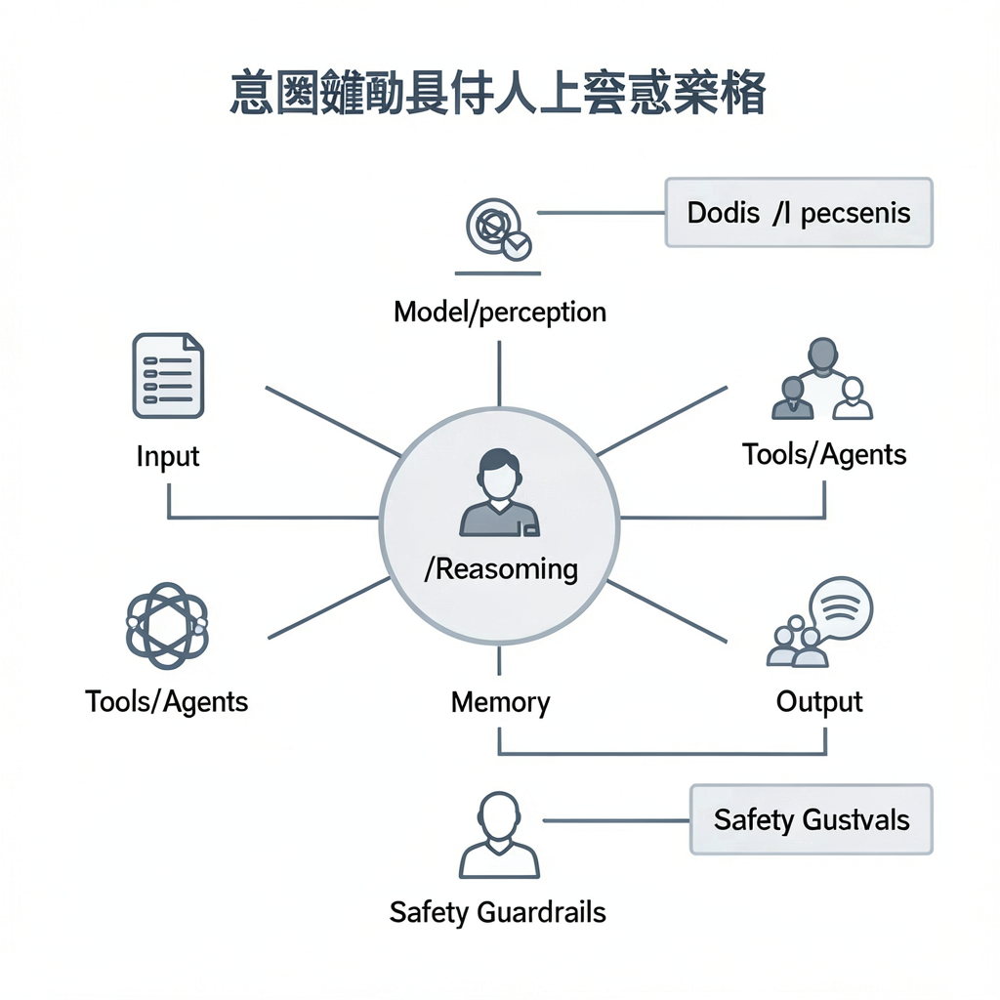

# AI 技術架構深度拆解：意圖驅動具身人工智慧架構

- 日期：2026-10-28
- 選題理由：今日素材中出現兩篇《National Science Review》論文：〈Intent-driven embodied artificial intelligence〉與〈Survey on embodied AI for industry: from the perspective of industrial robots〉，並配合 NSING 在 electronica 2026 展示 AI 機器人、馬達控制與數位能源，顯示具身 AI 已從實驗室走向產業部署。此架構整合感知、世界模型、意圖推理與閉環控制，可同時支援海事自主航行、醫療手術機器人與製造業柔性生產，具備跨域代表性。

## 一、架構原理與核心機制
意圖驅動具身 AI 架構包含五大層次： 1. 輸入/感知層：多模態感知器（視覺、力覺、本體感測、雷達/聲納、醫療影像）輸入原始資料，經由感知編碼器（如 ViT、PointNet、聲納 CNN）轉為潛在特徵向量，並同步進行時空對齊與不確定度估計。 2. 世界模型與狀態估計：以神經微分方程或擴散模型建構可微分世界模型，預測環境動態與自身動作後果；結合貝葉斯濾波或粒子濾波輸出帶信心區間的狀態估計，支援部分可觀測環境。 3. 意圖推理與任務規劃：大型語言/多模態模型（LLM/VLM）解析自然語言指令或高階目標，轉換為結構化意圖圖（Intent Graph），再經由層級式任務規劃器（HTN/STRIPS + 學習式啟發式）分解為技能序列與子目標，並具備線上重規劃能力。 4. 技能與控制層：技能庫包含參數化運動原語（DMP/ProMP）、強化學習策略與模型預測控制（MPC）控制器；執行時由仲裁機制依據情境切換或融合多技能，並透過實時力/視覺伺服閉環修正軌跡。 5. 記憶/資料層與監控：長期記憶採用向量資料庫儲存經驗片段（情境-動作-結果），支援少樣本適應與持續學習；短期工作記憶以注意力機制維持任務上下文。監控模組即時計算安全指標（碰撞風險、力矩極限、醫療合規規則），觸發熔斷或人工介入。 資料流：感知→世界模型→意圖解析→任務圖→技能調度→控制器→執行器，並以觀測回授更新世界模型與記憶。控制流：高層意圖以 Hz 級更新，中層規劃 10-50 Hz，底層伺服 1-2 kHz，形成多時標閉環。部署考量：邊緣端需具備確定性延遲（TSN/Time-Sensitive Networking）、異構加速（GPU/NPU/FPGA）、功能安全認證（ISO 13849、IEC 62304）與模型量化/蒸餾以滿足功耗預算。

## 二、海事領域應用（含實際例子）
情境一：港口自主駕駛拖車編隊作業。輸入資料：多車體 3D 雷達點雲、GPS/RTK、V2X 通訊封包、碼頭調度指令。系統運作：感知層融合雷達與 V2X 建立共享環境地圖；世界模型預測其他車輛與船舶動態；意圖層解析調度指令生成編隊拓撲與路徑；技能層協調多車體 MPC 維持編隊幾何與防撞。價值：提升碼頭吞吐量 15-20%、降低人力成本。風險：惡劣天氣感知退化、V2X 通訊延遲抖動導致編隊不穩、責任歸屬法律未明。 情境二：近海風機巡檢無人艇。輸入資料：海面雷達、光學/熱紅外相機、聲納、風浪預報 API。系統運作：感知層偵測葉片裂紋、鏽蝕與海洋生物附著；世界模型結合波浪譜預測艇體運動；意圖層依巡檢清單規劃逼近軌跡與停泊點；控制層執行波浪補償定點懸停與近距拍攝。價值：減少人員登艇風險、縮短巡檢週期。風險：海上通訊中斷導致自主決策失誤、聲納多徑效應造成定位漂移、國際海事組織（IMO）MASS 規範尚在演進中。

## 三、醫療領域應用（含實際例子）
情境一：腹腔鏡手術輔助機器人。輸入資料：內視鏡 4K/3D 影像、力覺桿回授、術前 CT/MRI 配準資料、醫師語音/手勢指令。系統運作：感知層即時分割器官、血管與腫瘤邊界；世界模型預測組織變形與出血風險；意圖層將醫師「分離右肝葉」指令轉為子任務序列；技能層執行柔性夾持、電凝與縫合原語，力覺伺服限制夾持力 < 2N。價值：降低醫師疲勞、提升微創精度、縮短學習曲線。合規風險：屬 FDA Class II/III 醫療器材，需 IEC 62304 軟體生命週期、ISO 14971 風險管理、臨床試驗證實；資料隱私須符 HIPAA/GDPR，模型變更需補充上市後監測。 情境二：ICU 智慧照護機器人。輸入資料：床邊多參數監測波形、深度相機體位影像、護理站指令、電子病歷結構化資料。系統運作：感知層偵測患者脫管、褥瘡風險體位、呼吸機不同步；意圖層解析「每 2 小時翻身、監測 SpO2 趨勢」生成排程；技能層協同移動底盤與協作機械臂執行翻身、拍背、導管固定；監控模組即時比對醫囑與生命徵象閾值，異常觸發護理師視訊確認。價值：緩解護理人力短缺、標準化照護流程。合規風險：涉及醫療決策支援軟體（CDS）分類、需機構審查會（IRB）通過、資料本地化儲存與去識別化、責任歸屬於醫療機構而非機器人廠商。

## 四、其他產業應用（含實際例子）
情境一：半導體晶圓廠柔性物流 AMMR（自主移動操作機器人）。輸入：天車調度指令、RFID/視覺定位、負載重量與重心估計。系統：意圖層解析「將 FOUP 從光刻區搬至薄膜區」；規劃層結合廠區動態地圖與天車時空窗口生成無衝突路徑；控制層執行舉升、對準、放置技能，力覺閉環補償地面不平。價值：減少專用天車投資、支援小批量多品種產線切換。 情境二：建築工地鋼筋綁扎與檢測雙臂機器人。輸入：BIM 模型、激光掃描點雲、鋼筋規格單。系統：感知層對齊實體與 BIM、偵測鋼筋間距偏差；意圖層依施工進度生成逐根綁扎順序；技能層雙臂協作完成繞線、扭緊、品檢，視覺伺服修正端點位置誤差 < 3mm。價值：解決熟練工短缺、提升施工品質一致性。

## 五、限制、風險與治理建議
1. 長尾場景泛化不足：世界模型在未見環境（極端天氣、罕見解剖變異、非結構化工地）預測誤差大，易導致規劃失效。2. 多時標實時性難保證：高層 LLM 推理延遲不可決定，若無硬體加速或蒸餾，難滿足 1-2 kHz 伺服回授。3. 安全驗證覆蓋率低：具身系統狀態空間極大，傳統測試與形式化驗證難以窮盡，功能安全認證成本高。4. 持續學習與遺忘權衡：線上適應新任務易災難性遺忘舊技能，需經驗回放與正則化，增加記憶體與訓練算力。5. 法規與責任灰色地帶：海事 MASS、醫療 CDS、工業機器人協作安全（ISO 10218/TS 15066）標準仍在演進，跨國部署合規成本高。6. 資料主權與隱私：醫療與國防相關感知資料不可上傳雲端，邊緣訓練算力受限，聯邦學習通訊開銷大。

## 參考來源
- https://pubmed.ncbi.nlm.nih.gov/43054956/
- https://pubmed.ncbi.nlm.nih.gov/43054954/
- https://www.eetimes.com/nsing-featured-cra-ai-robotics-motor-control-and-digital-energy-at-electronica-2026/
- https://www.moneydj.com/kmdj/news/newsviewer.aspx?a=7f106899-b8a7-4aca-9994-941f5128b35f
- https://www.cdns.com.tw/articles/1495778
- https://note.com/365medical_tokyo/n/n53c043bda079?hl=en
