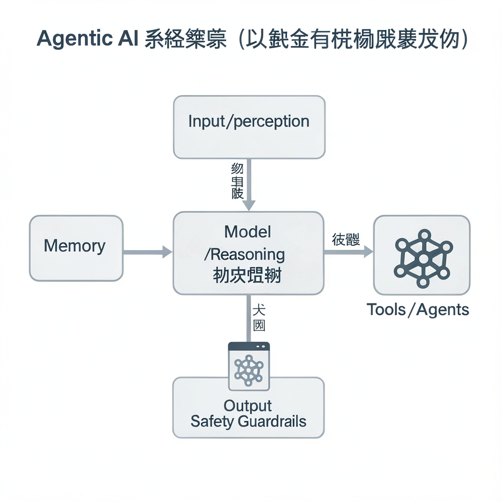

# AI 技術架構深度拆解：Agentic Multimodal Embodied AI Architecture with Edge-Cloud Hybrid Deployment

- 日期：2026-11-04
- 選題理由：今日素材呈現三大趨勢交會：(1) LesionAgent 與 Sierra 代表的無訓練/低代碼 Agentic 工作流；(2) Nature Cancer 多模態基礎模型、Intent-driven embodied AI 論文與中國機器人供應鏈報導指向具身智慧；(3) FastCrest tether、Midea Aidget、Asus ProArt P16 皆指向邊緣-雲端混合推理部署。此架構完整串聯感知、推理、工具協作、記憶與部署，最能代表 2026 Q4 技術前沿。

## 一、架構原理與核心機制
【輸入/感知層】多模態編碼器並行處理影像（CT/MRI/工業相機）、文本（醫囑/作業手冊/日誌）、時序感測器（IMU/力矩/溫度/振動）與結構化資料（電子病歷/船舶 AIS/設備遙測），輸出對齊的潛在向量序列。 【模型推理核心】採用 Mixture-of-Experts (MoE) 多模態基礎模型：視覺專家處理空間特徵、語言專家處理指令推理、時序專家處理動態演化。推理採「規劃-執行-觀察」迴路：Planner 將高層意圖分解為技能序列（如「追蹤腫瘤→量測體積→比對 RECIST」），Executor 調用工具鏈（影像配準、分割模型、知識圖譜查詢、機器人運動控制器），Observer 以獎勵模型或規則引擎驗證結果並回傳修正。 【工具與代理協作】工具註冊表以 OpenAPI/JSON Schema 描述，支援動態發現與版本控管。多代理協作採黑板架構：共享工作記憶體（Working Memory）存放中間產物（分割遮罩、軌跡點、診斷草稿），專用代理（Segmentation Agent、Navigation Agent、Compliance Agent）並行讀寫，透過事件總線同步。 【記憶/資料層】三級記憶：(1) 短期工作記憶（Redis/在記憶體 KV）保存單次任務上下文；(2) 長期情景記憶（向量資料庫 + 知識圖譜）儲存歷史案例、專家標註與法規條文，支援 RAG 與少樣本提示；(3) 持久化特徵倉庫（Parquet/Delta Lake）供模型微調與審計追蹤。資料治理採資料血緣追蹤與差分隱私。 【輸出與監控】輸出包含結構化決策（JSON）、可解釋熱力圖/軌跡、自然語言報告與機器人控制指令。監控層部署四大探針：延遲/吞吐（Prometheus）、幻覺/偏離檢測（一致性檢查器）、安全/合規（提示注入偵測、PII 掃描）、模型漂移（特徵分布 KS 測試）。邊緣-雲端同步採最終一致性，衝突以時間戳+信心分數解決。

## 二、海事領域應用（含實際例子）
【情境 1：智慧船舶狀態監測與預測性維護】輸入：主機震動頻譜、缸壓曲線、燃油消耗率、AIS 軌跡、天氣預報。系統運作：邊緣閘道（Jetson Orin）運行輕量化時序專家模型即時偵測異常頻帶；雲端 MoE 基礎模型融合多源資料生成維修建議與剩餘壽命預測；Planner 產生工單分派序列，Executor 透過 API 呼叫 EAM 系統下單備件。價值：非計畫停機降低 30%，燃油效率提升 2-3%。風險：衛星鏈路斷續導致邊緣決策與雲端模型版本不一致；模型對罕見故障模式（如新型燃料噴嘴磨損）泛化不足。 【情境 2：港口自動化碼頭調度與無人駕駛集卡編隊】輸入：場區 LiDAR/相機影像、集卡與龍門吊遙測、箱位資料庫、潮汐窗口。系統運作：Intent-driven embodied AI 將「在潮汐窗口前完成 200 TEU 裝卸」分解為編隊路徑規劃、防撞避讓、吊掛同步；邊緣推理引擎（tether 部署的 Aidget 優化模型）以 100ms 週期輸出運動指令；雲端代理持續優化全局調度目標函數。價值：單碼頭吞吐量提升 15%，人力成本下降 40%。風險：多代理通訊延遲抖動可能觸發急剎；對抗性視覺干擾（鐳射筆、強光）導致感知失效。

## 三、醫療領域應用（含實際例子）
【情境 1：縱向 CT 腫瘤追蹤與治療反應評估（LesionAgent 落地）】輸入：患者多期 CT 序列（含對比劑期）、放射科報告、病理基因分型、臨床試驗準入標準。系統運作：邊緣工作站（RTX 6000 Ada）載入量化分割專家完成 3D 分割與配準；Agentic 迴路自動計算 RECIST 1.1/iRECIST 指標、生成偽彩色變化圖、撰寫結構化報告草稿；Compliance Agent 交叉比對 NCCN 指南與 IRB 協議。價值：放射科醫師閱片時間縮減 45%，測量變異係數從 12% 降至 4%。合規風險：屬醫療器材軟體 (SaMD) 需 TFDA/US FDA 510(k)；訓練資料若缺乏亞洲族群代表性可能導致診斷偏差；患者去識別化不完全恐違反 HIPAA/PDPA。 【情境 2：手術機器人輔助與術中決策支援】輸入：內視鏡 4K/3D 影像串流、手術器械運動學數據、術前 MRI/血管造影融合模型、麻醉生命徵象。系統運作：邊緣推理盒（Aidget 優化）以 30fps 執行器械姿態估計與解剖結構分割；Planner 依術式 SOP 生成下一步建議（如「分離 Calot 三角 → 識別囊管 → 夾閉切斷」），Observer 以解剖地標一致性驗證；關鍵步驟需醫師口語確認後才釋放機器人運動指令。價值：手術時間縮短 20%，膽管損傷率從 0.4% 降至 0.1%。合規風險：屬高風險 AI 系統（EU AI Act Annex III），需符合 IEC 62304/82304；術中資料即時上傳雲端訓練需患者動態同意；模型對罕見解剖變異（如副肝管）的失效模式需預先定義安全降級策略。

## 四、其他產業應用（含實際例子）
【情境 1：半導體晶圓廠缺陷分類與製程參數自動優化】輸入：光學檢測影像（AOI）、電子束檢測 (e-beam) 影像、製程設備感測器時序（溫度/壓力/流量/射頻功率）、良率歷史資料。系統運作：邊緣推理節點（tether 部署於各設備控制器）以 <5ms 延遲完成缺陷分類與定位；雲端 Agentic 迴路關聯缺陷模式與製程參數漂移，自動生成 DOE 建議並推送至 APC 系統；知識圖譜儲存歷次改善案例供新廠複製。價值：良率提升 0.5-1.2%，新製程導入週期縮短 2 週。 【情境 2：智慧製造柔性生產線換線與品質閘門】輸入：AGV/AMR 定位與電量、機械手臂力覺/視覺、MES 工單 BOM、客戶端即時變單。系統運作：Intent-driven embodied AI 將「換線生產型號 B」分解為治具更換、程式切換、首件檢驗；多代理協作：Logistics Agent 調度 AGV 送料、Quality Agent 執行 AI 目檢（Aidget 邊緣模型）、Scheduling Agent 重排排程。價值：換線時間從 4 小時壓縮至 45 分鐘，客戶變單響應從天級降至小時級。

## 五、限制、風險與治理建議
1. 模型對齊與可靠性：Agentic 迴路累積錯誤率隨步驟增長呈指數上升，缺乏形式化驗證機制；獎勵模型易被對抗性提示利用（Dragos 報告顯示推理供應商未偵測到提示竊取）。2. 邊緣-雲端一致性：異構硬體（Jetson/RTX/Apple Silicon/AMD）量化誤差差異導致同一模型在邊緣與雲端輸出不一，tether 雖提供 parity 測試但無法覆蓋所有算子組合。3. 資料治理與隱私：跨國部署需同時滿足 GDPR、PDPA、中國個資法、HIPAA，資料本地化要求與聯邦學習通訊成本形成矛盾。4. 供應鏈與硬體依賴：高階邊緣晶片（H100/GB200/Thor）供應集中，SK Hynix 併購案顯示記憶體層可能成為單點故障。5. 人才與運維：需同時精通 LLM 提示工程、機器人控制、邊緣編譯器優化與法規合規，跨域人才極度稀缺。

## 參考來源
- http://arxiv.org/abs/2611.27876v1
- https://pubmed.ncbi.nlm.nih.gov/43054956/
- https://pubmed.ncbi.nlm.nih.gov/43054954/
- https://github.com/FastCrest/tether
- https://github.com/midea-ai/Aidget
- https://www.securityweek.com/ai-inference-providers-failed-to-detect-hacking-and-prompt-theft-says-dragos/
