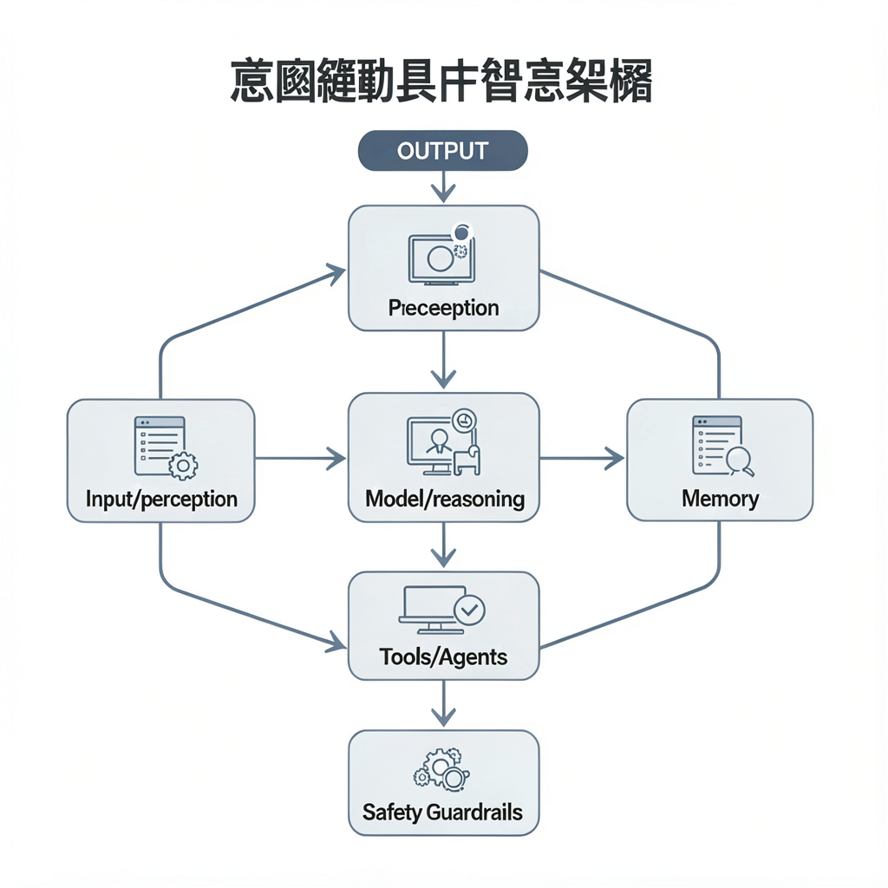

# AI 技術架構深度拆解：意圖驅動具身智慧架構

- 日期：2026-11-11
- 選題理由：今日素材中《National Science Review》發表「Intent-driven embodied AI」與「具身AI產業調查」兩篇論文，結合鴻海布局大模型、台積電指稱AI補足人力缺口、以及工業機器人落地需求，顯示此架構正從實驗室走向產線與關鍵基礎設施，具代表性。

## 一、架構原理與核心機制
架構包含五層： 1. 輸入/感知層：多模態編碼器（視覺ViT、語言LLM、本體感覺編碼器）將RGB-D影像、指令文本、關節狀態對齊至共享潛空間，支援流式與事件驅動兩種模式。 2. 意圖理解層：以大語言模型為核心的任務規劃器，接收自然語言指令與環境語義圖，輸出結構化意圖圖（Intent Graph），含子目標、前置條件、失敗恢復分支。 3. 模型推理/決策層：分層強化學習策略——高層依意圖圖選擇技能序列，低層技能策略（如抓取、導航、組裝）以離線預訓練+線上微調部署，採用世界模型預測動作後果並進行模型預測控制（MPC）修正。 4. 工具與代理協作層：技能註冊表管理可組合原子技能；多代理協調器透過黑板機制同步任務狀態、資源鎖定與異常事件，支援人機共同作業與遠端遙操作介入。 5. 記憶/資料層：向量資料庫儲存情景記憶（任務軌跡、失敗案例）、語義地圖與技能參數；知識圖譜編碼領域規範（如船殼焊接標準、手術器械計數規則），支援RAG檢索與持續學習。 6. 輸出與監控層：動作指令經安全檢查器（碰撞檢測、力矩限制、合規規則引擎）後下發至實時控制器；可觀測性堆疊收集遙測、決策日誌、模型不確定度，支援事後審計與線上漂移偵測。

## 二、海事領域應用（含實際例子）
情境一：港口集裝箱自動裝卸機器人。輸入：岸橋吊機視覺串流、場站管理系統（TOS）指令、AGV定位資料。運作：意圖層解析「將40呎箱移至區塊C-12」，規劃抓取點、路徑避障；低層技能執行精準對齊與鎖扣檢測；記憶層調取歷史箱型偏差模型修正。價值：單機效率提升15%、夜間無人化作業。風險：惡劣天氣感知退化導致誤判、通訊延遲影響多機協調。 情境二：船體水下檢測與修復ROV/AUV協作。輸入：側掃聲納拼圖、ROV推進器遙測、檢測報告文本。運作：意圖層將「掃描左舷壓載艙腐蝕並修補」分解為巡航、缺陷定位、噴塗作業；代理協作器分配AUV大範圍掃描與ROV精細作業；知識圖譜引用DNV-GL規範判定修補等級。價值：減少乾塢天數、降低潛水員風險。風險：水下通訊頻寬限制模型更新、動力學模型誤差導致定位漂移。

## 三、醫療領域應用（含實際例子）
情境一：骨科手術輔助機器人（脊椎椎弓根螺釘植入）。輸入：術中CT/導航追蹤、醫師語音指令、術前規劃DICOM。運作：意圖層解析「在L4左側植入6.5mm螺釘」，規劃入針軌跡避開神經根；低層技能執行鑽孔深度控制與力覺反饋停止；記憶層載入患者專屬骨質密度模型調整進給參數。價值：植入準確率>98%、輻射劑量降低30%。合規風險：FDA Class III醫療器材需鎖定模型版本、術中模型漂移需即時凍結與審計追蹤。 情境二：ICU智慧照護機械臂（體位變換、導管整理）。輸入：床側深度相機、生命徵象監測器、護理指令單。運作：意圖層依護理指令「每2小時翻身一次」生成動作序列，檢查導管張力與呼吸機管路；技能層採用阻抗控制配合患者體重分佈；知識圖譜嵌入護理SOP與感染控制規則。價值：減輕護理師肌骨傷害、提升翻身依從率。合規風險：患者隱私資料本地化處理、非預期接觸力觸發緊急停止機制需經臨床驗證。

## 四、其他產業應用（含實際例子）
情境一：半導體晶圓廠自動化物流搬運（OHT/AGV群）。輸入：MES調度指令、激光雷達SLAM地圖、設備狀態API。運作：意圖層將「將Lot#A234從光刻送至蝕刻」分解為路徑規劃、載具對接、異常重規劃；多代理協調器解決交叉路口死鎖；記憶層熱點路段預測模型動態調整權重。價值：吞吐率提升10%、人力成本下降。 情境二：再生能源風機葉片巡檢與修補無人機群。輸入：高解析度相機、熱紅外影像、SCADA振動數據。運作：意圖層依檢測報告「葉尖前緣侵蝕Level 2」規劃定點懸停修補；技能層結合視覺伺服與噴塗軌跡生成；知識圖譜引用IEC 61400-24驗收標準。價值：減少停機損失、避免高空作業風險。

## 五、限制、風險與治理建議
1. 真實世界長尾分布導致世界模型預測誤差累積，需大量實機資料微調。2. 多模態對齊在極端光照、多路徑衰減（船艙、手術室）下易失效。3. 安全檢查器與合規規則引擎延遲可能阻礙高頻控制迴路（>1kHz）。4. 持續學習面臨災難性遺忘與模型版本管理複雜度。5. 跨域知識圖譜建構依賴專家標註，擴展成本高。6. 邊緣算力限制大模型部署，常需蒸餾犧牲泛化能力。

## 參考來源
- https://pubmed.ncbi.nlm.nih.gov/43054956/
- https://pubmed.ncbi.nlm.nih.gov/43054954/
- https://news.google.com/rss/articles/CBMiWkFVX3lxTE9Jc2dSd1Vjd20wMlNxQktiaXNUQWhNSm16eFVEeXpYSGF4T0s4azFIM2k1VEhPLXN4WUFVQVdSSGpDb2xveDNQeS1qQUZVR2dHZ2Q5ZGVTOGk3d9IBX0FVX3lxTE1yT3UzaElUUXJNZE0wRmpaOWV2QkRhLVZ1WmZLMUlaeG1HbnJHa3lGSTFaWVNKdmo0V0FSNjViSGt6Tkh1MWl1QWJPdlloaXZfYmZYd3owVS1YaE5LWXBN?oc=5
- https://news.google.com/rss/articles/CBMiekFVX3lxTE5UMWhybXdlY2pTWVYwZm5lbURBeExoNF9zcmVFRXNmMV9qU2dTMUlMUUdldEZZeE9GNTlmcFpETlJtT01iU3EwZExpYzhfelZtSWIxM2xkOTUyOEFHZGQweXpJYnJSaWczeXZFRHdRRzU3ZGxjeFdmV0R3?oc=5
- https://github.com/notsodubeyous/IoT-Network-Intrusion-Detection-System-UNSW-NB15
- https://github.com/evelyyyyynnnnn/2.0-Healthcare-Ai-Systems
