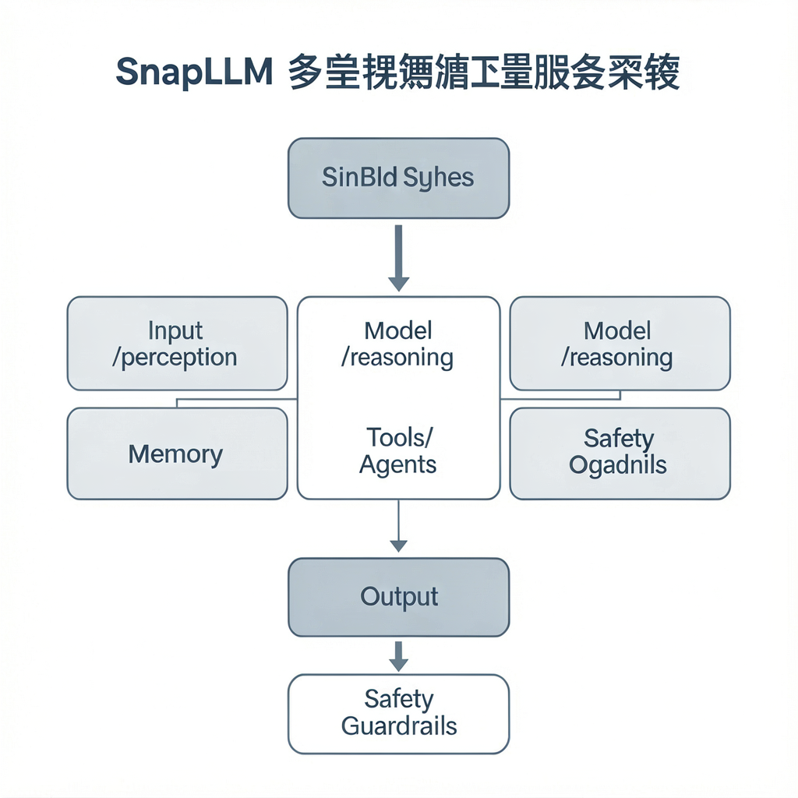

# AI 技術架構深度拆解：ESCARGOT: 基於動態思維圖與生物醫學知識圖譜的 LLM 代理架構

- 日期：2026-11-18
- 選題理由：今日素材中 ESCARGOT 同時具備學術論文、開源專案與明確架構設計，展示「LLM + 動態思維圖 + 知識圖譜」三層協作的代理範式，且生物醫學知識圖譜機制可直接延伸至海事法規、航運知識等領域，具備跨域遷移價值。

## 一、架構原理與核心機制
【輸入/感知層】接收自然語言查詢（如臨床病例描述、航運事故敘述），經由實體識別與關係抽出模組轉結構化三元組，並對齊至外部知識圖譜（UMLS、MeSH 或海事法規圖譜）。 【模型推理層】採用 LLM 作為核心推理引擎，提示詞注入「動態思維圖」機制：將推理步驟表示為有向無環圖，節點為子問題或中間結論，邊為邏輯依賴。LLM 依圖拓撲逐節點生成推理鏈，支援回溯與分支探索。 【工具/代理協作層】圖節點可觸發外部工具：SPARQL 查詢知識圖譜、Python 計算藥物劑量/航線油耗、API 呼叫即時 AIS/氣象資料。工具回傳結果寫回對應節點，形成「推理-驗證-修正」閉環。 【記憶/資料層】雙層記憶：短期工作記憶儲存當前思維圖狀態與工具輸出；長期知識庫包含領域知識圖譜（生物醫學/海事）、向量索引的非結構化文獻、歷史案例庫供少樣本檢索。 【輸出與監控層】最終答案由根節點彙整生成，附帶推理圖可視化與證據引用。監控模組記錄節點耗時、工具成功率、幻覺檢測分數（交叉驗證 KG 與文獻），支援人工審核介入與線上微調。

## 二、海事領域應用（含實際例子）
1. 航運事故根因分析輔助系統：情境為海巡署調查碰撞事故。輸入：AIS 軌跡、VHF 通訊紀錄、氣象報告、COLREGs 法條。系統運作：實體識別提取船舶、動作、環境因子；動態思維圖依因果鏈拆解「瞭望不當→未避讓→碰撞」；KG 查詢 COLREGs 第 5、7、8 條對應義務；工具計算相對方位、最近接近距離。價值：縮短調查週期、標準化報告。風險：AIS 資料缺失導致圖節點證據不足、法條解讀需人工複核。 2. 減碳航線規劃決策代理：情境為船東優化跨太平洋航線。輸入：船舶性能曲線、即時海流/風浪預報、港口靠泊窗口、CII 監管門檻。系統運作：思維圖節點分別評估「天氣路由」「慢速航行」「替代燃料加注」；KG 提供港口岸電設施、綠色走廊協議；工具呼叫氣象 API 與船舶性能模型。價值：多目標優化（燃油、排放、準班率）。風險：預報誤差傳遞至決策、KG 更新滯後於新港口設施。

## 三、醫療領域應用（含實際例子）
1. 罕見病診斷輔助代理：情境為遺傳諮詢門診面對複雜表型。輸入：患者 HPO 表型術語、全外顯體測序變異清單、家族系譜。系統運作：思維圖以表型-基因關聯為主幹，節點依序執行「表型相似度排序→候選基因變異致病性解讀→致病機制文獻佐證」；KG 查詢 OMIM、Orphanet、ClinVar；工具呼叫 CADD/REVEL 預測分數。價值：提升診斷率、縮短診斷漫遊。合規風險：屬醫療器材軟體（SaMD）需 TFDA/CE 認證、患者基因資料須符合 GDPR/HIPAA、最終診斷須由醫師簽署。 2. 腫瘤多學科會診（MDT）準備代理：情境為肺癌 MDT 會議前整理。輸入：影像報告、病理分子分型、治療史、最新 NCCN 指南版本。系統運作：思維圖按「分期→駕駛基因→治療選項→臨床試驗匹配」分支；KG 整合 NCCN、ESMO 指南與 ClinicalTrials.gov；工具計算腫瘤負荷、PD-L1 綜合陽性分數。價值：確保指南依從性、發掘試驗機會。合規風險：指南版本同步延遲、藥物適應症標籤差異、建議僅供參考不可取代醫師判斷。

## 四、其他產業應用（含實際例子）
1. 專利撰寫與審查輔助代理：輸入發明描述、現有技術文獻、IPC 分類。系統以思維圖拆解「技術問題→技術特徵→權利要求撰寫→新穎性比對」，KG 檢索 USPTO/EPO 專利資料庫，工具計算文本相似度與引用網絡中心性。價值：提升撰寫效率、降低被駁回風險。 2. 金融合規審查代理（反洗錢）：輸入交易流水、客戶 KYC、制裁名單、FATF 指引。思維圖依「客戶風險分級→交易模式偵測→可疑活動報告生成」流程，KG 整合制裁實體關係圖譜，工具呼叫規則引擎與異常檢測模型。價值：降低人工審核量、提高 SAR 品質。

## 五、限制、風險與治理建議
1. 知識圖譜建構與維護成本高，領域遷移需重新對齊實體與關係。2. 動態思維圖在長鏈推理中易發生錯誤傳播，缺乏理論收斂保證。3. LLM 幻覺仍可能污染 KG 查詢生成的 SPARQL，需嚴格交叉驗證。4. 即時工具鏈（氣象、AIS、基因資料庫）延遲與可用性影響端到端時效。5. 監管合規（醫療器材、金融審計）要求完整審計軌跡，現有開源版本尚缺乏企業級合規模組。

## 參考來源
- https://www.semanticscholar.org/paper/61d3f95318d52bd15ef36cdf93b25bae1fe135ef
- https://github.com/EpistasisLab/escargot
- https://tw.news.yahoo.com/ai%E7%B5%90%E5%90%88%E6%B5%B7%E4%BA%8B%E5%B0%88%E6%A5%AD%E9%96%8B%E5%89%B5%E8%88%AA%E9%81%8B%E6%96%B0%E5%B1%80-%E5%BC%B7%E5%8C%96%E7%87%9F%E9%81%8B%E6%B1%BA%E7%AD%96-%E5%AE%89%E5%85%A8%E7%AE%A1%E7%90%86%E8%88%87%E6%B8%9B%E7%A2%B3%E6%95%88%E7%9B%8F-100359130.html
- https://inews.hket.com/article/4228931/%E3%80%90AI-%E9%86%AB%E7%99%82%E3%80%91%E8%9E%9E%E8%9F%BB%E9%9F%93%E6%AD%86%E6%AF%85%EF%BC%9AAI%E5%83%85%E8%BC%94%E5%8A%A9%E3%80%81%E8%87%A8%E5%BA%8A%E6%B1%BA%E7%AD%96%E5%BF%85%E9%A0%88%E4%BA%A4%E4%BA%88%E9%86%AB%E7%94%9F%E3%80%80%E7%94%A8%E6%88%B6%E7%AA%81%E7%A0%B41.5%E5%84%84
