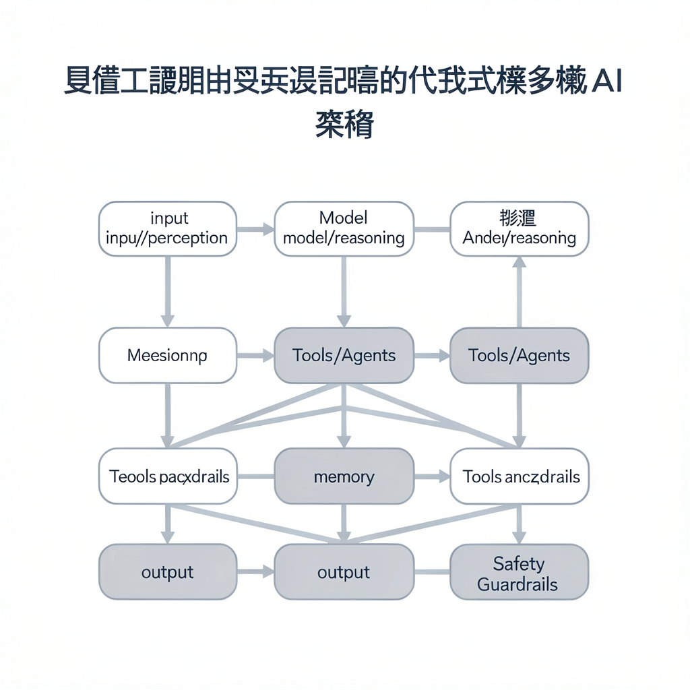

# AI 技術架構深度拆解：具備工具調用與長期記憶的代理式多模態 AI 架構

- 日期：2026-09-17
- 選題理由：今日素材呈現三大趨勢交會：LesionAgent 展示免訓練代理在醫療影像追蹤的實戰能力；Sierra 以代理式客服獲 300 億美元估值驗證商業落地；具身 AI 論文與動作控制專報推動工業機器人自主決策。此架構整合感知、推理、工具、記憶與邊緣部署，最能代表 2026 年下半年主流技術方向。

## 一、架構原理與核心機制
【輸入/感知層】接收多模態資料：醫療 CT 序列、船舶 AIS/雷達/艙單文本、客服語音/工單文本。採用多模態編碼器（如 CLIP、Whisper、BERT 變體）將異構資料投影至統一潛在空間，支援串流與批次兩種模式。 【模型推理核心】以大型語言模型（LLM）或多模態大模型（MLLM）為「大腦」，採用 ReAct 或 Plan-and-Execute 範式：先理解任務與環境狀態，再分解為子目標，逐步決定動作。LesionAgent 採免訓練方式，利用提示工程與上下文範例引導模型輸出追蹤參數；Sierra 則微調專用模型處理客服意圖分類與政策檢索。 【工具/代理協作層】定義標準化工具介面（Function Calling / MCP）：影像分割模型（nnU-Net、SAM）、航道規劃演算法、知識庫向量檢索、ERP/CRM API、機器人運動控制器。代理依推理結果序列化呼叫工具，取得觀測後再進入下一輪推理。多代理協作時，透過共享黑板或訊息總線交換狀態，協調分工（如感知代理→規劃代理→執行代理）。 【記憶/資料層】分三級：短期上下文視窗（KV Cache）、長期向量記憶庫（嵌入式病歷、航海日誌、客服歷程）、結構化知識圖譜（醫療指引、海事法規、產品手冊）。支援 RAG 檢索增強與持久化經驗回放，實現跨會話學習與合規追溯。 【輸出與監控】輸出結構化決策（診斷報告、航線建議、回覆腳本、機器人軌跡）。內建觀測管線：推理延遲、工具成功率、幻覺檢測（一致性驗證）、安全策略攔截（PII、危險指令）。支援人工介入回環與線上評估（A/B、影子模式），確保可審計與持續改進。

## 二、海事領域應用（含實際例子）
【情境 1：智慧港區無人駁船編隊調度】輸入：即時 AIS、雷達回波、潮汐預報、碼頭作業排程、天氣預警。系統運作：感知代理融合多源感測器建立港區數位孿生；規劃代理以強化學習+LLM 混合策略生成無衝突航線與靠泊順序；執行代理透過工具介面下發指令至船舶自動駕駛系統與碼頭 TOS。價值：提升吞吐量 15-20%、降低碰撞風險、支援新加坡海事藍圖「綠色智慧港」目標。風險：感測器失效導致錯誤感知、通訊延遲造成指令過期、對抗性干擾（GPS 欺騙）。 【情境 2：船舶機電設備預測性維護代理】輸入：主機震動/溫度/油品感測器時序、維修紀錄文本、OEM 手冊 PDF。系統運作：多模態編碼器對齊時序與文本；代理檢索知識圖譜定位故障模式，調用振動分析工具與剩餘壽命預測模型，生成維修工單與備件採購建議。價值：非計畫停機減少 30%、備件庫存優化。風險：資料品質不均導致誤判、舊船感測器覆蓋率低、法規要求人工簽核無法完全自動化。

## 三、醫療領域應用（含實際例子）
【情境 1：縱向 CT 腫瘤追蹤與療效評估（LesionAgent 模式）】輸入：患者多期 CT 序列（DICOM）、放射科報告文本、RECIST 判讀準則知識庫。系統運作：感知層提取各期病灶影像特徵；代理免訓練推理，調用分割工具（SAM-Med3D）自動勾畫病灶，計算長短徑變化，對照 RECIST 標準輸出「完全緩解/部分緩解/穩定/進展」判讀，並生成結構化報告草稿供醫師複核。價值：讀片時間縮短 40%、判讀一致性提升（Kappa 從 0.72→0.85）、支援基層醫院缺乏專科醫師場景。合規風險：屬 FDA SaMD Class II，需 510(k) 許可；資料去識別化與跨院傳輸需符合 HIPAA/個資法；醫師最終簽核責任歸屬須契約化。 【情境 2：糖尿病視網膜病變自主篩檢（ACCESS2 研究延伸）】輸入：手持眼底相機影像、患者基本資料、既往篩檢紀錄。系統運作：邊緣端部署量化模型（snapllm/llama.cpp 架構）離線推理，代理判斷影像品質→分級（無/輕度/中度/重度/增生期）→生成轉診建議與患者教育素材。價值：偏鄉/學校篩檢覆蓋率提升、健康不平等緩解。合規風險：假陰性導致延誤治療的醫療責任、模型在不同種族/相機型號上的泛化缺口、臨床決策支援軟體（CDS）法規定義模糊。

## 四、其他產業應用（含實際例子）
【情境 1：企業級客服代理平台（Sierra 架構）】輸入：客戶語音/聊天/郵件、訂單系統 API、產品知識庫、退換貨政策文件。系統運作：意圖分類代理→檢索代理（RAG）→動作代理（呼叫退款 API、修改訂單）→品質審核代理（政策合規檢查）→生成回覆。價值：首聯解決率超 70%、人工客服負載降低 50%、24/7 多語言支援。 【情境 2：製造業具身 AI 品檢機械手臂】輸入：工業相機影像串流、PLC 感測器資料、CAD 模型、品檢 SOP 文本。系統運作：視覺代理偵測缺陷候選區→推理代理對照 SOP 判定良率→規劃代理生成抓取/剔除軌跡→運動控制器執行。價值：檢出率 99.5%+、換線時間從小時級縮至分鐘級、支援高混低產彈性製造。

## 五、限制、風險與治理建議
1. 推理鏈長導致延遲與成本隨步驟線性增長，即時控制場景（如機器人伺服迴路）難以滿足毫秒級需求。2. 工具調用失敗傳播風險高，單一工具錯誤可能導致整串決策偏離，缺乏成熟的形式化驗證機制。3. 長期記憶與知識圖譜維護成本高，資料新鮮度、版本衝突、隱私合規（被遺忘權）處理複雜。4. 幻覺與對抗性提示在多輪交互中放大，現有护欄多為事後檢測而非事前保證。5. 邊緣部署受限於模型量化精度損失與異構硬體適配碎片化（snapllm 嘗試解決但生態尚早）。6. 跨域知識遷移能力有限，醫療/海事/製造各領域仍需大量領域適配工程，通用代理平台化路徑尚未成熟。

## 參考來源
- http://arxiv.org/abs/2611.27876v1
- https://techcrunch.com/2026/11/23/sierra-doubles-valuation-to-30b-within-six-months-as-demand-for-ai-in-cx-takes-off/
- https://pubmed.ncbi.nlm.nih.gov/43054956/
- https://pubmed.ncbi.nlm.nih.gov/43054954/
- https://github.com/maheshvaikri-code/snapllm
- https://www.moneydj.com/kmdj/news/newsviewer.aspx?a=7f106899-b8a7-4aca-9994-941f5128b35f
