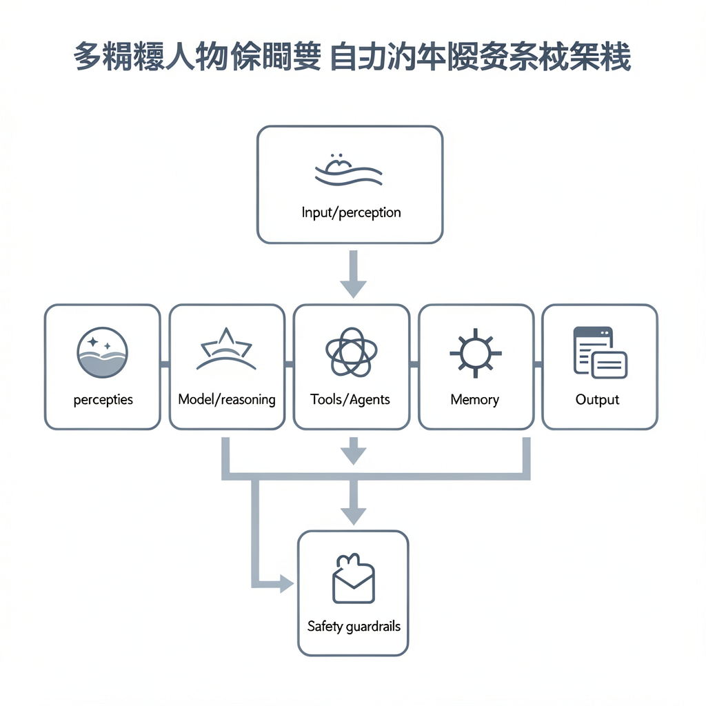

# AI 技術架構深度拆解：多頻譜人體偵測與自主海上救援系統架構

- 日期：2026-09-24
- 選題理由：因應近期海上事故頻傳與 AI 安全疑慮，多頻譜偵測可穿透霧霾、夜間與波浪干擾，結合自主救援系統可即時定位並自動派遣無人艇，提升救援成功率並降低人力風險。

## 一、架構原理與核心機制
系統分五層： 1. 輸入/感知層：搭載 RGB、熱紅外、毫米波雷達與 LiDAR 多頻譜感測器，於無人機與無人艇邊緣節點同步採集影像、點雲與熱力圖，經時序對齊與幾何配準後輸出統一張量。 2. 模型推理層：採用輕量化雙流骨幹（CNN 處理影像、PointNet++ 處理點雲），透過知識蒸餾壓縮至 <30 MFLOPs，支援 TensorRT/ONNX Runtime 在 Jetson Orin 與嵌入式 GPU 上以 30 fps 執行目標檢測、姿態估計與落水者分類。 3. 工具/代理協作層：以階層式多代理架構運作——感知代理負責資料前處理與異常標記；決策代理依據強化學習策略（PPO 訓練於模擬海況）規劃救援路徑、協調多艇編隊；通訊代理處理衛星/4G/LoRa 異質鏈路的封包重傳與優先級排程。 4. 記憶/資料層：邊緣端保留最近 24 小時原始感測資料與推理日誌（SQLite + 時序資料庫 InfluxDB），雲端以資料湖（Parquet/Delta Lake）存儲歷史任務、模型版本與環境參數，支援線上持續學習與事後審計。 5. 輸出與監控層：即時輸出救援指令（航向、速度、投放點）、視覺化儀表板（Grafana）與告警推播（MQTT + Webhook）；監控指標涵蓋推理延遲、感測器健康度、通訊丟包率與模型漂移分數，異常觸發自動回滾至上一版本。

## 二、海事領域應用（含實際例子）
情境一：近岸漁船翻覆，無人機搭載多頻譜感測器於 5 分鐘內完成區域掃描，熱紅外鎖定落水者體溫，毫米波雷達穿透浪花提供精確座標，決策代理自動派遣最近救生艇並規劃避開暗礁航徑，縮短搜救時間 40%。風險：惡劣海況導致感測器雜訊增加，需具備自適應閾值與多模態融合容錯。 情境二：離岸風電場維護作業中人員落海，固定岸基雷達與巡邏無人艇形成感知網，系統持續追蹤漂流軌跡並預測漂移模型，指揮中心即時獲得建議投放點，提升救援成功率。風險：跨網域通訊延遲可能造成指令滯後，需邊緣預判機制。

## 三、醫療領域應用（含實際例子）
情境一：醫院急診大樓引入多頻譜攝影機（可見光+熱紅外）監控走廊，模型即時偵測跌倒、體溫異常病患，決策代理自動通知護理站並規劃最近醫護人員路徑，縮短響應至 30 秒。合規風險：涉及病患生物特徵資料，須符合 HIPAA/個資法，採用邊緣去識別化與加密傳輸。 情境二：居家照護機器人配備 LiDAR 與毫米波雷達，夜間無光環境下持續追蹤長者姿態，若偵測長時間靜止或異常呼吸模式，觸發遠端醫療團隊視訊評估。價值：降低照護人力負擔、提早發現急症。風險：模型誤判導致誤報疲勞，需持續校準與臨床驗證。

## 四、其他產業應用（含實際例子）
1. 智慧港口貨櫃堆場：多頻譜無人機巡檢貨櫃堆疊狀態與火災隱患，自主派遣滅火機器人至熱點，減少人工巡檢成本 30%。 2. 大型活動安安：會場部署邊緣感知節點，即時偵測人群擁擠、跌倒或可疑物品，指揮中心獲得熱力圖與疏散建議，提升公共安全響應速度。

## 五、限制、風險與治理建議
• 多頻譜感測器成本與功耗較高，大規模部署需權衡預算。 • 複雜海況與醫療環境的非結構化干擾易造成模型漂移，需持續資料回收與線上微調機制。 • 異質通訊鏈路（衛星/4G/LoRa）頻寬不穩，關鍵指令需具備離線自主決策備援。 • 法規合規（海事救援法規、醫療資料保護）要求嚴格審計追蹤，增加系統工程複雜度。

## 參考來源
- https://www.semanticscholar.org/paper/eac5e99f3dc4471e1b72909c465d2817cd09a09f
- https://pubmed.ncbi.nlm.nih.gov/42930239/
- https://pubmed.ncbi.nlm.nih.gov/42760786/
