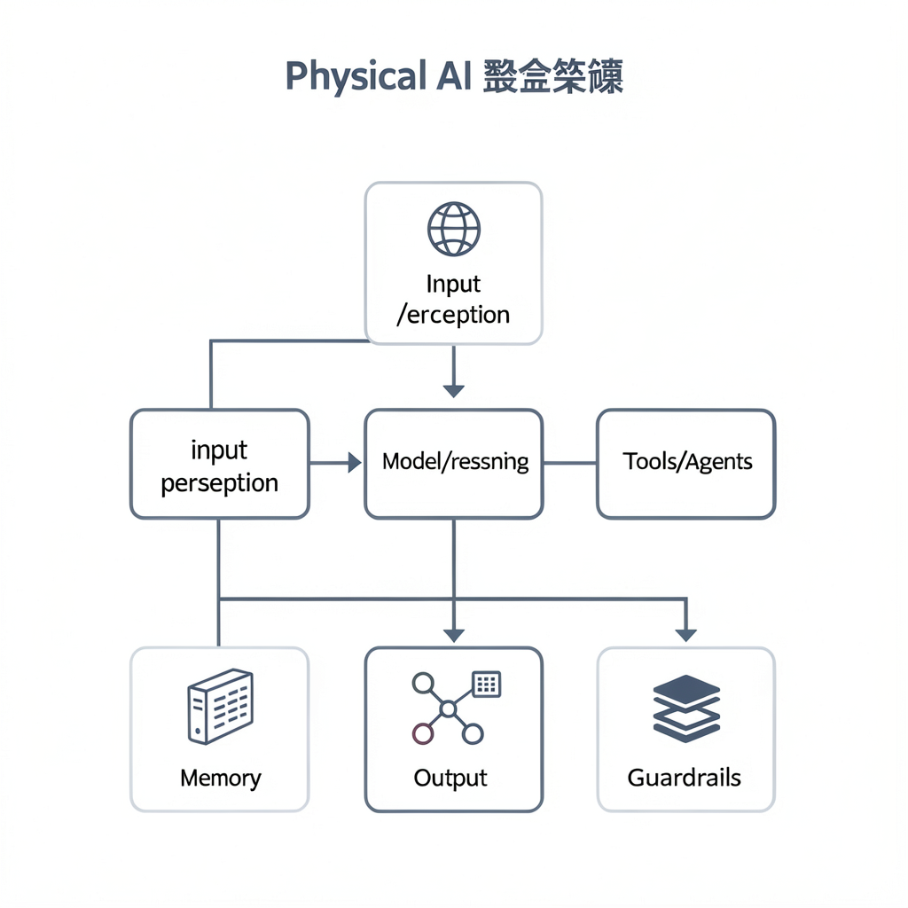

# AI 技術架構深度拆解：Physical AI 整合架構

- 日期：2026-10-01
- 選題理由：今日素材中 IEEE TPAMI 發表的 Physical AI 綜述，系統性定義感知、推理、建模、互動四層協同架構，代表具身智慧與多模態融合的最新範式，適合作為跨域 AI 架構深度拆解的代表。

## 一、架構原理與核心機制
Physical AI 架構將智慧體拆解為四大核心層： 1. 感知層：整合視覺、雷達、力覺、音訊等多模態感測器，透過統一的特徵對齊模組（如 Progressive Feature Alignment）將異構資料映射至共享潛在空間，支援即時環境建模。 2. 推理層：採用大型語言模型與視覺語言模型結合的 Chain-of-Thought 機制，並引入 Meta-Ability Guided Distillation（MAGIC）以壓縮推理路徑，實現高效的規劃與決策。 3. 建模層：維護動態世界模型，包含幾何一致性（Gaussian Geometric-Consistency）與語義地圖，支援長時程狀態估計與反事實模擬。 4. 互動層：透過工具調用介面（API、機器人控制指令）與外部系統協作，並具備線上學習機制，將互動結果回寫記憶庫。 資料流：感測器 → 特徵對齊 → 共享潛在空間 → 推理引擎 → 世界模型更新 → 行動指令 → 執行器 → 環境反饋 → 記憶更新。 控制流：高層任務規劃器下發子目標，推理層依據當前世界模型生成動作序列，監控模組即時評估安全性與不確定性，若超過閾值則觸發人工介入或安全降級。 部署考量：邊緣端部署輕量化感知與推理模組（量化、知識蒸餾），雲端負責大模型訓練、世界模型同步與長期記憶儲存；需建立低延遲通訊協定（TSN/5G）與資料治理流程以滿足即時性與隱私合規。

## 二、海事領域應用（含實際例子）
1. 複雜海況船舶偵測：輸入 SAR 影像與 AIS 軌跡，感知層經 PGNet 的 Progressive Feature Alignment 與 Gaussian Geometric-Consistency Assignment 輸出高精度船舶邊界框；推理層結合海況模型預測航行意圖，互動層自動向 VTS 發送預警。價值：提升偵測召回率並降低誤報；風險：極端海態導致特徵退化、模型漂移需持續線上微調。 2. 船舶軌跡異常檢測：輸入歷史 AIS 序列、氣象海流資料，感知層編碼時空特徵，推理層利用世界模型進行反事實模擬，判斷偏離常態機率；互動層觸發港口安檢調度。價值：早期發現非法漁撈或碰撞風險；風險：資料缺失與隱私限制可能影響模型泛化。

## 三、醫療領域應用（含實際例子）
1. 實驗動物 24 小時行為監測（AI 電眼）：輸入多攝影機影像、生理訊號，感知層進行姿態估計與行為分類，推理層結合世界模型識別疼痛、癲癇等異常模式，互動層自動標記時間戳供研究員審閱。價值：減少人工觀察偏誤、加速藥物篩選；合規風險：動物福利法規要求資料匿名化與最小化收集。 2. 多模態臨床決策支援：輸入電子病歷表格、醫學影像、基因體資料，感知層透過 Trans-MMVAE 進行跨模態融合，推理層生成診斷假設與治療建議，互動層以可解釋報告呈現醫師。價值：整合異構資料提升診斷準確度；合規風險：醫療器材認證（TFDA/CE）、資料主權與模型解釋性需符合 GDPR/個資法。

## 四、其他產業應用（含實際例子）
1. 自主室內導航機器人：輸入 RGB-D、LiDAR、語音指令，感知層對齊多模態特徵，推理層採用 MAGIC 的 Chain-of-Distillation 產生高效導航路徑，互動層控制底盤與機械手執行抓取。價值：降低推理延遲至 100ms 內，適合即時服務機器人。 2. 企業級集成學習平台：輸入表格、文本、時間序列資料，感知層統一特徵工程管線，推理層呼叫 E2E 套件自動搜尋最佳集成策略，互動層輸出模型部署腳本與監控儀表板。價值：縮短模型開發週期、提升預測穩健度。

## 五、限制、風險與治理建議
Physical AI 架構雖具跨域整合優勢，但面臨：(1) 多模態對齊在長尾分布與噪聲環境下易失效，需大量標註與持續領域適應；(2) 世界模型的長時程一致性受限於記憶容量與計算預算，邊緣部署需權衡精度與延遲；(3) 安全關鍵場景（海事、醫療）的可解釋性與法規認證流程尚未標準化，導致落地週期拉長；(4) 資料主權與隱私法規（GDPR、個資法）限制跨機構資料共享，影響聯邦學習與知識蒸餾效果。

## 參考來源
- https://pubmed.ncbi.nlm.nih.gov/42284175/
- https://pubmed.ncbi.nlm.nih.gov/42118647/
- https://pubmed.ncbi.nlm.nih.gov/42924538/
- https://news.google.com/rss/articles/CBMiUkFVX3lxTE02MUpObEdBUlMwY2JybFUyckM4aHpsNEdFLWYxOGFNWUhZUmtmY09xWGFJZDZvcGNhMHhWYVdPSjFpbFJLQlltcjRwRWhnN1lxOGfSAVBBVV95cUxQUFZtTm5oWk9TOUZCSHV3Qjhfc0U3T0I3SmJYU2VDeEE4dXhfS0F6eDFfcURhV2tHcFp5MW1qNE1Mcm5yT1YxQ2g5SlFxMk5UOQ?oc=5
- https://news.google.com/rss/articles/CBMiSEFVX3lxTE5KTTV0cHJYU1dJaE9SYVBPWnk5bGRfV19CSzZWNWNIUVc3azFXMGIxTXY5WDJGYWNZQnBRc0JmWkRubnN2bFhBXw?oc=5
