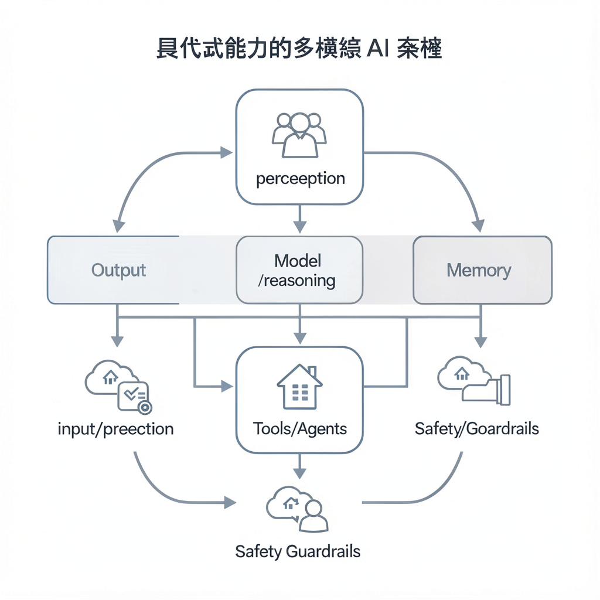

# AI 技術架構深度拆解：具代理能力的多模態 AI 架構

- 日期：2026-10-08
- 選題理由：今日素材跨越搜尋、醫療、工業、客服四大場景，皆指向同一架構樣態：以大型語言模型為核心推理引擎，結合工具調用、長期記憶與多模態感知，形成能自主規劃、執行並回饋的代理系統。Google AI Mode 接入 Drive/Wallet、LesionAgent 追蹤腫瘤、Sierra 客服代理、具身 AI 論文與產業調查，共同驗證此架構已成主流範式。

## 一、架構原理與核心機制
【輸入/感知層】接收文本、語音、影像、結構化資料（如 CT 序列、船舶 AIS、醫療紀錄），經多模態編碼器（ViT、Whisper、BERT 類編碼器）映射為統一語義嵌入空間；支援 RAG 檢索增強，將外部知識庫（法規、手冊、病歷、海圖）向量化並以混合檢索（稀疏+稠密+重排序）注入上下文。 【模型推理核心】採用指令微調的大型語言模型（如 Llama 3 系列、Qwen 2.5、Nemotron 3 Ultra）作為規劃器與推理器，採 Chain-of-Thought、ReAct 或 Plan-and-Solve 範式分解任務，輸出結構化動作序列（工具呼叫、API 參數、程式碼片段）。支援函數呼叫標準（OpenAI Function Calling、MCP），並可透過 LoRA/QLoRA 快速適配垂直領域。 【工具與代理協作層】維護工具註冊表（搜尋引擎、程式碼解釋器、資料庫 SQL、領域模擬器、機器人控制介面），代理依推理結果動態選擇並串聯工具；多代理協作採用監督者-工作者或圖基編排，透過共享記憶體與訊息總線交換中間結果，支援人工介入與審核節點。 【記憶/資料層】分短期工作記憶（對話上下文、工具回傳）、長期情景記憶（向量資料庫如 Milvus、Weaviate、PGVector，存儲使用者偏好、歷史決策、領域知識圖譜）、程序性記憶（技能庫、Prompt 模板、少樣本範例）。採用記憶壓縮與遺忘機制控制上下文窗口與儲存成本。 【輸出與監控】輸出包含自然語言回覆、結構化報告、API 指令、機器人軌跡規劃；監控層記錄完整推理鏈、工具調用延遲、Token 成本、幻覺檢測分數、安全策略違規，支援線上評估與離線回放，並提供可觀測性儀表板。

## 二、海事領域應用（含實際例子）
情境一：智慧港區調度代理。輸入：即時 AIS 軌跡、氣象預報、碼頭作業狀態、船舶載貨清單。系統運作：代理感知多模態資料，規劃最靠泊順序與拖輪分配，呼叫港區模擬器評估方案，輸出調度指令與風險預警。價值：提升吞吐量 8-12%、減少等待時間；風險：模型誤判導致碰撞風險、資料延遲造成決策失效、對抗性 AIS 偽裝攻擊。 情境二：船舶狀態基礎健康管理代理。輸入：引擎震動頻譜、燃油消耗曲線、保養紀錄、機油分析報告。系統運作：代理檢索設備手冊與歷史故障庫，推理異常根因，生成保養工單並預訂備件。價值：非計畫停機降低 30%、延長大修間隔；風險：感測器漂移導致誤診、跨廠牌資料異質性、法規要求人工簽核無法完全自動化。

## 三、醫療領域應用（含實際例子）
情境一：縱向影像腫瘤追蹤代理。輸入：患者多期 CT/MRI 序列、放射科報告、病理基因型。系統運作：LesionAgent 式代理以執行免訓練追蹤，自動分割病灶、計算 RECIST 1.1 指標、生成結構化回應報告，並標記需人工複核切片。價值：放射科醫師閱片時間縮短 40%、量化指標一致性提升；合規風險：屬醫療器材軟體（SaMD）需 FDA 510(k)/MDR CE 認證、患者資料去識別化與跨境傳輸限制、幻覺導致漏報微小轉移。 情境二：糖尿病視網膜病變篩檢自主代理。輸入：眼底照相影像、患者病史、HbA1c 數值。系統運作：代理依 ACCESS2 研究流程，自主判讀分級、產生轉診建議、寫入電子病歷並排程追蹤。價值：偏鄉篩檢覆蓋率提升、減少專科醫師負擔；合規風險：自主診斷法律責任歸屬、演算法偏差對特定族群敏感度降低、需符合 HIPAA/GDPR/個資法。

## 四、其他產業應用（含實際例子）
情境一：企業知識管理與客服代理。輸入：客戶工單、產品手冊、程式碼庫、合約 PDF。系統運作：代理檢索內部知識庫、生成故障排除步驟、呼叫工單系統建立任務、必要時轉接人工。價值：首聯解決率提升、客服成本降低 50% 以上。 情境二：工業機器人柔性製造代理。輸入：訂單 BOM、機台狀態、視覺檢測影像、刀具壽命資料。系統運作：代理規劃加工路徑、動態調整參數、協調多機台協作、異常時啟動補償策略。價值：換線時間縮短 60%、良率提升 2-3 個百分點。

## 五、限制、風險與治理建議
1. 推理鏈長導致延遲與成本隨任務複雜度超線性增長，邊緣部署受限於算力與記憶體。2. 工具調用失敗率與幻覺疊加，長流程成功率難以保證，需人工介入機制。3. 多模態對齊在長尾領域（罕見疾病、特殊船型）表現不穩，資料稀疏導致領域適配困難。4. 記憶隱私與資料主權衝突，跨國部署需解決資料本地化與模型同步矛盾。5. 缺乏統一評測基準，安全性紅隊測試覆蓋面有限，監管合規路徑尚未成熟。

## 參考來源
- https://techcrunch.com/2026/11/23/google-searchs-ai-mode-can-now-tap-into-drive-and-wallet-for-more-personalized-responses/
- http://arxiv.org/abs/2611.27876v1
- https://pubmed.ncbi.nlm.nih.gov/43054956/
- https://pubmed.ncbi.nlm.nih.gov/43054954/
- https://pubmed.ncbi.nlm.nih.gov/43069285/
- https://techcrunch.com/2026/11/23/sierra-doubles-valuation-to-30b-within-six-months-as-demand-for-ai-in-cx-takes-off/
