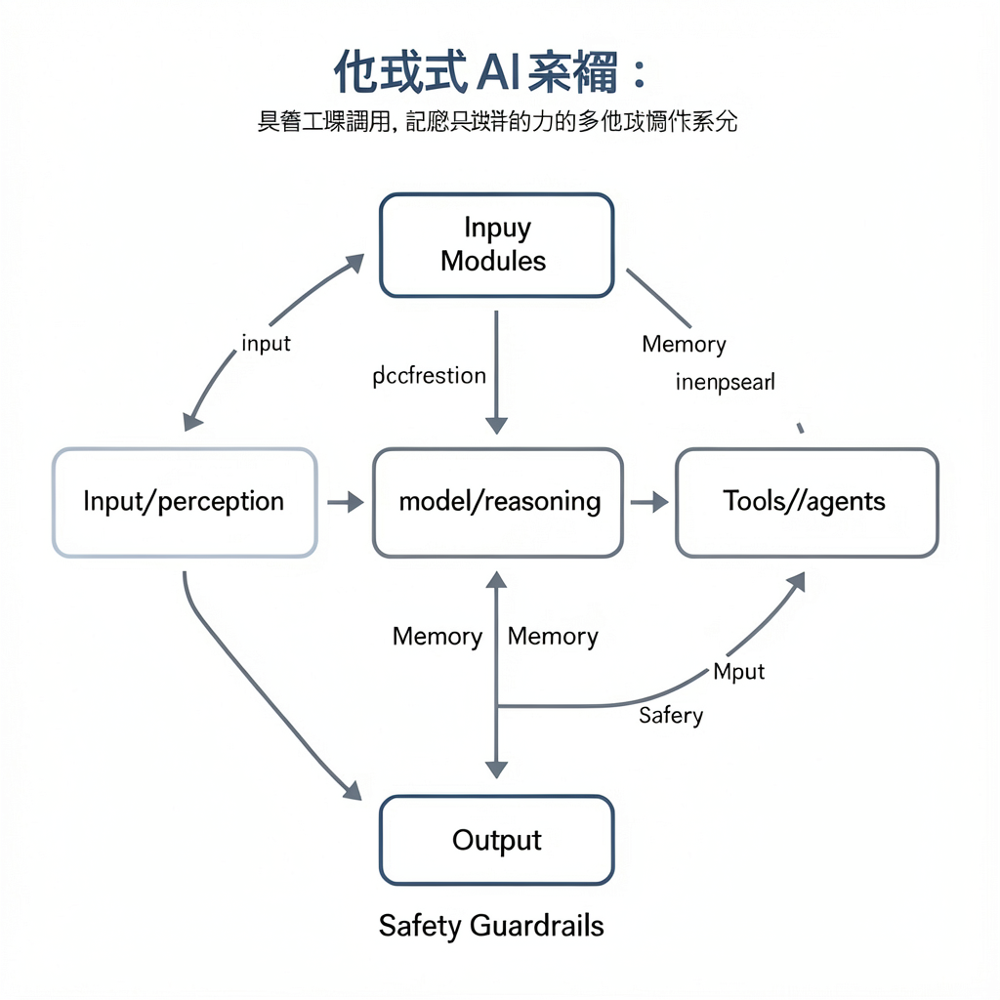

# AI 技術架構深度拆解：代理式 AI 架構：具備工具調用、記憶與規劃能力的多代理協作系統

- 日期：2026-10-15
- 選題理由：今日素材呈現多個生產級與研究級驗證：Google Search AI Mode 整合 Drive/Wallet 實現個人化工具調用；LesionAgent 展示免訓練代理於縱向 CT 腫瘤追蹤；Sierra 估值倍增證明客服代理商業化；Intent-driven embodied AI 與產業具身智能綜述奠定理論基礎。此架構整合 LLM 推理、工具鏈、長短期記憶與多代理協作，為當前最具代表性的最新 AI 技術架構。

## 一、架構原理與核心機制
核心機制包含五層： 1. 輸入/感知層：接收多模態輸入（文字、影像、結構化資料、API 事件），經由嵌入模型與感知編碼器統一為向量表示，支援 RAG 檢索與工具選擇的語意理解。 2. 模型推理層：以大型語言模型為核心控制器，執行任務分解、推理鏈（CoT/ReAct）、工具選擇與參數生成。採用結構化輸出（JSON/Function Calling）確保下游可執行。 3. 工具與代理協作層：維護工具註冊表（搜尋、程式碼執行、資料庫查詢、領域模型推理、硬體控制）。代理依規劃結果串聯或並行調用工具，支援多代理對話與協商（如規劃代理、執行代理、驗證代理）。 4. 記憶/資料層：短期記憶保存對話上下文與中間結果；長期記憶採向量資料庫（用戶偏好、領域知識、歷史軌跡）與圖資料庫（實體關係）支援跨會話持久化與個人化。 5. 輸出與監控層：聚合工具回傳結果，經由輸出格式化器產生最終回應；同時記錄追蹤、延遲、Token 成本、工具成功率與安全違規，支援線上評估與人工介入回環。部署面採微服務化，模型推理與工具執行解耦，支援邊緣-雲端協同與異構算力調度。

## 二、海事領域應用（含實際例子）
情境一：港區智慧調度代理。輸入：AIS 軌跡、氣象、泊位佔用、貨櫃優先序。系統運作：規劃代理解析調度目標，檢索歷史最優策略（向量庫），調用模擬器評估候選方案，執行代理下發指令至 TOS。價值：縮短船舶周轉 15-20%，降低碳排。風險：模型幻覺導致錯誤指令需人工覆核；資料延遲影響即時性。 情境二：船舶狀態基礎預測維護代理。輸入：引擎感測器串流、維修紀錄、OEM 手冊。系統運作：感知層異常檢測觸發代理，檢索相似故障案例與維修手冊，推理層生成檢修工單與備品建議，回寫 EAM 系統。價值：非計畫停機減少 30%。風險：感測器雜訊導致誤觸發；跨廠牌資料異質整合困難。

## 三、醫療領域應用（含實際例子）
情境一：縱向影像腫瘤追蹤代理。輸入：患者多期 CT 序列、放射科報告、RECIST 準則知識庫。系統運作：感知層分割病灶，推理層呼叫 LesionAgent 免訓練追蹤病灶演變，工具層計算體積變化率與回應評估，長期記憶儲存患者影像軌跡供後續比對。價值：放射科醫師閱片時間縮減 40%，量化評估一致性提升。合規風險：屬醫療器材軟體（SaMD），需 FDA/CE 認證；患者隱私資料跨境傳輸限制。 情境二：糖尿病視網膜病變篩檢自主代理。輸入：眼底照相影像、患者病歷、ACCESS2 研究臨床指引。系統運作：代理自主執行影像品質檢查、病變分級、轉診建議生成，低風險案例自動出具報告，高風險升級至眼科醫師。價值：解決基層篩檢醫師不足，縮減健康不平等。合規風險：自主診斷法律責任歸屬未明；演算法偏差對特定族群誤判率較高。

## 四、其他產業應用（含實際例子）
情境一：企業知識管理與程式碼生成代理。輸入：內部文件、程式碼庫、Jira 需求單。系統運作：代理理解需求，檢索相關架構文件與相似實作，生成程式碼與測試，經 CI/CD 驗證後建立 PR。價值：開發週期縮短 30%，新人上手加速。 情境二：製造產線異常診斷與動作控制代理。輸入：PLC 遙測、機器視覺影像、保全手冊。系統運作：感知層偵測異常，推理層關聯歷史故障模式，規劃檢修步驟並透過工具下發機械臂/AGV 動作指令。價值：平均修復時間（MTTR）降低 25%，支援無人化夜班。

## 五、限制、風險與治理建議
1. 推理可靠性：長鏈推理易累積錯誤，缺乏形式化驗證機制。2. 工具調用安全性：提示注入、越權調用、資料外洩風險高，需嚴格沙箱與權限模型。3. 記憶一致性：長期記憶更新與衝突解決機制尚未標準化，易產生過時或矛盾知識。4. 可觀測性盲區：多代理協作鏈路追蹤複雜，根因分析困難。5. 算力成本：工具迴圈與多模態推理導致 Token 消耗指數級增長，邊緣部署受限於模型量化精度損失。6. 法規合規：自主決策於高風險領域（醫療、海事、金融）缺乏明確責任歸屬框架。

## 參考來源
- https://techcrunch.com/2026/11/23/google-searchs-ai-mode-can-now-tap-into-drive-and-wallet-for-more-personalized-responses/
- http://arxiv.org/abs/2611.27876v1
- https://techcrunch.com/2026/11/23/sierra-doubles-valuation-to-30b-within-six-months-as-demand-for-ai-in-cx-takes-off/
- https://pubmed.ncbi.nlm.nih.gov/43054956/
- https://pubmed.ncbi.nlm.nih.gov/43054954/
- https://github.com/maheshvaikri-code/snapllm
