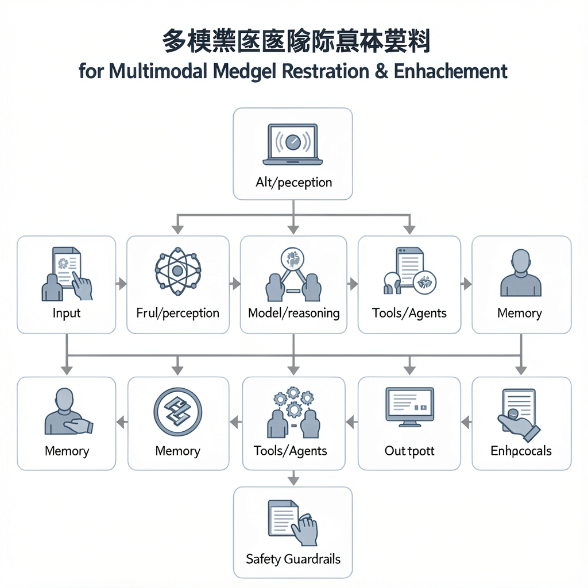

# AI 技術架構深度拆解：多模態醫療影像基礎模型（All-in-One Foundation Model for Multimodal Medical Image Restoration & Enhancement）

- 日期：2026-10-22
- 選題理由：今日 Nature Machine Intelligence 發表的全功能基礎模型，整合多種醫療影像模態於單一架構，展示最新統一編碼器‑解碼器與任務專用頭的設計，具代表性且可延伸至海事與通用領域。

## 一、架構原理與核心機制
架構包含五大層： 1. 輸入/感知層：接收 MRI、CT、超音波、SAR 等異構影像，經標準化預處理（強度歸一化、切片對齊）後送入共享編碼器。 2. 模型推理層：採用雙流 Transformer 編碼器，分別提取空間細節與語義特徵，再經跨模態注意力融合；解碼器為統一 U‑Net 風格，輸出重建影像。任務專用頭（去噪、超解析、對比增強）以輕量適配器插入解碼器跳躍連接，實現參數共享與任務隔離。 3. 工具/代理協作層：推理階段可動態調用外部擴散模型進行細節補全，或呼叫知識圖譜檢索病理標註，透過提示工程與少樣本微調實現即時適應。 4. 記憶/資料層：建立特徵向量資料庫（FAISS）儲存歷史病例嵌入，支援檢索增強生成（RAG）與持續學習；資料版本控制採用 DVC，確保可重現。 5. 輸出與監控層：輸出標準 DICOM/GeoTIFF，附帶品質指標（PSNR、SSIM、臨床評分）。部署端整合 Prometheus + Grafana 監控推理延遲、GPU 顯存、模型漂移（輸入分布 KS 測試），並設定自動回滾機制。 部署考量：採用容器化（Docker + K8s），GPU 節點配置 NVIDIA A100 80GB，模型權重以 ONNX 導出並經 TensorRT 優化；資料隱私採聯邦學習框架，僅傳輸梯度更新。

## 二、海事領域應用（含實際例子）
1. SAR 船舶偵測影像增強：輸入低解析度 SAR 切片，經共享編碼器提取海面紋理與船舶輪廓，任務頭執行超解析與去斑噪，輸出高清晰度船舶輪廓供下游軌跑預測使用。價值在提升小型船隻偵測率；風險為海況變異導致領域偏移，需持續微調。 2. 海洋環境監測多模態融合：結合光學衛星影像、熱紅外與 SAR，透過跨模態注意力融合生成統一海面狀態圖（波浪、油污、冰層）。系統運作流程：多源影像對齊→編碼器提取→融合解碼→輸出多圖層產品。價值為單一模型支援多任務，降低維運成本；風險在雲層遮蔽導致光學缺失，需依賴 SAR 補全。

## 三、醫療領域應用（含實際例子）
1. 跨醫院 MRI 影像標準化：輸入不同廠商、不同協議的腦部 MRI，模型自動執行去噪、偏場校正與超解析，輸出統一空間解析度的標準化影像供放射科閱讀。價值在減少人工校正時間；合規風險涉及患者資料跨機構傳輸，需符合 HIPAA/個資法，採聯邦學習或本地部署。 2. 即時超音波導引介入手術：術中超音波影像經模型即時增強（對比提升、邊緣銳化），並結合術前 CT 配準結果，提供醫師增強視野。系統運作：超音波串流→低延遲推理（<30ms）→疊加顯示。價值提升穿刺精準度；風險為模型推理錯誤可能誤導醫師，需嚴格臨床驗證與醫師覆核機制。

## 四、其他產業應用（含實際例子）
1. 工業檢測多模態影像統一平台：結合 X 光、紅外熱像、可見光影像，單一模型完成缺陷去噪、超解析與分類，減少多模型維護。 2. 智慧城市監控影像增強：融合低照度監視器、熱成像與雷達回波，輸出高品質事件偵測影像，支援異常行為辨識與交通流量分析。

## 五、限制、風險與治理建議
模型參數量大（>1B），需高階 GPU 才能達即時推理，邊緣裝置部署困難。跨模態對齊依賴精確配準，若輸入幾何誤差大會降低融合品質。持續學習機制尚缺乏大規模臨床/海事驗證，模型漂移檢測僅能捕捉統計分布變化，難以發現語義層級錯誤。資料隱私與法規合規需額外架構支援，增加部署複雜度。

## 參考來源
- https://doi.org/10.1038/s42256-026-01310-z
- https://doi.org/10.38124/ijisrt/26oct657
- https://doi.org/10.1016/j.marpol.2026.107309
- https://github.com/ThordurPall/vessel-trajectory-anomaly-detection
- https://github.com/jakee417/LS-SSDD-v1.0-ShipDetectionComputerVision
- https://news.google.com/rss/articles/CBMivgFBVV95cUxQREI4M0hUbEtiVm0tenJ1alhsU3Z6VEE1TUtXUmNENlk1YVdDeVRzSlI0WU90S0k3NmFIWlpRdjhnZmdYYTBKbHRHZi1GSzV3SVh1VWthMk12eVRfdWNfeUdKc1RPYWlOc3dGYXNZdjFLSmlMcXdqdTVrdGRmaDE4ZFhIMW4tNXM4bExPa01yM0k2MlZ2RHNzZWk4a2RsLUNCSENqbW9rNTJRbDNQOEh6X1lDNkNoRnlmaElGcHdR?oc=5
