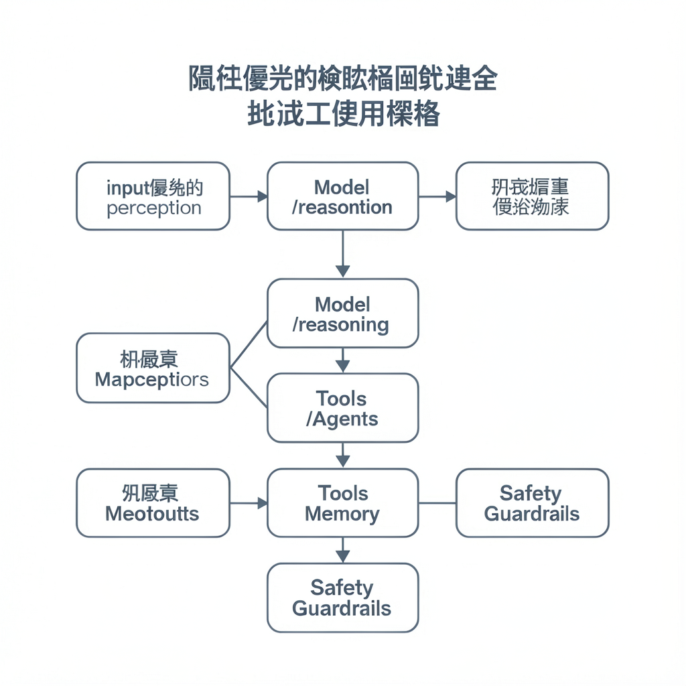

# AI 技術架構深度拆解：隱私優先的檢索增強生成與代理工具使用架構

- 日期：2026-10-29
- 選題理由：今日素材中 MyGPT 論文明確提出「隱私優先、開源的 RAG 平台」，結合生物資訊學論文展示的多步推理與程式碼撰寫能力、醫療新聞強調的合規與以病患為核心、以及網安專案的異常偵測需求，共同指向一種具備檢索增強、工具調用、記憶管理與隱私保護的代理式架構。此架構為當前產業落地最具代表性的技術範式。

## 一、架構原理與核心機制
架構包含五大核心層： 1. 輸入/感知層：接收多模態輸入（文字、程式碼、醫療影像、日誌、感測器資料），經由資料清洗、去識別化（PII 脫敏）、分塊與向量化（嵌入模型）後寫入向量資料庫。支援串流與批次兩種攝取模式，並提供資料血統追蹤。 2. 模型推理層：以開源 LLM（如 Llama 3、Qwen 2.5）為骨幹，採用指令微調與偏好對齊（DPO/RLHF）強化領域知識與工具調用能力。推理時採用「思維鏈 + 工具調用」雙軌：先由規劃器分解任務，再依步驟決定是否呼叫外部工具（程式碼執行器、SQL 查詢、影像分析模型、檢索器）。支援函數呼叫格式與結構化輸出（JSON Schema），確保下游可解析。 3. 工具與代理協作層：定義標準化工具介面（OpenAPI/Function Calling），包含： - 程式碼沙箱：安全執行 Python/R，支援資料分析、生物資訊管線、統計建模。 - 領域知識庫檢索器：混合稀疏/稠密檢索（BM25 + 向量），支援重排序與引用追溯。 - 專用模型適配器：醫療影像分割、日誌異常偵測、船舶航行軌跡預測等垂直模型。 - 多代理協作：規劃代理、執行代理、審核代理分工，透過訊息總線（如 Kafka/NATS）非同步協調，支援人工介入檢查點。 4. 記憶/資料層： - 短期記憶：對話上下文視窗（滑動窗口 + 關鍵資訊壓縮）。 - 長期記憶：向量資料庫（Milvus/Weaviate/pgvector）儲存領域知識與使用者偏好；圖資料庫（Neo4j）建構實體關係圖譜，支援多跳推理。 - 隱私保護：資料最小化、聯邦學習選項、差分隱私噪聲注入、本地部署優先，符合 GDPR、HIPAA、個資法。 5. 輸出與監控層：產生結構化回應（文字、圖表、程式碼、報告），附帶引用來源與信心分數。監控包含：延遲、Token 成本、檢索命中率、工具成功率、幻覺檢測（一致性檢查）、安全違規攔截。提供審計日誌與模型版本治理（MLflow/Weights & Biases），支援藍綠部署與金絲雀發布。

## 二、海事領域應用（含實際例子）
情境一：智慧船隊狀態感知與異常預警 輸入資料：AIS 軌跡、引擎感測器串流、天氣預報、港口作業日誌、維修紀錄。 系統運作：感知層即時攝取串流資料，經去噪後寫入時序資料庫與向量庫。代理規劃器將「異常偵測」分解為軌跡偏移分析、引擎振動頻譜比對、天氣風險評估三個子任務，分別調用統計異常檢測工具、領域知識檢索器（歷史故障案例）、天氣 API。審核代理交叉驗證結果，生成含信心分數的預警報告並推送至岸端調度系統。 價值：將故障前兆偵測時間從小時級縮短至分鐘級，降低非計畫停航成本。 風險：海上通訊斷續導致資料缺口；模型對罕見故障模式泛化能力有限，需人工複核。 情境二：港口作業優化與碳排監測 輸入資料：堆場吊掛作業日誌、卡車進出閘口紀錄、船舶靠離泊時間表、燃油消耗報表。 系統運作：代理將「碳排優化」轉化為多目標排程問題，調用程式碼沙箱執行強化學習/啟發式演算法，檢索國際海事組織（IMO）法規與港口作業最佳實務作為約束條件。輸出調度建議與碳排試算報表，附引用法規條文。 價值：協助港口符合 IMO CII/EEXI 法規，減少怠速等待與空駛里程。 風險：排程建議若未考慮即時突發狀況（如突發設備故障）可能導致連鎖延誤，需保留人工覆寫機制。

## 三、醫療領域應用（含實際例子）
情境一：罕見胃腸道病變輔助診斷與醫學訓練 輸入資料：內視鏡影像、病理切片、電子病歷結構化欄位、醫學文獻知識庫。 系統運作：感知層將影像經去識別化後送入分割模型產生病變候選區域；規劃代理啟動「一樣本合成」工具（參考 Nature Communications 論文）生成合成病變影像擴充訓練集，並檢索最新臨床指引與相似病例。診斷代理綜合影像特徵、病理報告、指引建議，輸出結構化診斷意見與信心區間，附引用文獻 DOI。 價值：提升罕見病變偵測敏感度，降低漏診率；合成資料緩解資料稀缺，加速醫師訓練。 合規風險：屬醫療器材軟體（SaMD），需 TFDA/CE/FDA 認證；合成資料若未嚴格驗證可能引入偏差；病患資料跨機構流動需符合醫療法與個資法。 情境二：洗腎病患個體化照護決策支援 輸入資料：血液生化數值、透析機參數、體重變化、用藥紀錄、護理紀錄文字。 系統運作：代理每日自動抓取最新檢驗值，檢索 KDIGO 指引與醫院照護協定，調用程式碼沙箱計算乾體重建議、鐵劑/促紅素劑量調整方案。審核代理檢查藥物交互作用與過敏史，生成給醫護團隊的「照護建議單」，標註需醫師核簽欄位。 價值：標準化照護流程，減少醫療差異，支援北榮臺東分院等基層院所提升專科照護品質。 合規風險：建議單屬臨床決策支援（CDS），若被視為診斷工具需更嚴格驗證；資料本地化部署與存取控制為必要條件。

## 四、其他產業應用（含實際例子）
情境一：企業內部知識管理與程式碼生成助手 輸入資料：內部 Wiki、技術文件、程式碼庫、Issue 追蹤系統、會議逐字稿。 系統運作：工程師以自然語言提問（如「如何實作分散式追蹤？」），代理檢索相關文件與程式碼片段，調用程式碼沙箱驗證片段可執行性，生成含單元測試的實作建議與架構決策記錄（ADR）草稿。 價值：縮短新人上手時間，保留組織隱性知識，程式碼品質與一致性提升。 情境二：金融合規文件自動審閱與風險摘要 輸入資料：法規更新公文、內部作業手冊、交易異常報表、客戶 KYC 資料。 系統運作：代理監控法規來源（金管會、央行網站），增量更新向量庫。合規人員輸入「最新洗錢防制辦法對跨境轉帳影響」，系統檢索條文差異、對應內部條款、歷史缺失案例，輸出差異比較表、影響範圍評估、待辦行動清單。 價值：將法規變更響應時間從週級縮短至日級，降低合規罰鍰風險。

## 五、限制、風險與治理建議
1. 檢索品質高度依賴嵌入模型與分塊策略，長文脈與多跳推理仍易遺漏關鍵證據。 2. 工具調用鏈越長，錯誤傳播機率指數上升，需嚴格的審核代理與人工介入檢查點，增加延遲與成本。 3. 隱私優先設計（本地部署、去識別化）犧牲部分模型效能與資料豐富度，聯邦學習通訊開銷大。 4. 開源模型在專業領域（醫療、海事法規）的零樣本能力仍遜於閉源大模型，需持續投入領域適配微調。 5. 審計與解釋性機制尚未標準化，難以滿足高風險領域（醫療器材、金融核心）的監管審查要求。

## 參考來源
- https://pubmed.ncbi.nlm.nih.gov/43073267/
- https://pubmed.ncbi.nlm.nih.gov/42958757/
- https://news.google.com/rss/articles/CBMib0FVX3lxTE1ja3Y4TmgwRDJTVjlYdk5HVWZvOEdPbFVIRlFwRVhkTDRKMVlESmRNQWVMSWZ3VW5hZFU2RlI0Wk1IMjVfWnEwc0NHU2RET2FnMUxraXY1WjNuU09GZko0THRWblI4MDRuV2E4cXU4aw?oc=5
- https://news.google.com/rss/articles/CBMimAFBVV95cUxQdFZENkhzcFFJb3JIZmlETk1ndFRpdnN4WS1xMzFfLXRvWjdrUGtSS3ZpeTg4Zk5Wa2lJZXY5MHQ5STFDamFlZUVsNGUwWHZ6ZFNRLXhTU2RxTzA0WWo3V2ZOUm10S3F2MHgtM0xjamp2OE8yTnZQZkd5QTRIT2dZX18xd0JtY21YT05HUWlEMExKNURBN3pKUA?oc=5
- https://github.com/slrbl/Intrusion-and-anomaly-detection-with-machine-learning
- https://pubmed.ncbi.nlm.nih.gov/42284175/
