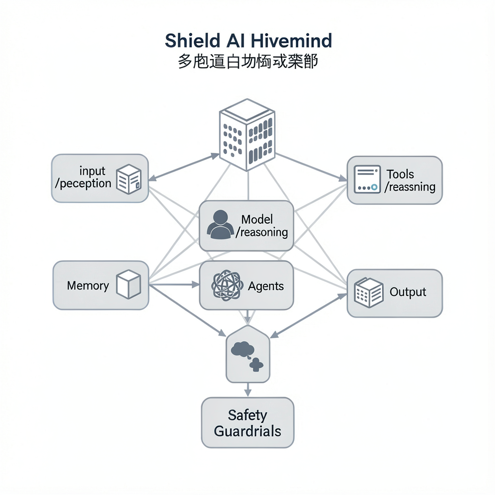

# AI 技術架構深度拆解：Shield AI Hivemind 多代理自主協同架構

- 日期：2026-11-05
- 選題理由：今日新聞中雷虎科技攜手 Shield AI 公開展示「Hivemind」於多艇協同作戰，實證了去中心化多代理自主架構在真實海事環境的邊緣部署與即時協調能力，具備感知-規劃-控制閉環與跨平台互操作性，為當前最具代表性的具身多代理架構落地案例。

## 一、架構原理與核心機制
Hivemind 採模組化自主堆疊，核心包含五層： 1. 感知/輸入層：融合多艇上的光電、雷達、AIS、GNSS/INS 與通訊鏈路資料，經由時空對齊與多模態融合產生共同作戰圖像（COP），支援去中心化狀態估計。 2. 模型推理層：在邊緣算力（NVIDIA Jetson AGX Orin / x86）上執行輕量化深度神經網路進行目標檢測、分類與意圖推斷；規劃模組採用混合 A*/RRT* 與強化學習策略，產生避障、編隊、交戰等行為軌跡。 3. 代理協作層：採發布/訂閱制戰術總線（基於 DDS/Zenoh），各代理廣播意圖、狀態與任務分配訊息，透過共識演算法（如 CBBA、市場機制）完成任務分解與角色指派，無中央指揮單點故障。 4. 記憶/資料層：本地保留任務日誌、感知快照與策略經驗回放緩衝區；任務後同步至雲端進行離線訓練與策略蒸餾，支援聯邦學習更新邊緣模型。 5. 輸出與監控層：低階控制器將軌跡轉為舵機/推進器指令；健康管理模組監測通訊延遲、算力負載與感知品質，觸發降級模式（如失聯自主歸航）。部署採容器化（K3s）與 OTA 更新，確保異構平台一致性。

## 二、海事領域應用（含實際例子）
情境一：港口巡邏編隊。輸入：多艘無人艇的雷達/光電串流、AIS 目標、海圖與氣象資料。系統運作：各艇獨立感知融合後發布 COP，CBBA 分配巡邏區塊與攔截任務，規劃器生成無碰撞航徑，戰術總線同步編隊幾何。價值：單一操作員監管 5-10 艇，覆蓋率提升 3 倍；風險：通訊干擾導致共識失效、感知盲區誤判漁船。 情境二：反潛/水下管線檢查協同。輸入：拖曳聲納、側掃聲納、水下定位信標。系統運作：水面艇與無人潛航器（UUV）異構協同，聲納資料經邊緣推理產生接觸報告，Hivemind 分配 UUV 重新獲取與分類，水面艇提供中繼與數據回傳。價值：縮短偵蒐-確認循環至分鐘級；風險：水聲通訊高延遲/低頻寬削弱即時協調，模型對非訓練目標泛化受限。

## 三、醫療領域應用（含實際例子）
情境一：院際急重症轉診醫療運輸編隊。輸入：救護車/直升機遙測、患者生理訊號、醫院床位與專科醫師排程、路況與氣象。系統運作：各運輸載具為代理，共享患者狀態與資源可用性，CBBA 分配最佳接收醫院與護送路徑，規劃器動態避開擁塞與禁飛區，健康管理監控醫療設備電量與通訊品質。價值：縮短門到球oon 時間、優化區域資源調度；合規風險：患者隱私資料跨機構傳輸需符合 HIPAA/個資法，醫療決策最終責任歸屬醫師非演算法。 情境二：手術室多機械臂協同輔助。輸入：內視鏡影像、力覺回饋、術前影像配準、器械位姿。系統運作：主刀機械臂與持鏡/吸引機械臂為代理，共享術野語義地圖，意圖識別模組解讀醫師手勢/語音指令分配子任務，阻抗控制確保安全交互。價值：減少醫師疲勞、提升精度；合規風險：醫療器材軟體等級（IEC 62304 Class C）驗證嚴格，模型更新需再認證，責任鏈複雜。

## 四、其他產業應用（含實際例子）
情境一：智慧倉儲異構機器人編隊。AGV/AMR、無人叉車、巡檢無人機共享倉儲數位孿生地圖，透過戰術總線協調貨架搬運、庫存盤點與充電排程，動態重規劃避開擁塞區，單一調度員管理百台設備。 情境二：離岸風電場巡檢與維修協同。水面無人艇攜帶無人機與爬壁機器人，共享結構健康監測資料，Hivemind 分配近距離目視/超音波檢查任務，邊緣推理識別裂紋腐蝕並即時產出報告，降低人員登機風險與作業窗口需求。

## 五、限制、風險與治理建議
1. 通訊依賴性：高動態海況下視距外鏈路易中斷，去中心化共識在高延遲/丟包環境可能震盪或分裂。2. 邊緣算力限制：模型量化導致精度損失，長尾目標檢測率下降。3. 驗證與認證缺口：軍民雙用自主系統缺乏統一適航/航安標準，責任歸屬模糊。4. 對抗脆弱性：感知模型易受對抗樣本、GPS 欺騙與通訊干擾攻擊。5. 資料治理：多國水域作業涉及資料主權與出口管制，聯邦學習跨境同步面臨法規障礙。

## 參考來源
- https://news.google.com/rss/articles/CBMijAFBVV95cUxNZUN0NG9XRVVJZDBkX0NYNlJPY2FLVmpqM3NCZnc3RkdoUEplOFVZT19KV3U3MHFfVGtwQjhNN3RKd2tmVDdVaGtaeVd6aDVNRVRFQ2o4el9uVGJ1Z2xSdzZydUx1UjRSSXdINmZOcS05MXYxeVRCRzUyVHYtRUxobmtvSjVTSkNIbTJ4eQ?oc=5
- https://pubmed.ncbi.nlm.nih.gov/43054956/
- https://pubmed.ncbi.nlm.nih.gov/43054955/
- https://github.com/FastCrest/tether
