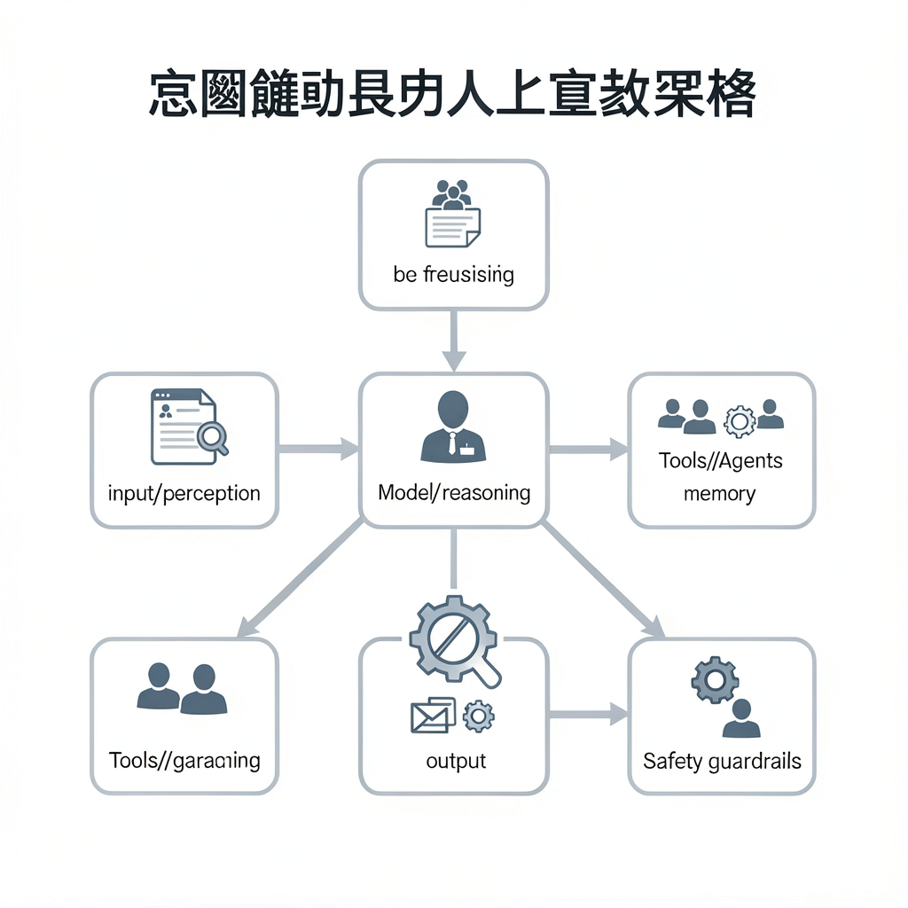

# AI 技術架構深度拆解：訓練自由代理式多模態架構

- 日期：2026-11-12
- 選題理由：今日素材中 LesionAgent（arXiv 2611.27876）與 Omnissa 專訓均指向同一趨勢：不再微調大模型，而是以「代理式工作流」串聯預訓練多模態基座、外部知識庫與工具鏈，實現零樣本適應。此架構同時出現在醫療影像追蹤、RAG 知識接地、邊緣推理引擎（MNN）與雲端代理服務中，具備跨領域代表性。

## 一、架構原理與核心機制
核心機制包含五層： 1. 輸入/感知層：接收多模態資料（CT 序列、航運感測器串流、電子病歷文字、基因組表達矩陣），經標準化前處理（DICOM 標準化、NMEA 解碼、FHIR 映射）後，由多模態編碼器（如 CLIP、BioMedCLIP、衛星影像 ViT）投影至共享潛空間。 2. 模型推理層：採用凍結的基座模型（LLaVA-Med、GPT-4o、Hyperbolic LLM），不更新權重。推理採「思維鏈 + 工具調用」雙軌：規劃器分解任務為子目標，執行器依序呼叫分割模型（nnU-Net）、檢索器（向量資料庫）、物理模擬器（船體阻力 CFD）、藥物交互作用 API。 3. 工具/代理協作層：以 LangGraph / AutoGen 定義有向無環圖（DAG），節點為可替換工具（分割、配準、檢索、計算、通訊），邊攜帶結構化中間產物（JSON Schema）。代理具備「觀察-規劃-行動-反饋」迴路，支援人工介入檢查點。 4. 記憶/資料層：短期記憶以對話緩衝區（Redis）保存上下文；長期記憶分為情節記憶（向量庫 Milvus 存放歷史案例嵌入）、語義記憶（知識圖譜 Neo4j 儲存領域本體：航道規則、腫瘤分期準則、藥物代謝途徑）、程序記憶（工作流模板版本控管）。RAG 檢索採混合檢索（BM25 + 稠密向量 + 圖遍歷），並以重排序器（BGE-Reranker）提升精度。 5. 輸出與監控層：產出結構化報告（FHIR DiagnosticReport、IMO 風險評估 XML）、可視化覆蓋圖、決策解釋（SHAP/LIME）。監控指標含延遲 P99、工具成功率、幻覺檢測（SelfCheckGPT）、資料漂移（KS 測試）、合規稽核日誌（HIPAA、IMO、GDPR）。部署採混合雲邊：邊緣節點跑 MNN/ONNX Runtime 執行輕量推理與預處理，雲端跑重型基座與知識圖譜，雙向同步採用 gRPC + mTLS。

## 二、海事領域應用（含實際例子）
情境一：智慧航線優化與減碳決策支援。輸入資料：AIS 軌跡、氣象預報（ECMWF）、船舶性能曲線、港口作業窗口、CII/EEXI 法規參數。系統運作：代理依序呼叫（1）航海圖向量檢索最佳航道、（2）物理模擬器估算不同航速/航線的燃油消耗與排放、（3）法規知識圖譜驗證合規性、（4）多目標優化器（NSGA-III）產出帕累托前緣。價值：單航次省油 3-5%，CII 等級提升；風險：極端天氣下物理模型外推誤差、AIS 訊號缺失導致軌跡插值偏差。 情境二：船隊狀態基礎預測性維護。輸入資料：主機缸壓波形、潤滑油鐵譜、振動頻譜、維修紀錄文字。系統運作：多模態編碼器將時序訊號與維修日誌對齊嵌入，代理檢索歷史故障案例，呼叫殘餘壽命預測模型（Transformer-based RUL），生成維修工單與備品備料建議。價值：非計畫停機降低 20%；風險：感測器漂移造成標籤噪聲、跨船型遷移性有限。

## 三、醫療領域應用（含實際例子）
情境一：縱向 CT 腫瘤追蹤與療效評估（LesionAgent 實例）。輸入資料：患者多期 CT（DICOM）、放射科報告（結構化 RECIST）、基因突變面板。系統運作：代理以 nnU-Net 分割基準期病灶，呼叫配準工具（Elastix）對齊隨訪影像，計算體積變化率，檢索 NCCN 指引知識圖譜判斷療效分類（CR/PR/SD/PD），自動生成結構化報告草稿供醫師覆核。價值：讀片時間縮短 40%，評估一致性提升；合規風險：屬 FDA SaMD Class II，需 510(k) 清關，資料去識別化須符 HIPAA Safe Harbor。 情境二：多模態腫瘤學基座模型輔助診斷（Nature Cancer 多模態基座）。輸入資料：全切片影像（WSI）、空間轉錄體、臨床表型。系統運作：代理協調病理基座（UNI/Conch）提取形態特徵、空間轉錄體編碼器提取微環境特徵，融合後檢索同質患者隊列生存曲線，輸出分層風險分數與臨床試驗匹配建議。價值：精準分層提升 15% C-index；合規風險：跨國資料傳輸需符 GDPR 第 46 條、模型解釋性需滿足 EU AI Act 高風險 AI 要求。

## 四、其他產業應用（含實際例子）
情境一：晶圓廠製程異常偵測與根因分析。輸入：設備感測器高頻時序（OPC-UA）、製程參數日誌、維護知識庫。代理串聯異常檢測（Isolation Forest）、知識圖譜推理（因果鏈追溯）、模擬器驗證（TCAD），輸出根因報告與參數調整建議，預估良率提升 0.5-1.2%。 情境二：金融合規自動化審查（KYC/AML）。輸入：客戶身分證件、交易流水、制裁名單、負面新聞。代理呼叫 OCR、實體連結、圖神經網路洗錢模式檢測、法規檢索器，生成可追溯的審查紀錄與風險等級，人工複核時間縮減 60%。

## 五、限制、風險與治理建議
1. 基座模型凍結導致領域知識更新滯後，需依賴 RAG 知識庫即時性，若知識庫過時將產生系統性錯誤。2. 代理工作流長鏈條放大單點失敗率，工具回傳格式不一致易觸發級聯錯誤，需嚴格 Schema 契約與熔斷機制。3. 多模態對齊品質受限於預訓練資料分布，罕見病理型態或極端海況下嵌入空間外推不可靠。4. 邊緣部署記憶體限制（MNN 量化至 INT4）可能導致推理精度下降 2-4%，需逐案驗證。5. 合規層面：醫療涉 SaMD 認證、海事涉 IMO MSC.1/Circ.1638 網安規範、金融涉巴塞爾 III 模型風險管理，跨域部署合規成本高。

## 參考來源
- http://arxiv.org/abs/2611.27876v1
- https://github.com/MIC-DKFZ/LesionAgent
- https://www.msn.com/en-in/technology/artificial-intelligence/ai-is-moving-from-something-we-use-to-acting-on-our-behalf-omnissa-s-amit-singh/ar-AA2i1lIn
- https://www.msn.com/en-in/news/other/before-ai-answers-it-searches-how-rag-connects-language-models-to-external-knowledge/ar-AA2i1dQr
- https://github.com/alibaba/MNN
- https://doi.org/10.1038/s42256-026-01328-3
