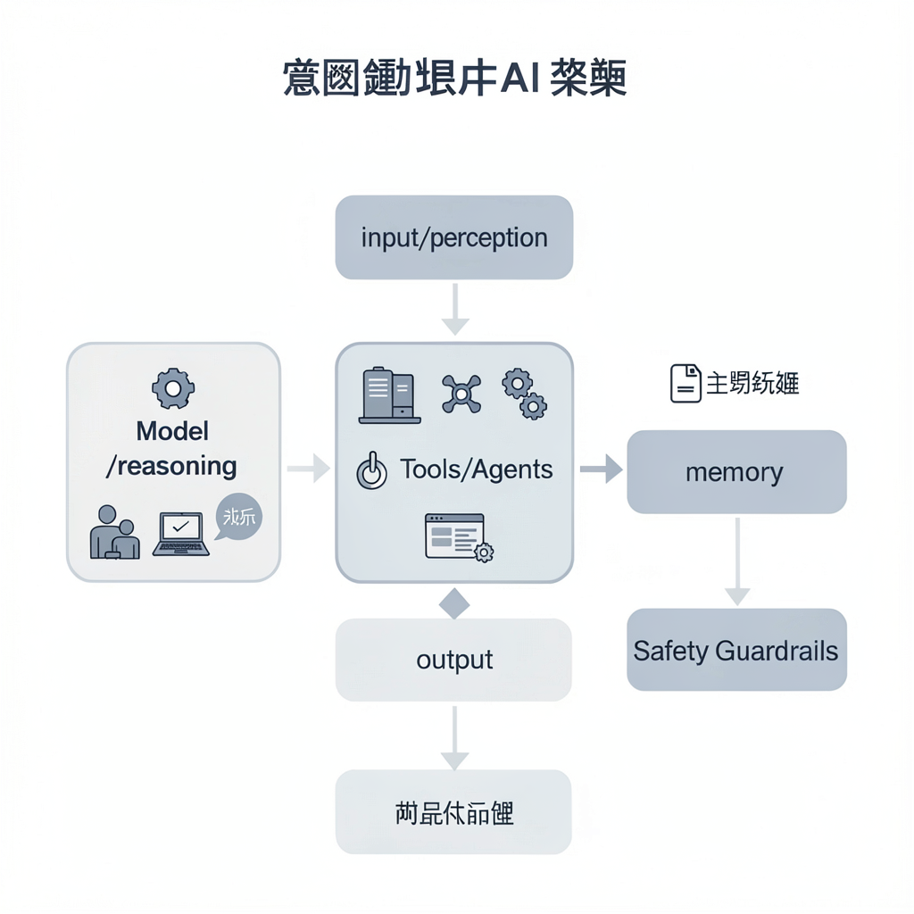

# AI 技術架構深度拆解：AutoMaster：自主後訓練架構

- 日期：2026-11-19
- 選題理由：今日選擇AutoMaster，核心在於其創新的自主後訓練架構：同一模型透過自我蒸餾扮演更優教師，無需額外標註數據即可持續優化，大幅降低訓練成本與資料依賴，並展現出強大的泛化與適應能力，精準回應產業對AI自主進化、低門檻部署的迫切需求，並為後續多模態與具身智能奠定堅實基礎。

## 一、架構原理與核心機制
架構包含五大層： 1. 輸入/感知層：接收原始語料、任務指令與環境回饋，經由資料清洗、格式統一與向量化後送入核心。 2. 模型推理層：基座模型在推理階段同時扮演學生與教師角色，學生端產生候選輸出，教師端依據自定義評分函數（如一致性、多樣性、任務指標）對候選進行打分。 3. 工具/代理協作層：引入外部工具（檢索增強、程式碼執行、知識圖譜查詢）與多代理協調機制，教師代理可動態調用工具驗證學生輸出，並將驗證結果回傳至評分模組。 4. 記憶/資料層：維護長期經驗庫與短期情境緩存，經驗庫儲存高分樣本、錯誤案例與工具調用軌跡，供後續迭代檢索；情境緩存保留當前任務的多輪互動歷史，確保上下文一致。 5. 輸出與監控層：經過多輪自我蒸餾後，輸出最終優化模型權重與訓練日誌；監控模組即時記錄損失曲線、評分分佈、工具調用成功率與資源消耗，支援自動早停與異常告警。整體流程形成閉環：感知→推理→工具驗證→記憶更新→輸出，實現無人工介入的持續自我改進。

## 二、海事領域應用（含實際例子）
情境一：航線優化決策支援。輸入資料包含 AIS 軌跡、氣象預報、港口作業時刻表。系統以 AutoMaster 迭代生成多候選航線，教師代理呼叫航海模擬器評估油耗與風險，經驗庫累積歷史最優航線。價值：自動產出兼顧減碳與準時的航線建議，降低人工規劃成本。風險：模擬器模型若未涵蓋極端海況，可能產生過度激進路徑。 情境二：船舶設備預測性維護。輸入為引擎感測器時間序列、維修紀錄。學生模型預測故障機率，教師代理調用故障知識圖譜驗證預測合理性，錯誤案例存入經驗庫供下輪修正。價值：提前發現潛在故障，減少非計畫停機。風險：感測器噪聲與資料缺失可能導致誤判，需人工複核關鍵警報。

## 三、醫療領域應用（含實際例子）
情境一：臨床指南自動更新與解釋。輸入為最新醫學文獻、指南文本、病例資料。AutoMaster 讓模型自行生成指南摘要與推薦治療路徑，教師代理呼叫醫學知識庫與藥物交互檢查工具驗證，經驗庫保存專家審核通過的版本。價值：加速指南知識落地，輔助醫師快速掌握新證據。合規風險：輸出必須經醫師確認，不可直接作為處方依據，系統需記錄審核軌跡以符合醫療器材法規。 情境二：影像輔助診斷模型持續微調。輸入為多中心影像資料與標註品質指標。學生模型產生診斷熱力圖，教師代理利用放射科專家標註樣本與一致性檢查工具評分，低分樣本回存經驗庫供再訓練。價值：降低標註成本並提升模型泛化。合規風險：跨機構資料傳輸需符合個資法與 HIPAA，模型更新須經臨床驗證才能上線。

## 四、其他產業應用（含實際例子）
情境一：程式碼生成與自動重構平台。輸入為專案原始碼、測試套件與需求文檔。AutoMaster 讓模型產生重構方案，教師代理執行測試與靜態分析工具驗證，經驗庫累積通過測試的重構模式。價值：減少開發人員重複勞動，提升代碼品質。 情境二：客服對話系統自我優化。輸入為歷史對話紀錄、知識庫與滿意度評分。學生模型生成回覆候選，教師代理呼叫情感分析與知識檢索工具打分，低分對話存入經驗庫供後續微調。價值：持續提升對話品質並降低人工標註需求。

## 五、限制、風險與治理建議
1. 自我評分函數設計若存在盲點，會導致模型強化錯誤模式。2. 工具調用延遲與失敗率直接影響迭代效率，需高可用基礎設施。3. 經驗庫增長可能引入偏差，需定期人工審核與清洗。4. 缺乏外部專家標註的基準測試，難以量化絕對性能提升。5. 部署於高風險領域（醫療、航運）時，仍須保留人工把關機制，無法完全替代專業判斷。

## 參考來源
- https://arxiv.org/abs/2611.26510v1
- https://github.com/RUCAIBox/AutoMaster
- https://tw.news.yahoo.com/ai%E7%B5%90%E5%90%88%E6%B5%B7%E4%BA%8B%E5%B0%88%E6%A5%AD%E9%96%8B%E5%89%B5%E8%88%AA%E9%81%8B%E6%96%B0%E5%B1%80-%E5%BC%B7%E5%8C%96%E7%87%9F%E9%81%8B%E6%B1%BA%E7%AD%96-%E5%AE%89%E5%85%A8%E7%AE%A1%E7%90%86%E8%88%87%E6%B8%9B%E7%A2%B3%E6%95%88%E7%9B%8F-100359130.html
- https://inews.hket.com/article/4228931/%E3%80%90AI-%E9%86%AB%E7%99%82%E3%80%91%E8%9E%9E%E8%9F%BB%E9%9F%93%E6%AD%86%E6%AF%85%EF%BC%9AAI%E5%83%85%E8%BC%94%E5%8A%A9%E3%80%81%E8%87%A8%E5%BA%8A%E6%B1%BA%E7%AD%96%E5%BF%85%E9%A0%88%E4%BA%A4%E4%BA%88%E9%86%AB%E7%94%9F%E3%80%80%E7%94%A8%E6%88%B6%E7%AA%81%E7%A0%B41.5%E5%84%84
