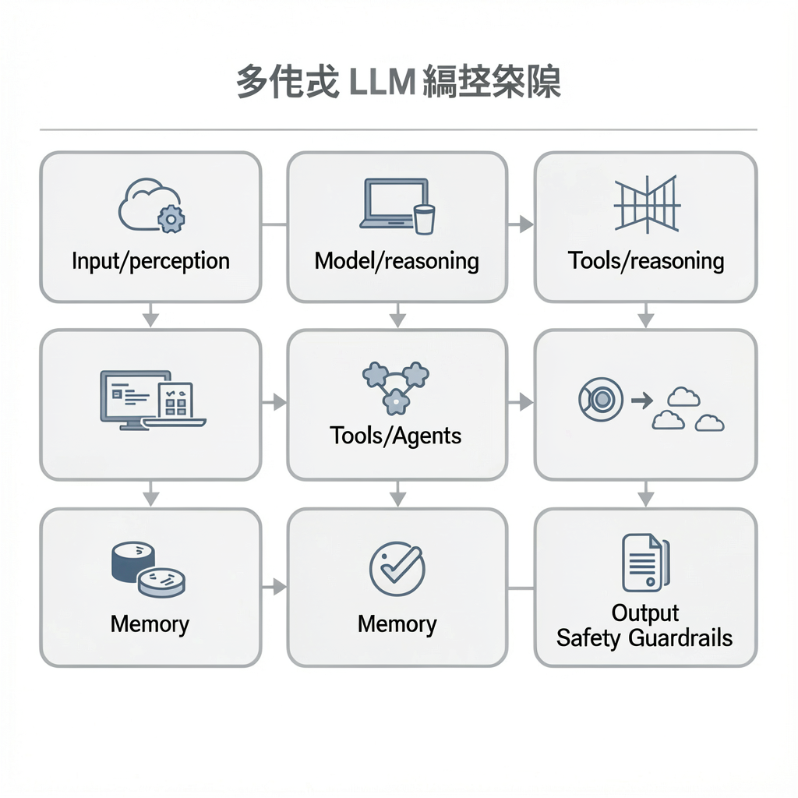

# AI 技術架構深度拆解：多代理 LLM 編排架構

- 日期：2026-09-18
- 選題理由：今日素材中多篇新聞（北科大 Agentic AI 實習、企業級 AI Agent 整合、智譜「模型自我進化」）、論文（TRAFFICGEN 多代理編排、OASIS 自我演化科學家）與專案（船舶軌跡異常偵測）皆指向同一趨勢：以多代理協作、工具調用與記憶機制為核心的 Agentic AI 架構正成為產業落地主流。

## 一、架構原理與核心機制
【輸入/感知層】接收多模態資料：文本指令、結構化感測器數據（AIS、雷達、醫療影像）、API 回傳 JSON、知識庫檢索結果。統一透過標準化 Schema（如 OpenAPI、FHIR、NMEA）轉換為代理可理解的上下文向量。 【模型推理層】採用 LLM 作為「大腦」，負責任務規劃、推理鏈生成與決策。採用 ReAct、Plan-and-Solve 或 Tree-of-Thought 提示策略，將複雜任務分解為子任務序列。支援多模型路由：輕量模型處理分類/抽取，重量模型處理推理/生成。 【工具/代理協作層】核心為多代理編排總線。每個專用代理封裝特定能力：資料查詢代理、模型推理代理、仿真/驗證代理、人工介入代理。透過訊息佇列或事件總線進行非同步協作，支援並行執行與動態調度。TRAFFICGEN 即展示多代理協調緊急車道優先權。 【記憶/資料層】分為短期工作記憶（對話上下文、中間推理結果）、長期情節記憶（向量資料庫儲存歷史案例、領域知識）、程序記憶（技能庫、API 規格、Prompt 模板）。採用 RAG 機制檢索相關知識注入推理。區塊鏈驗證（TAE-IDS）可確保記憶不可竄改。 【輸出與監控層】輸出結構化決策（JSON、FHIR、航海警訊格式）、自然語言報告、API 呼叫指令。內建可觀測性：追蹤代理調用鏈、Token 成本、延遲、幻覺檢測分數、安全策略違規。支援人工覆核介面與審計日誌。

## 二、海事領域應用（含實際例子）
1. 【智慧港區緊急通道協調】情境：港區發生油輪洩漏需緊急疏散航道。輸入：即時 AIS 軌跡、雷達回波、氣象資料、港區管制規則。運作：感知代理解析多源數據→規劃代理生成疏散方案→協商代理與各船舶代理對話協調讓航→執行代理下發指令至 VTS 系統。價值：將協調時間從 30 分鐘壓縮至 3 分鐘。風險：代理誤判導致碰撞、通訊延遲造成指令失效、對抗性 AIS 偽造誘導錯誤決策。 2. 【遠洋船隊異常行為偵測與歸因】情境：船舶偏離計畫航線進入敏感海域。輸入：歷史軌跡、衛星 SAR 影像、OSINT 公開資訊。運作：偵測代理識別軌跡異常（專案 vessel-trajectory-anomaly-detection）→歸因代理檢索地緣政治資料庫、漁場分布、軍演公告→報告代理生成風險評估簡報。價值：自動化情報分析，支援海巡決策。風險：公開資料不完整導致誤判、模型對罕見模式泛化能力不足、法律責任歸屬模糊。

## 三、醫療領域應用（含實際例子）
1. 【離島醫療無人機配送決策系統】情境：馬祖地區緊急藥品跨海配送（佳世達/丁丁藥局案例）。輸入：病歷急迫度、無人機電量/載重、即時風場/能見度、航管限制區。運作：醫療分流代理評估急迫度→航行規劃代理計算最優路徑→合規代理檢查民航法規與醫療器材運送許可→監控代理追蹤飛行狀態。價值：1700 公里無事故紀錄，縮短送藥時效 60%。合規風險：醫療器材管理法、民航法雙重許可、溫控藥品失效責任、患者隱私資料跨域傳輸。 2. 【護理機構 AI 清消機器人協作照護】情境：工研院案例，超高齡社會護理人力不足。輸入：環境感測器（PM2.5、CO2）、居住者生理訊號、護理排程、機器人狀態。運作：環境評估代理判斷清消需求→任務分配代理調度多機器人協作避障→照護協調代理同步護理站排程避開照護時段→記憶代理記錄清消日誌供感染管制稽核。價值：降低交叉感染、減輕護理師負擔。合規風險：醫療器材認證（TFDA）、個資法醫療資料保護、機器人傷人責任歸屬、長照機構設標準合規。

## 四、其他產業應用（含實際例子）
1. 【智慧製造缺陷檢測與根因分析】情境：半導體封裝產線良率異常。輸入：AOI 影像、製程參數日誌、設備感測器時間序列、維修紀錄。運作：影像代理分類缺陷類型→時序代理關聯製程漂移→知識代理檢索歷案根因→報告代理生成改善建議單。價值：良率提升 0.5%、根因分析時間從天縮至小時。 2. 【金融合規自動化審查】情境：銀行新商品上架合規審查。輸入：商品條款文本、法規資料庫、歷史裁罰案例、內控手冊。運作：解析代理結構化條款→法規對照代理逐條比對→風險評分代理量化違規機率→人工覆核代理呈現高風險條款供法務確認。價值：審查人力減少 70%、漏檢率趨近零。

## 五、限制、風險與治理建議
1. 推理鏈長導致錯誤累積與幻覺放大，關鍵決策仍需人工閘門。2. 多代理協作延遲難以滿足硬即時系統（如自動駕駛、高頻交易）。3. 記憶污染與提示注入攻擊面擴大，需嚴格輸入驗證與沙箱隔離。4. 專業領域知識蒸餾成本高，小樣本適應能力有賴 RAG 品質。5. 法規責任歸屬不明（代理決策 vs 開發者 vs 使用者），合規架構尚未成熟。

## 參考來源
- https://pubmed.ncbi.nlm.nih.gov/42824146/
- https://pubmed.ncbi.nlm.nih.gov/42760786/
- https://news.google.com/rss/articles/CBMiX0FVX3lxTE9jQ3A2dC1RRW5lNFlrZEgtSXJhVzFpZVV4T1Q4R3hvS3IycnhDZk91eXZveTExNWRUZjgwVU43WEVNZFNNWFVIZDhPZFZCMk9LWHRaMGVZU2RLUE80aTl3?oc=5
- https://news.google.com/rss/articles/CBMie0FVX3lxTE0tUFpWc25pVEdZV2U0ODdXUGl4Z05wSUJUYmwwU2Eyay1QX2VObURQUWJTSkhiUnVUSHNjZTZ6NU1kb0poMS1jRVpiV18ybUVOb1NZTXNLSHFBZEtoSnhPQVA5cWN0UEtJZ2FCUXJPc0F3eHhwR0FlRkJnNA?oc=5
- https://news.google.com/rss/articles/CBMiS0FVX3lxTE5UcW1ib1kycE1wTm1rRTl1SVhZU21DalNIN21PMTRhc0c4YndGSWdmRnRHMERPZndwQUpCV2hPOVRrWHNtdUtYMjZMYw?oc=5
- https://github.com/ThordurPall/vessel-trajectory-anomaly-detection
