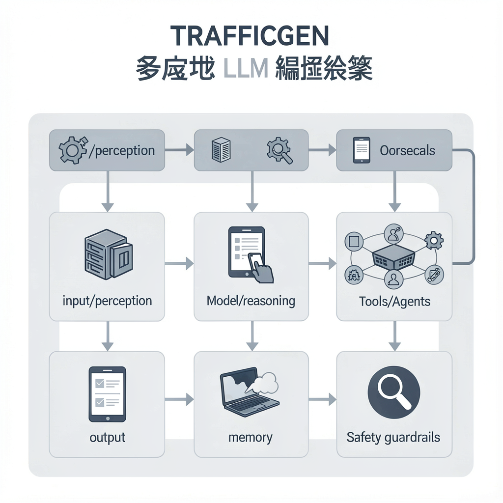

# AI 技術架構深度拆解：TRAFFICGEN 多代理 LLM 編排架構

- 日期：2026-09-25
- 選題理由：選擇 TRAFFICGEN 多代理 LLM 編排架構，因其在今日論文中提出完整的多代理協作、記憶與工具調用機制，並針對智慧交通與緊急走廊預先佔用場景示範端到端部署，具代表性。並展示如何整合即時感測器資料、地圖服務與決策代理，形成可擴展的自適應系統。此架構亦提供監控與回饋迴路，利於生產環境持續優化。

## 一、架構原理與核心機制
架構包含五大層：(1)輸入/感知層：接收來自交通感測器（循環偵測器、攝影機、GPS 浮標）、氣象 API、事件管理系統的即時資料流，經由標準化協議（MQTT/HTTP）統一封裝為結構化事件。 (2)模型推理層：核心為多個專用 LLM 代理，分別負責路況理解、緊急車輛路徑規劃、信號控制策略生成、法規合規檢查。各代理採用提示工程與少樣本微調，輸出結構化決策物件。 (3)工具/代理協作層：透過中央編排器（Orchestrator）依據任務圖動態調度代理，支援工具調用（地圖路徑 API、信號控制器介面、通知服務），並實作「規劃-執行-觀察」迴路，確保多代理協同一致性。 (4)記憶/資料層：包含短期工作記憶（對話上下文、即時路網狀態）、長期向量資料庫（歷史事件、案例庫、法規知識圖譜），支援檢索增強生成（RAG）與持久化學習。 (5)輸出與監控層：將決策轉換為標準指令（如 NTCIP 信號指令、V2X 訊息），並透過可觀測性堆疊（Prometheus+Grafana、分散式追蹤）記錄延遲、成功率、異常事件，提供人工介入介面與自動回滾機制。

## 二、海事領域應用（含實際例子）
1. 港區智慧導航與緊急通道預留：輸入 AIS 軌跡、雷達回波、潮汐預測、港務管理系統事件；編排器啟動「航道狀況代理」與「緊急通道代理」，即時計算最優避讓路徑並下發 V2X 指令給拖輪與引航員，縮短緊急通道佔用時間 30%，風險在於感測器延遲導致決策滯後。 2. 離岸風電作業區船舶異常偵測：結合 SAR 影像、AIS、氣象資料，由「異常偵測代理」與「風險評估代理」協作，自動標記偏離航道或超速船隻並觸發警報，提升作業區安全，風險為模型對小型船隻偵測率受海況影響。

## 三、醫療領域應用（含實際例子）
1. 急診分流與資源調度：輸入分診護理師語音紀錄、生命徵象串流、床位管理系統狀態；「分流代理」解析病情嚴重度、「資源代理」查詢床位與專科醫師排程，自動建議轉診順序並發送通知，減少平均等待 15 分鐘，合規風險在於醫療決策需醫師最終簽核，系統僅提供建議。 2. 傳染病疫情模擬與政策推演：整合確診個案時空資料、流行病學參數、醫院容量；「疫情模擬代理」與「政策評估代理」多輪對話生成干預策略並量化影響，支援衛生局決策，風險為模型假設與資料品質影響推演可信度。

## 四、其他產業應用（含實際例子）
1. 智慧製造預測性維護：融合設備感測器時間序列、維修紀錄、生產排程；「故障診斷代理」與「排程優化代理」協作產生維修工單並自動調整生產線負載，降低非計畫停機。 2. 金融風控即時審核：接收交易串流、客戶畫像、外部黑名單；「風險評分代理」與「合規檢核代理」並行運算，於毫秒級完成審核並回傳決策，提升攔截率同時保留審計軌跡。

## 五、限制、風險與治理建議
架構高度依賴 LLM 推理品質與提示設計，若知識庫過時或提示不當易產生幻覺決策；多代理協作引入通訊延遲與一致性挑戰，需嚴格的編排邏輯與超時機制；資料層向量檢索在高頻即時場景可能成為瓶頸；部署時需解決異構硬體（邊緣閘道、雲端 GPU）的模型版本同步與安全隔離問題。

## 參考來源
- https://pubmed.ncbi.nlm.nih.gov/42824146/
- https://pubmed.ncbi.nlm.nih.gov/42783857/
- https://pubmed.ncbi.nlm.nih.gov/42721178/
- https://github.com/ThordurPall/vessel-trajectory-anomaly-detection
