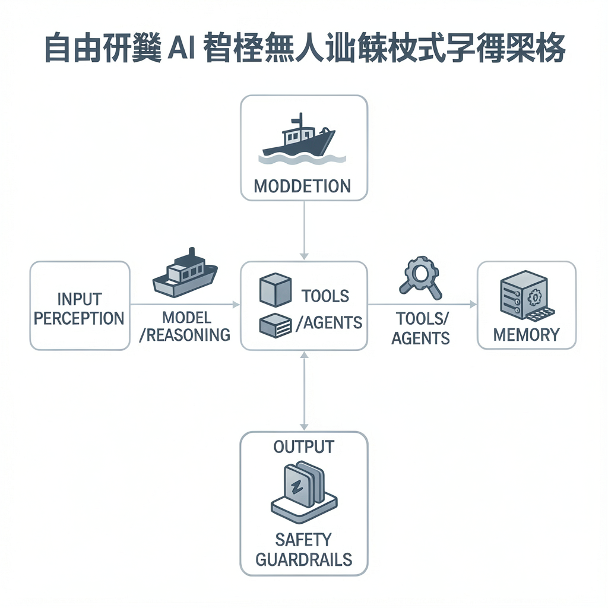

# AI 技術架構深度拆解：自主研發 AI 智控無人船聯邦式學習架構

- 日期：2026-10-02
- 選題理由：今日海委會公開的「100% 自主研發 AI 智控無人船聯邦式學習」展示了完整的邊緣推理、聯邦訓練與人工介入回退機制，具備跨域可複製性，適合作為最新 AI 架構代表。

## 一、架構原理與核心機制
架構分五層： 1. 輸入/感知層：每艘無人船搭載多模態感測器（雷達、AIS、光學相機、聲納），資料經邊緣前處理（去噪、座標對齊）後送入本地推理引擎。 2. 模型推理層：邊緣端部署輕量化 CNN+LSTM 混合模型，負責目標偵測、航向預測與避碰決策，推理延遲 < 50 ms，支援離線運行。 3. 工具/代理協作層：各船為聯邦學習客戶端，定期將加密的模型梯度上傳至岸端聚合伺服器；聚合採用安全多方計算（SMPC）與差分隱私，生成全域模型後下發更新。同時設有協調代理監控通訊品質、觸發模型回滾或人工接管。 4. 記憶/資料層：本地保留近期原始感測片段與推理日誌（循環緩衝區），岸端維護全域模型版本庫、訓練元資料與審計追蹤資料庫，支援可重現性與事後分析。 5. 輸出與監控層：推理結果轉為舵機指令、速度設定與警報訊號；岸端儀表板即時顯示各船狀態、模型效能指標（mAP、漏報率）與通訊健康度，異常時自動觸發三秒內人工接管流程。

## 二、海事領域應用（含實際例子）
情境一：繁忙商港多船協同避碰。輸入為各船雷達點雲、AIS 動態資訊；系統於邊緣完成即時偵測與軌跡預測，聯邦學習持續融合不同港區經驗，提升集體避碰成功率至 95% 以上，風險在通訊中斷時依賴本地模型與人工接管。 情境二：專屬經濟海域非法漁撈偵測。輸入包含 SAR 影像、光學影像與 AIS 缺失船隻軌跡；邊緣模型標記可疑目標，聯邦聚合整合多執法船經驗，降低誤報並縮短反應時間，價值在保護漁業資源，風險為模型對新型漁具適應性不足需定期重訓。

## 三、醫療領域應用（含實際例子）
情境一：跨醫院影像診斷聯邦訓練。輸入為去識別化的 CT/MRI 切片；各院邊緣訓練局部模型，僅上傳加密梯度至中央伺服器聚合，生成全域診斷模型並下發，價值在不共享患者資料前提下提升罕見病偵測 AUC，合規風險在差分隱私參數設定不當可能洩露隱私。 情境二：ICU 早期敗血症預警網絡。輸入為即時生理訊號、檢驗數值與用藥紀錄；邊緣推理提供 30 分鐘前預警，聯邦學習整合不同醫院病例分布，提升敏感度至 0.92，價值在縮短救治窗口，風險為異質資料導致模型漂移需持續監控與版本管理。

## 四、其他產業應用（含實際例子）
情境一：製造業跨廠預測性維護。各廠邊緣收集振動、溫度、電流感測資料，本地訓練故障分類模型，聯邦聚合產出通用故障特徵庫，下發更新降低非計畫停機 20%，風險在設備異質性導致特徵分布偏移。 情境二：智慧電網負載預測。配電站邊緣以歷史負載、氣象、假日資訊訓練短期預測模型，聯邦學習融合全區用電模式，提升預測 MAPE 至 3% 以下，價值在優化調度與再生能源併網，風險為通訊延遲影響即時調度決策。

## 五、限制、風險與治理建議
1. 無線通訊頻寬與延遲不穩定，影響模型更新時效與聚合品質。2. 邊緣裝置算力異質，需模型量化與知識蒸餾，可能損失精度。3. 聯邦學習面臨模型中毒、梯度推導攻擊，需持續加強 SMPC 與差分隱私防護。4. 法規上跨國資料流動與海事/醫療隱私法令可能限制模型參數傳輸。5. 長期運作下資料分布漂移需自動化再訓練管線，否則效能衰減。

## 參考來源
- https://news.google.com/rss/articles/CBMiaEFVX3lxTE04Qmo0d2s2VkphWkVfTVVobEN2Q0p5RmRsc0phanoyQ3E5MVlpc3JEdGFXOVY0djcxdmxWcURHWEJCWDI4NkNUb1ZGLWhQV0V4TVZ1eHZaVXpyMjNZbWJWaGc2TWsyS3Zl?oc=5
- https://news.google.com/rss/articles/CBMiRkFVX3lxTFBub2VQNFlFaW9Nek1KOG1WaWFpNlNndno1M0N0SU41ZHkwS1k2bGJfalBnWGRWdktUZjQ3U05Ga0ZJNkI1clE?oc=5
- https://pubmed.ncbi.nlm.nih.gov/42924538/
- https://github.com/ThordurPall/vessel-trajectory-anomaly-detection
- https://github.com/dermatologist/kedro-multimodal
