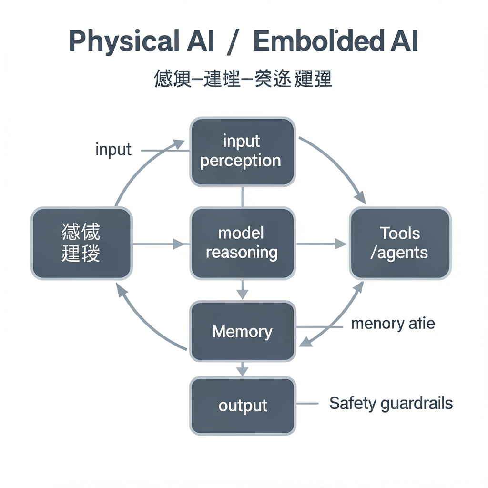

# AI 技術架構深度拆解：Physical AI / Embodied AI 架構：感知-推理-建模-互動 (PRMI) 閉環

- 日期：2026-10-09
- 選題理由：今日素材中 IEEE TPAMI 發表的 Physical AI 綜述論文系統定義了感知-推理-建模-互動四元架構，並與 GPT-6 Astra 實車路考、MAGIC 視覺語言導航、PGNet 海事船舶偵測、護理師 AI 工具等多領域落地案例同步出現，顯示此架構已從理論走向跨域部署關鍵節點，具代表性。

## 一、架構原理與核心機制
Physical AI 架構核心為感知-推理-建模-互動 (PRMI) 閉環。 1. 輸入/感知層：整合多模態感測器資料（視覺、雷達、LiDAR、生理訊號、AIS 航跡、電子病歷文本）。採用編碼器將異構資料映射至統一潛在空間，並透過特徵對齊模組（如 PGNet 的 Progressive Feature Alignment）處理時空不一致與雜訊。 2. 模型推理層：以大型基礎模型（LLM/VLM）為核心推理引擎，結合思維鏈、工具調用、代理規劃。MAGIC 採用 Meta-Ability Guided Interactive Chain-of-Distillation，將導航任務分解為子能力並蒸餾至輕量模型；GPT-6 Astra 則在推理層引入世界模型預測車輛動力學與交通規則約束。 3. 工具/代理協作層：推理層輸出結構化動作指令，透過工具介面調用底層控制器（車輛 CAN 總線、船舶舵機、醫療資訊系統 API）、檢索增強生成 (RAG) 查詢知識庫、或啟動專用模型（如船舶偵測器、異常軌跡分類器）。代理之間透過訊息總線協作，支援多代理協同（如多船編隊、醫療多科會診）。 4. 記憶/資料層：包含情景記憶（近期感知-動作軌跡）、語義記憶（領域知識圖譜、法規條文）、程序記憶（技能庫、提示詞模板）。採用向量資料庫與圖資料庫混合儲存，支援線上持續學習與離線蒸餾更新。 5. 輸出與監控層：執行動作後回收環境回饋（狀態變化、人工介入標記、安全違規事件），構建閉環資料流。部署端邊雲協同：邊緣端執行低延遲感知與控制，雲端負責重訓練、模型版本管理、合規稽核日誌。監控指標涵蓋任務成功率、安全違規率、推理延遲、模型漂移度。

## 二、海事領域應用（含實際例子）
情境一：港區智慧船舶交通管制。輸入資料：AIS 軌跡、岸基雷達/光學影像、氣象海象、港區作業排程。系統運作：感知層融合多源資料建立統一態勢圖；推理層以 VLM 預測船舶意圖與碰撞風險；代理層自動生成避讓建議並透過 VHF/數位通訊下發；記憶層累積近失事件庫供離線強化學習。價值：降低人工監管負載、提升擁擠水域通航效率。風險：感測器盲區導致誤判、通訊延遲造成指令失效、模型對罕見船型泛化不足。 情境二：遠洋貨輪自主航行輔助。輸入資料：船載雷達/光學/紅外影像、電子海圖、引擎狀態、衛星通訊回傳氣象。系統運作：感知層即時偵測小型漁船、浮標、冰塊（PGNet 風格偵測器）；推理層規劃最省油且合規航路；代理層控制自動駕儀與主機轉速；監控層記錄偏離航線事件供事後審計。價值：減少船員疲勞、優化燃油消耗。風險：極端海況感知失效、網路斷線導致雲端協同中斷、國際海事組織 (IMO) 法規合規認證尚未完備。

## 三、醫療領域應用（含實際例子）
情境一：急診分流與臨床決策支援。輸入資料：病患主訴文本、生命徵象串流、既往病歷結構化資料、影像報告。系統運作：感知層以多模態編碼器對齊文本與時間序列；推理層 LLM 結合醫學知識圖譜生成鑑別診斷與建議檢查；代理層自動下單檢驗、推送醫囑至 HIS；記憶層記錄醫師覆核修正供持續微調。價值：縮短分流決策時間、降低漏診率。合規風險：屬醫療器材軟體 (SaMD) 需 TFDA/FDA 核准、模型解釋性需滿足醫師審核門檻、病患隱私資料跨雲端傳輸需符合 HIPAA/個資法。 情境二：護理師長照照護機器人協作。輸入資料：病床壓力感測器、攝影機姿態估計、護理紀錄語音輸入、用藥條碼掃描。系統運作：感知層偵測跌倒風險、體位變換需求；推理層依照照護規範生成作業流程；代理層控制移位機器人、語音提醒護理師；監控層記錄執行完成度與異常事件。價值：緩解護理人力短缺、標準化照護品質。合規風險：機器人物理接觸安全需符合 ISO 13482、語音資料去識別化、責任歸屬於機構而非模型供應商。

## 四、其他產業應用（含實際例子）
情境一：智慧製造柔性生產線。輸入：機台振動/溫度/電流感測器、機器視覺檢測影像、MES 排程資料。系統：感知層多模態融合預測設備健康度；推理層規劃最佳換模時機與品質參數調整；代理層下發 PLC 指令、觸發備品備料；記憶層累積專家經驗知識圖譜。價值：減少非計畫停機、提升良率。 情境二：都市交通多模態調度平台。輸入：公車/捷運/共享機車即時位置、號誌狀態、人流熱區、天氣。系統：感知層構建城市數位雙生；推理層以多代理強化學習優化號誌配時與調度；代理層下發號誌控制指令、推送乘客導引資訊；監控層追蹤準點率與擁擠度。價值：提升大眾運輸分擔率、降低排放。

## 五、限制、風險與治理建議
1. 真實世界長尾分布導致感知與推理在罕見情境失效，需大量標註資料與模擬器覆蓋。2. 端雲協同一致性難題：邊緣模型量化精度損失、雲端更新推送延遲、版本回滾機制複雜。3. 安全對齊與可解釋性缺口：LLM 幻覺可能產生危險動作，需形式化驗證與運行時防護欄。4. 法規合規滯後：海事 (IMO MASS)、醫療 (SaMD)、車用 (ISO 26262/21448) 認證流程長、標準尚在演進。5. 資料主權與隱私：跨國部署需符合 GDPR、個資法、資料本地化要求，聯邦學習與隱私計算增加系統複雜度。

## 參考來源
- https://pubmed.ncbi.nlm.nih.gov/42284175/
- https://pubmed.ncbi.nlm.nih.gov/42118647/
- https://pubmed.ncbi.nlm.nih.gov/42924538/
- https://news.google.com/rss/articles/CBMiXkFVX3lxTE5aOVMxaFdRdVZOLVNmVmVoaXdKZ0hVQy1wMlBkU29lSlA5dThGZERJdHp0b0xhX19HS1RSN0N5MEtMZ2lLSmNZX09QYVNCbGlXbzFNZUs5U3V3Rks4WWc
- https://news.google.com/rss/articles/CBMiYEFVX3lxTFA5bHR1ZDk2c3JEWDd4ZnQ3c1VWbnY4N2pYWnRhNFRCN3NlVU5ZTHA3MHJ1WjhaYWVCaHFwbldvTl9qNXc0Zi03a1JDb09pcFdkWEJycmMxTjM4alZSN0RKR9IBZkFVX3lxTFBQUWttcTh2Ykw3d2M0RE5kMVNBWXpNSnllV2JDOGszbGdPX3RhZ0c2ZnR0QWhKOEVXMEN5TzE4alpicG4tUVhsOUxzaTNOYnoxS1pqendoNW9KWEZrbGlPQzZWRDRCZw
- https://github.com/ThordurPall/vessel-trajectory-anomaly-detection
