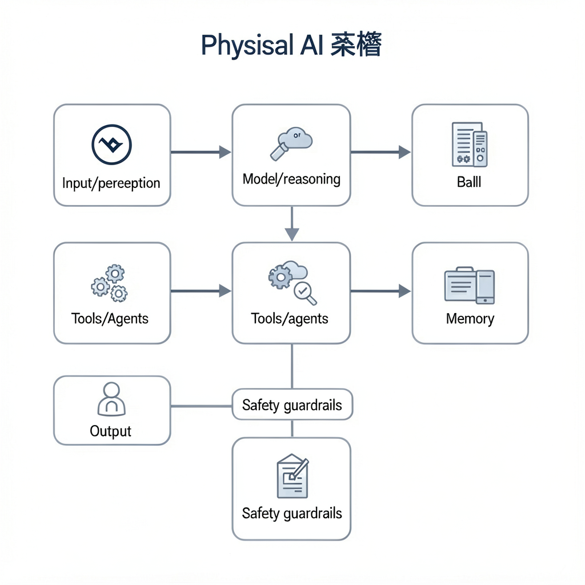

# AI 技術架構深度拆解：Physical AI 架構

- 日期：2026-10-16
- 選題理由：今日素材中出現《Aligning Perception, Reasoning, Modeling and Interaction: A Survey on Physical AI》一文，系統性整合感知、推理、建模與互動四大支柱，代表具身智能與多模態代理協作的最新架構趨勢，適合作為深度拆解對象。

## 一、架構原理與核心機制
Physical AI 架構以四層協同為核心： 1. 輸入/感知層：整合視覺、雷達、聲納、慣性測量、生理訊號等多模態感測器，經由邊緣預處理（去噪、時序對齊、特徵擷取）輸出統一語義張量。 2. 模型推理層：採用大型基礎模型（視覺‑語言、世界模型）進行場景理解與因果推理，並結合輕量化專用頭（目標檢測、軌跡預測）實現即時決策。 3. 工具/代理協作層：引入模組化工具鏈（物理模擬器、運動規劃器、知識圖譜查詢），由高層代理依據任務目標動態編排子代理，支援「感知‑規劃‑執行」閉環。 4. 記憶/資料層：包含長期知識庫（領域本體、法規標準）、情景記憶（歷史任務軌跡、異常案例）與線上快取（即時感測流），支援檢索增強生成與持續學習。 5. 輸出與監控層：將決策轉換為致動指令（舵機、推進器、手術器械），並由安全監控器（形式化驗證、異常檢測、人工介入介面）即時審核，確保可解釋與可追溯。整體資料流為感知→編碼→推理→工具調用→記憶讀寫→輸出，控制流則由中央協調器依據任務狀態機驅動各子模組，部署時需考慮邊緣算力分配、延遲預算、模型量化與法規合規驗證。

## 二、海事領域應用（含實際例子）
1. 自主航行船舶：輸入多波束聲納、AIS、光學相機、氣象雷達資料；感知層融合生成周圍環境語義地圖，推理層以世界模型預測其他船隻意圖，工具層調用碰撞避免規劃器與航線優化模擬器，記憶層保存海圖更新與歷史航跡，輸出層下達舵角與推力指令，監控層即時檢查 COLREGS 合規。價值在於降低人為錯誤、提升營運效率；風險包括感測器失效、模型對罕見海況泛化不足。 2. 水下聲學生態監測：輸入水下陣列麥克風長時序訊號；感知層進行聲學事件偵測與物種分類，推理層結合海洋環境模型推估族群動態，工具層呼叫聲傳播模擬器校正距離估計，記憶層累積長期生態基線，輸出生成預警報表與保育建議。價值為即時生態洞察；風險在於環境雜訊干擾與標註資料稀少。

## 三、醫療領域應用（含實際例子）
1. 手術機器人輔助：輸入內視鏡影像、力回饋、術前 CT/MRI；感知層實時分割解剖結構與器械姿態，推理層以手術階段識別模型預測下一步操作，工具層協同運動規劃與碰撞檢查模擬器，記憶層存取患者專屬解剖變異與術中併發症案例，輸出層產生微動控制指令，監控層執行安全邊界檢查與醫師覆核介面。價值為提升精度與縮短學習曲線；合規風險涉及醫療器材認證（ISO 13485、FDA 510(k)）與資料隱私。 2. 多模態影像診斷平台：輸入 X 光、CT、MRI、病理切片影像；感知層統一編碼為多模態嵌入，推理層採用跨模態注意力機制進行疾病分級，工具層整合放射組學特徵庫與臨床指南知識圖譜，記憶層保存歷史診斷與專家會診紀錄，輸出生成結構化報告與信心度，監控層記錄決策路徑供稽核。價值在於提高診斷一致性；風險包含模型偏移、跨機構資料異質性與法規（HIPAA、GDPR）遵循。

## 四、其他產業應用（含實際例子）
1. 智慧製造柔性生產線：感測器（視覺、力覺、溫度）輸入工件狀態，推理層以數位孿生模型即時優化加工參數，工具層調用機械臂運動規劃與品質檢測模組，記憶層保存製程配方與缺陷案例，輸出層下達 PLC 指令，監控層執行 SPC 統計控制。價值為減少停機與提升良率。 2. 城市交通多模態調度：融合路側雷達、車聯網訊號、公共運輸時刻表，推理層以強化學習代理協同優化信號燈週期與車隊調度，工具層呼叫交通流模擬器評估方案，記憶層累積歷史擁塞模式，輸出層發布動態導航建議，監控層確保緊急車輛優先。價值為降低通勤時間與排放。

## 五、限制、風險與治理建議
Physical AI 架構面臨：多模態資料異質性導致對齊困難；即時推理對邊緣算力與延遲極為敏感，模型量化可能損失精度；安全關鍵場景需形式化驗證與法規認證，開發週期長；長期部署易產生模型漂移，需持續監控與線上微調；跨域知識整合（海事、醫療、製造）缺乏統一本體，增加整合成本。

## 參考來源
- https://pubmed.ncbi.nlm.nih.gov/42284175/
- https://news.google.com/rss/articles/CBMiVEFVX3lxTE1DUzcxS3VyZEYtVDczOEhDWWJiVU12RUNTQzU3ZWR5YlNQdXZNeHdnVVF5bFM0WlJnelNwSVJkMmxqNHROUzItY0JhUjYxaEloN05CNg?oc=5
- https://news.google.com/rss/articles/CBMiXEFVX3lxTE5yLW9zMVV3ZlhPek5zRkxlak5zaVdyMWV2MnJqeFZBeEtxeFlpci11aGg2RDQ3Q2NnTkdOWmFmU2ZGV1pWSlBtbWRpT2IzcV9SU25nTkcxRlk2aUFK0gFiQVVfeXFMT0FHb2hIeGZKMi04M040c3FyNTFSbkdWbVlGQnNWTU1BNlNpT2hxRllMRGF0aEQwOEZ0cHh0RlBLN0hmTmRuaXZtNTU1cVdNS2otRk50bm4zbUYzalZ6SG1ETWc?oc=5
- https://news.google.com/rss/articles/CBMiYkFVX3lxTE1GNW9UQWc5eHcyZEY5V2JRWC1yVFBfRnFFbFdicF9MUkNfTHA4U1JzRG1mUmJ3NEpkQkpIdXp4bm52RDhzZXlGWDJVbENiOTRnRm9kTGZwa0gtUmtSYmdoam9R0gFiQVVfeXFMTUY1b1RBZzl4dzJkRjlXYlFYLXJUUF9GcUVsV2JwX0xSQ19McDhTUnNEbWZSYnc0SmRCSkh1enhubnZEOHNleUZYMlVsQ2I5NGdGb2RMZnBrSC1Sa1JiZ2hqb1E?oc=5
