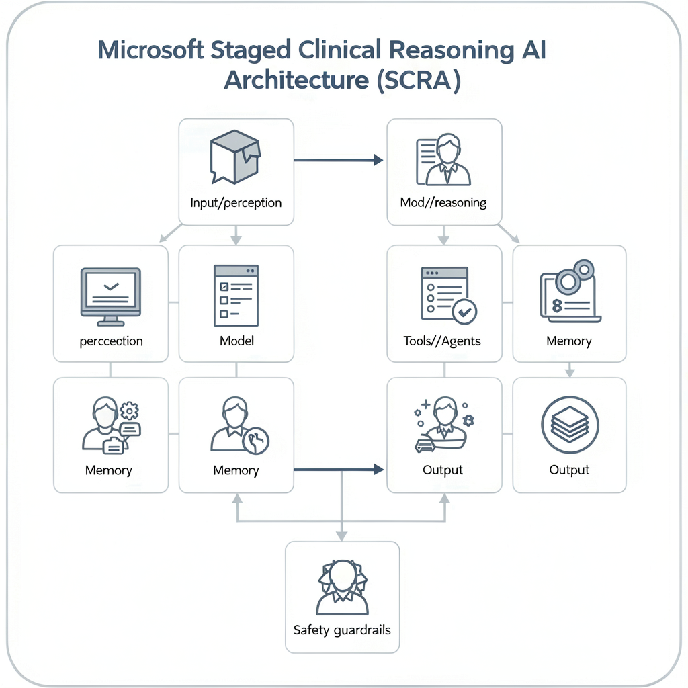

# AI 技術架構深度拆解：Microsoft Staged Clinical Reasoning AI Architecture (SCRAI)

- 日期：2026-10-23
- 選題理由：今日素材中微軟發布的醫療 AI 診斷系統登上《科學》期刊，並展示分階段排查機制，準確率在疑難病例超越醫師兩倍，代表具備多模態感知、多步推理與工具協作的最新系統架構，具跨領域擴展潛力。

## 一、架構原理與核心機制
架構包含五大層： 1. 輸入/感知層：接收電子病歷、影像、檢驗數值、醫師語音紀錄等多模態資料，經標準化（FHIR、DICOM）轉為結構化向量。 2. 模型推理層：以大型語言模型為核心，採用分階段推理（Stage‑1 症狀聚類、Stage‑2 鑑別診斷生成、Stage‑3 指南檢索與一致性驗證），每階段輸出中間結構化結論並傳遞給下一階段。 3. 工具/代理協作層：引入知識圖譜查詢代理、臨床指南 API、藥物交互檢查微服務，推理過程中動態調用並將結果寫入上下文。 4. 記憶/資料層：長期記憶採用向量資料庫儲存歷史病例嵌入與指南版本，短期記憶以對話狀態機制維護多輪推理上下文，支援增量微調。 5. 輸出與監控層：產出結構化診斷建議、置信度分數、推理鏈路日誌，並接入審計追蹤與模型漂移監控管線，支援人機協同覆核與持續學習。部署採用混合雲邊緣：核心推理於 GPU 叢集，邊緣節點負責資料前處理與隱私脫敏，符合 HIPAA/GDPR 合規需求。

## 二、海事領域應用（含實際例子）
1. 船舶故障診斷：輸入引擎感測器串流、維修紀錄、設備手冊 PDF；系統先聚類異常模式，再生成可能故障清單，再查閱廠商服務公告與法規要求，輸出維修優先順序與風險等級。價值在縮短停機時間、降低誤判；風險為感測器噪聲導致錯誤推理，需邊緣端濾波。 2. 離岸風電場巡檢規劃：輸入衛星影像、無人機巡檢影片、氣象預報、資產台帳；分階段推理評估結構損傷嚴重度、優先派工路徑、合規檢查（如海洋保護區限制），輸出動態作業計畫。價值提升巡檢效率與安全；風險在跨域資料格式不一致與即時通訊延遲。

## 三、醫療領域應用（含實際例子）
1. 罕見病鑑別診斷：輸入基因體測序結果、表型描述、文獻知識庫；Stage‑1 擷取候選基因變異，Stage‑2 對應臨床表型與文獻證據，Stage‑3 驗證指南建議與藥物可用性，輸出診斷報告與臨床試驗推薦。價值加速確診；合規風險涉及基因資料隱私與臨床決策責任歸屬。 2. 急診分流與治療建議：輸入生命徵象、主訴語音、影像初步報告；系統快速分階段生成分流等級、初步診斷、建議檢查與用藥，並即時推送至醫師工作站供覆核。價值降低擁擠與誤診；風險為模型在極端病例產生幻覺，需人工最終把關。

## 四、其他產業應用（含實際例子）
1. 法律案件要點提取與勝訴率預測：輸入判決書全文、法條資料庫、當事人陳述；分階段抽取爭點、檢索相關判例、模擬法官推理路徑，輸出策略建議與風險評估。 2. 金融信用風險多源融合評估：輸入企業財報、新聞輿情、供應鏈圖譜、宏觀指標；Stage‑1 特徵工程與異常檢測，Stage‑2 多模態融合推理违约概率，Stage‑3 合規規則檢核（如反洗錢），輸出評級與解釋報告。

## 五、限制、風險與治理建議
架構依賴大型語言模型，仍存在幻覺、推理鏈路不可控、對長尾醫療/海事知識覆蓋不足等問題；多模態資料對齊與隱私脫敏增加工程複雜度；監管合規（醫療器材認證、海事安全標準）需逐案驗證，部署成本與 GPU 資源需求高，持續微調與漂移監控需專責團隊。

## 參考來源
- https://news.google.com/rss/articles/CBMiV0FVX3lxTE8xUEhGODRVNWhvTDkwVFZDOGIxemZERTBDdTViODVpbER6WHNvMmhnZGltcG9kb3hFQm51d1dvRXRKVmVaMERoVGs1STZfbVItdWFwWEdVYw?oc=5
- https://news.google.com/rss/articles/CBMiugFBVV95cUxQSno0Vk9qWkNyRW9HbnRkRFY5VVowdjhCNXliSXdDNW9rTGFIazdCM1RTQ1pxYnVLZ3BrYkFEdkd4OVVncDg2NG1PSlFoaV94LVVsMjF0UTUweXBnSjJNTzlGMjFseGVsekZpcXRkYkt5TVlkR1luSUl0MkxLRHNYMkNqXzZqTnNHZmNIalJmSEZBQjNWYXA4a3BrSUhoR21PSmFVREVHdHBnWjBxWElpd2NYR1dmeDRCd2c?oc=5
- https://doi.org/10.1038/s42256-026-01310-z
