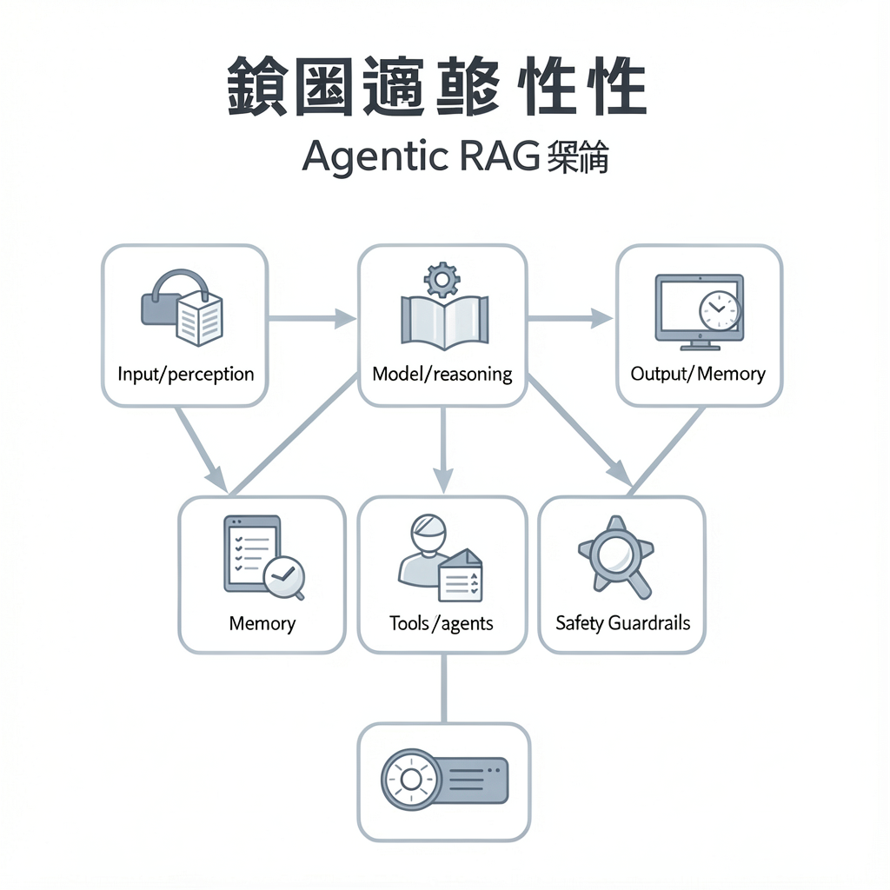

# AI 技術架構深度拆解：意圖驅動具身代理 AI 架構

- 日期：2026-10-30
- 選題理由：今日素材中多條線索指向同一架構趨勢：Sierra 以代理式客服估值 300 億美元、LesionAgent 展示免訓練代理追蹤腫瘤、《Intent-driven embodied AI》與產業具身 AI 綜述確立理論基礎、動作控制專報與本地 AI 筆電暗示邊緣部署落地。此架構整合大語言模型規劃、多模態感知、工具鏈與長期記憶，正從雲端走向邊緣實體機器人與醫療影像工作站，具代表性。

## 一、架構原理與核心機制
架構包含五大層： 1. 輸入/感知層：多模態編碼器（視覺 ViT、語音 Whisper、文本 Tokenizer、機器人本體感測器 IMU/力矩/關節編碼器）將異構資料對齊至共享潛空間，支援串流與批次兩種模式。 2. 模型推理層：核心為「意圖解析器」（LLM-based Planner）與「動作解碼器」（Diffusion Policy 或 VLA 模型）。意圖解析器接收使用者指令與環境語境，輸出結構化任務圖；動作解碼器依任務圖逐步生成低階控制指令，並以一致性檢查機制防止幻覺動作。 3. 工具/代理協作層：採用 ReAct + Toolformer 機制，註冊表管理可呼叫工具（檢索引擎、物理模擬器、PACS 查詢、航海圖 API、資料庫 SQL）。代理間透過訊息總線交換結構化意圖與觀測，支援階層式委派（高層規劃代理→低層執行代理）。 4. 記憶/資料層：短期工作記憶以 KV Cache 保存對話與觀測歷程；長期記憶採用向量資料庫 + 知識圖譜，支援情節記憶與程序記憶分離寫入，並提供版本化檢索供回溯審計。 5. 輸出與監控層：輸出端包含自然語言回覆、機器人軌跡指令、結構化報告；監控子系統即時計算動作安全邊界、推理延遲、Token 成本、幻覺偵測分數，並提供人機介入介面。 部署考量：雲端訓練／微調（Halo 框架支援多模態大模型分散式訓練），邊緣推理採用模型蒸餾 + INT4/INT8 量化，於工業電腦或 AI PC（如 Asus ProArt P16 NPU）執行；採用 OTA 更新機制同步權重與工具註冊表，並以零信任網路分段隔離控制平面與資料平面。

## 二、海事領域應用（含實際例子）
1. 港口無人駕駛拖車編隊調度：情境為貨櫃碼頭夜間作業；輸入為岸橋排程、即時 GPS/雷達/攝影機融合感知、路況動態圖；系統運作：高層代理解析「將 40 呎箱從 03 號岸橋移至 CY-12 區」意圖，規劃多車體避撞路徑，低層代理發送 CAN 總線指令控制轉向/煞車；價值：單班次省 30% 人力、降低碰撞風險；風險：感知遮蔽導致路徑偏移、通訊延遲超 100ms 觸發急停。 2. 船舶機艙預測性維護代理：情境為遠洋貨輪主機缸套磨損監測；輸入為震動頻譜、潤滑油鐵粉濃度、歷史維修日誌、OEM 手冊向量庫；系統運作：代理週期性檢索最新震動特徵，對照知識圖譜推理磨損階段，自動生成工單建議更換週期與備品採購單；價值：非計畫停機率降 40%、備品庫存優化；風險：感測器漂移造成誤判、衛星回傳頻寬限制模型更新頻率。

## 三、醫療領域應用（含實際例子）
1. 纵向 CT 腫瘤追蹤與療效評估：情境為肺癌標靶治療追蹤；輸入為不同時期胸部 CT 序列、放射科報告文字、RECIST 1.1 準則知識庫；系統運作：LesionAgent 免訓練代理自動對齊序列、分割結節、計算長軸短軸變化率，生成結構化療效報告供醫師複核；價值：讀片時間縮短 60%、測量變異係數降至 5% 以下；合規風險：屬醫療器材軟體 (SaMD) 需 TFDA/US FDA 510(k) 清關、資料去識別化與醫院資安法遵循。 2. 多模態腫瘤學基礎模型輔助診斷：情境為病理切片 + 基因體學整合診斷；輸入為全切片影像 (WSI)、RNA-seq 突變資料、臨床病歷；系統運作：代理協同呼叫病理視覺編碼器與基因轉換器，融合潛向量後由 LLM 生成分子分型建議與臨床試驗匹配清單；價值：罕見亞型診斷準確度提升、精準用藥匹配率提高；合規風險：涉及基因資料隱私 (GDPR/HIPAA/GDPR)、模型解釋性需符合臨床決策支援軟體 (CDS) 監管指引。

## 四、其他產業應用（含實際例子）
1. 製造業柔性生產線換線代理：情境為客製化 3C 組裝線頻繁換型；輸入為 BOM 變更單、機械手臂運動學參數、視覺檢測標準；系統運作：代理解析新產品組裝意圖，自動生成機械手臂軌跡、視覺檢測腳本與 PLC 邏輯，經仿真驗證後一鍵下發；價值：換線時間從 4 小時壓縮至 30 分鐘、良率穩定。 2. 智慧電網負載平衡與故障隔離：情境為分散式再生能源高滲透配網；輸入為 PMU 相量測量、智慧電表功率流、氣象預測、保護繼電器動作記錄；系統運作：代理即時推演潮流、預測過載熱點，協調儲能充放電與需求側響應，故障發生時自動計算最小切負荷集合並下發分斷器指令；價值：停電指數 SAIDI 改善 25%、再生能源棄電率下降。

## 五、限制、風險與治理建議
1. 長時程規劃仍易發生錯誤累積，缺乏形式化驗證機制保證安全關鍵任務正確性。2. 多模態對齊依賴大規模標註資料，領域遷移時效能衰減明顯，免訓練代理僅適用於分布內任務。3. 邊緣部署受限於算力與記憶體，量化後模型推理品質難以量化保證。4. 工具鏈擴展缺乏標準化介面，整合成本隨工具數呈超線性增長。5. 記憶層隱私洩漏風險高，需嚴格存取控制與差分隱私機制。6. 監管框架（EU AI Act、台灣 AI 基本法草案）對高風險 AI 系統要求完整風險管理檔案，合規成本高。

## 參考來源
- https://techcrunch.com/2026/11/23/sierra-doubles-valuation-to-30b-within-six-months-as-demand-for-ai-in-cx-takes-off/
- http://arxiv.org/abs/2611.27876v1
- https://pubmed.ncbi.nlm.nih.gov/43054956/
- https://pubmed.ncbi.nlm.nih.gov/43054954/
- https://www.therobotreport.com/special-report-engineering-focus-on-motion-control/
- https://arstechnica.com/reviews/2026/11/review-the-asus-proart-p16-offers-a-glimpse-of-a-future-powered-by-local-ai/
