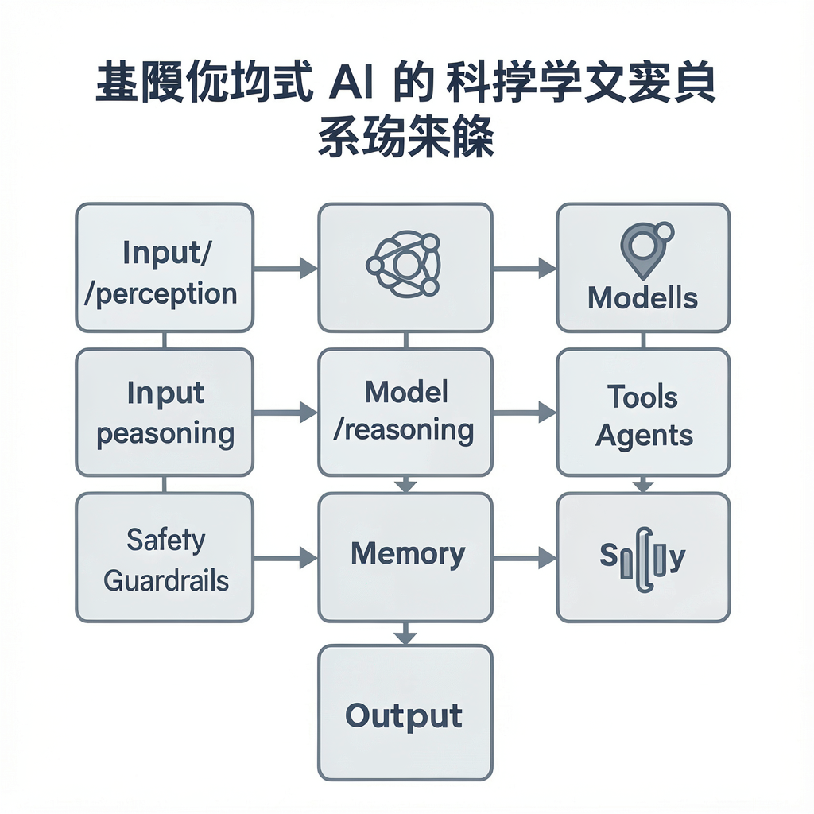

# AI 技術架構深度拆解：基於代理式 AI 的科學發現系統架構

- 日期：2026-11-06
- 選題理由：今日 Nature Computational Science 發表「System of agentic AI for the discovery of metal-organic frameworks」，展示多代理協作、工具調用與記憶機制整合的完整架構，代表當前 Agentic AI 從聊天機器人邁向自主科研的關鍵里程碑，具高參考價值。

## 一、架構原理與核心機制
【輸入/感知】接收自然語言研究目標（如：高吸附容量 MOF）、文獻語料、實驗數據、模擬反饋（DFT/MD 計算結果），透過嵌入模型轉為向量檢索相關知識。【模型推理】採用多角色 LLM 代理：規劃代理分解任務、行動代理生成代碼/假設、評審代理驗證合理性與安全性，形成「規劃-執行-觀察-反思」迴路。【工具/代理協作】整合 Python 執行環境、計算化學軟體（ASE, VASP）、材料資料庫（MP, CSD）、自動化合成機器人 API，代理間透過結構化訊息總線交換狀態與工件。【記憶/資料層】短期工作記憶儲存當前迴路上下文；向量資料庫索引文獻與知識圖譜；關係型資料庫記錄實驗參數與結果；長期記憶透過微調或 RAG 更新領域適應權重。【輸出與監控】�出候選結構、合成路徑、預測屬性報告；監控模組執行幻覺檢測（交叉驗證模擬值）、安全攔截（危險化學品合成攔截）、人工介入檢查點與完整審計日誌。

## 二、海事領域應用（含實際例子）
1. 船殼防污塗料材料發現：輸入目標屬性（低表面能、無毒、耐海水）、現有塗料數據、流體動力學模擬參數。系統規劃代理分解為單體篩選、聚合物生成、分子動力學模擬任務，行動代理調用 DFT 計算附著能、MD 模擬生物附著過程，評審代理過濾毒性預測為陽性者。價值：縮短研發週期 50%，降低燃油消耗；風險：模擬與真實海洋環境差異導致失效。2. 自主航行決策代理系統：輸入 AIS 目標、電子海圖、氣象預報、船舶操縱模型。感知代理融合多源感測器，規劃代理生成避碰航徑，執行代理轉換為舵機指令，評審代理依據 COLREGS 檢查合規性。價值：提升擁擠水域航行安全與營運效率；風險：感測器故障或對抗性干擾導致決策錯誤。

## 三、醫療領域應用（含實際例子）
1. 抗腫瘤藥物分子自主設計：輸入靶點蛋白結構、期望 ADMET 屬性、專利避讓要求。系統文獻代理檢索已知配體，生成代理提出新骨架，對接代理執行分子對接與自由能擾動計算，毒性代理預測 hERG/肝毒性。價值：加速先導化合物發現，降低湯藥成本；合規風險：AI 生成分子專利歸屬模糊、臨床前數據可信度需 FDA/EMA 驗證。2. 個體化放療計劃代理：輸入患者 CT/MRI、輪廓勾畫、劑量限制。分割代理自動勾畫靶區/OAR，規劃代理優化射野角度與權重，驗證代理獨立劑量計算，記錄代理生成 QA 報告。價值：縮短計劃時間至分鐘級，標準化品質；風險：輪廓錯誤傳播、模型外推導致劑量熱點、醫療責任歸屬爭議。

## 四、其他產業應用（含實際例子）
1. 固態電池電解質材料研發：輸入離子電導率、電化學窗口、機械強度目標。代理系統自動搜尋晶體結構、執行 AIMD 模擬鋰離子遷移、預測界面穩定性，並輸出合成配方發送至自動化實驗室。價值：突破試誤瓶頸，縮短商業化時間。2. 企業級程式碼重構與遷移：輸入舊版單體應用碼庫、目標微服務架構規範。理解代理建立知識圖譜，規劃代理拆分邊界，編碼代理生成新服務與測試，審查代理執行靜態分析與安全掃描。價值：降低 70% 人工重構工時；風險：業務邏輯隱性知識遺失、生成代碼授權合規。

## 五、限制、風險與治理建議
多代理迴路中幻覺疊加風險高，單一錯誤可能傳播放大；工具調用（如 DFT 模擬）計算成本極大且精度受限於近似方法；缺乏統一評估基準，難以量化「發現」的新穎性與價值；自主合成涉及危險化學品需嚴格物理隔離與人工核准；資料來源版權與隱私合規（GDPR/HIPAA）增加部署複雜度；長時程任務的記憶管理與一致性保證仍為開放問題。

## 參考來源
- https://pubmed.ncbi.nlm.nih.gov/43064736/
- https://pubmed.ncbi.nlm.nih.gov/43054955/
- https://pubmed.ncbi.nlm.nih.gov/43054956/
- https://news.google.com/rss/articles/CBMijwFBVV95cUxPVU1JWEFzNUJaV3V0VTFLQTdnbkNHellKQi10Z2xtUGc0Szg0S0lvcEtZQVRGLU42TzUwcDdEV1NocGYxVm5TUTJ1dTIzVnIybXUzN2VqWmFuSkRXR3dqN1hQUGxNUEpvY2U2MEE3bjlib0NmcXRnUzFjTC1wTDdDekEzZ3FiRUlnVXFIQkdZbw?oc=5
- https://github.com/FastCrest/tether
