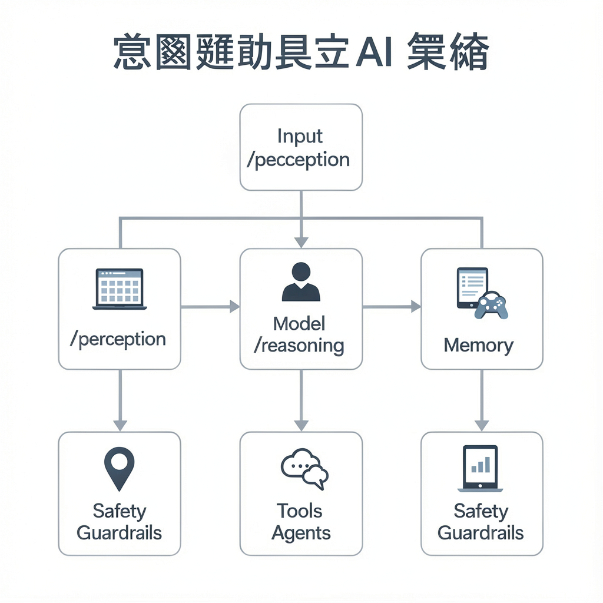

# AI 技術架構深度拆解：多模態 RAG 賦能的代理式 AI 架構（含邊緣雲端混合部署）

- 日期：2026-11-13
- 選題理由：今日素材同時出現 RAG 技術解析、海事多模態決策、醫療多模態基礎模型、意圖驅動具身 AI、邊緣推理引擎與主權 AI 治理等議題，該架構能串聯檢索增強、工具代理、多模態感知與邊緣雲端協同，最完整代表當前產業落地主流。

## 一、架構原理與核心機制
【輸入/感知層】接收文本、航海儀表遙測、醫療影像、基因組序列、日誌流等異構資料，經由多模態編碼器（CLIP 風格視覺編碼器、BERT 風格文本編碼器、時間序列 Transformer）映射至共享潛在空間，並以語意分塊與元資料標註建立向量索引。【模型推理層】採用解碼器專用 LLM（如 Llama 3 / Qwen 2.5 系列）作為推理核心，透過 LoRA 或 MoE 適配領域知識；推理前先由路由器判斷是否需檢索、工具呼叫或直接生成。【工具/代理協作層】實作 ReAct / Plan-and-Execute 模式：代理持有工具註冊表（向量檢索、SQL 查詢、航線優化求解器、醫學知識圖譜 API、邊緣推理端點），依規劃步驟串聯呼叫，並以結構化輸出（JSON Schema）確保可驗證。【記憶/資料層】分三級：短期上下文視窗（KV Cache）、長期向量資料庫（Milvus / PGVector）存放領域語料與使用者偏好、圖資料庫（Neo4j）維護實體關係與因果鏈；支援增量索引與版本化回滾。【輸出與監控層】輸出經過守護rails（格式校驗、幻覺偵測、PII 脫敏）後回傳；監控採 OpenTelemetry 追蹤延遲、Token 成本、檢索命中率、工具成功率，並接入人工回饋迴路（RLHF/RLAIF）持續微調。部署採邊緣雲端混合：邊緣端（Jetson / RTX / Apple Silicon）跑量化小模型與關鍵推理，雲端負責大模型、索引建構與訓練，FastCrest Tether / Aidget 負責模型轉換、驗證與 OTA 部署。

## 二、海事領域應用（含實際例子）
1. 智慧航線優化與減碳決策：情境為遠洋貨輪即時調整航線；輸入包含 AIS 軌跡、氣象預報（風浪、洋流）、船舶性能曲線、港口作業窗口；系統以多模態編碼器融合時空資料，RAG 檢索歷史最佳航段與法規限制，代理呼叫優化求解器生成候選航線，LLM 以自然語言解釋風險權衡並輸出 ETA/油耗/CO2 預估；價值在單航次省油 3-5%、合規自動化，風險為極端天氣下模型外推失效與衛星通訊中斷導致邊緣決策失誤。2. 機艙異常預警與維修知識輔助：情境為主機震動異常升高；輸入為高頻震動頻譜、潤滑油分析報告、維修手冊 PDF；向量檢索相似故障案例與 OEM 服務公告，代理串聯診斷規則引擎與備件庫存 API，輸出分級建議（繼續監測/減載/停機檢修）與作業步驟；價值縮短 MTTR 並避免災難性故障，風險為訓練資料偏向特定機型導致泛化不足、法規要求人工複核延誤。

## 三、醫療領域應用（含實際例子）
1. 多模態腫瘤多學會診斷輔助：情境為肺癌病例討論會；輸入包含全切片影像（WSI）、CT 影像、基因面板報告、病理報告文字；系統以多模態基礎模型（如論文提及的分子形態聯合模型）編碼各模態，RAG 檢索 NCCN 指南、臨床試驗入組標準、最新文獻，代理協同病理、影像、藥物基因組三個專用工具，輸出分期建議、標靶藥物匹配度與臨床試驗推薦；價值提升診斷一致性與精準用藥，合規風險為醫療器材認證（TFDA/US FDA SaMD）、患者隱私（HIPAA/GDPR）與醫師最終責任歸屬。2. 罕見病基因變異解釋與遺傳諮詢：情境為兒科遺傳諮詢門診；輸入為三代外顯子體測序 VCF、表型 HPO 用語、家系圖；向量資料庫存放 ClinVar、gnomAD、文獻摘要，代理呼叫變異致病性預測工具（AlphaMissense、REVEL）、表型匹配演算法，生成 ACMG/AMP 分類報告與通俗解釋給家屬；價值加速罕見病確診、減少無效檢查，合規風險為變異解釋不確定性導致過度醫療、知情同意與資料二次使用授權。

## 四、其他產業應用（含實際例子）
1. 企業影子 AI 治理與知識問答：情境為員工使用未審核 SaaS AI 工具洩漏機密；輸入為網路流量日誌、DLP 警報、內部文件庫；系統以非監督異常偵測識別可疑 AI 流量，RAG 檢索資安政策與合規法規，代理自動封鎖、產生審核工單並推薦合規替代方案；價值降低資安事件 40% 以上、滿足主權 AI 要求。2. 智慧製造邊緣品檢與知識傳承：情境為 PCB AOI 影像誤判率高；輸入為高解析度影像、製程參數、資深技師口述經驗影音；邊緣端跑量化缺陷分類模型，雲端以多模態 RAG 索引技師經驗並微調小模型，OTA 部署回邊緣；價值誤判率下降 60%、隱性知識資產化。

## 五、限制、風險與治理建議
檢索品質高度依賴切塊策略與嵌入模型，領域冷啟動需大量標註；代理規劃在長鏈條任務易產生錯誤傳播，需強化驗證機制；多模態對齊在資料稀疏模態（如基因組）表現不穩；邊緣雲端同步一致性、模型版本管理與異構硬體相容性增加運維複雜度；法規合規（醫療器材、海事分類社、資料主權）需逐案認證，延遲上線。

## 參考來源
- https://www.msn.com/en-in/news/other/before-ai-answers-it-searches-how-rag-connects-language-models-to-external-knowledge/ar-AA2i1dQr
- https://tw.news.yahoo.com/ai%E7%B5%90%E5%90%88%E6%B5%B7%E4%BA%8B%E5%B0%88%E6%A5%AD%E9%96%8B%E5%89%B5%E8%88%AA%E9%81%8B%E6%96%B0%E5%B1%80-%E5%BC%B7%E5%8C%96%E7%87%9F%E9%81%8B%E6%B1%BA%E7%AD%96-%E5%AE%89%E5%85%A8%E7%AE%A1%E7%90%86%E8%88%87%E6%B8%9B%E7%A2%B3%E6%95%88%E7%9B%8F-100359130.html
- https://pubmed.ncbi.nlm.nih.gov/43064800/
- https://pubmed.ncbi.nlm.nih.gov/43054956/
- https://github.com/FastCrest/tether
- https://github.com/midea-ai/Aidget
