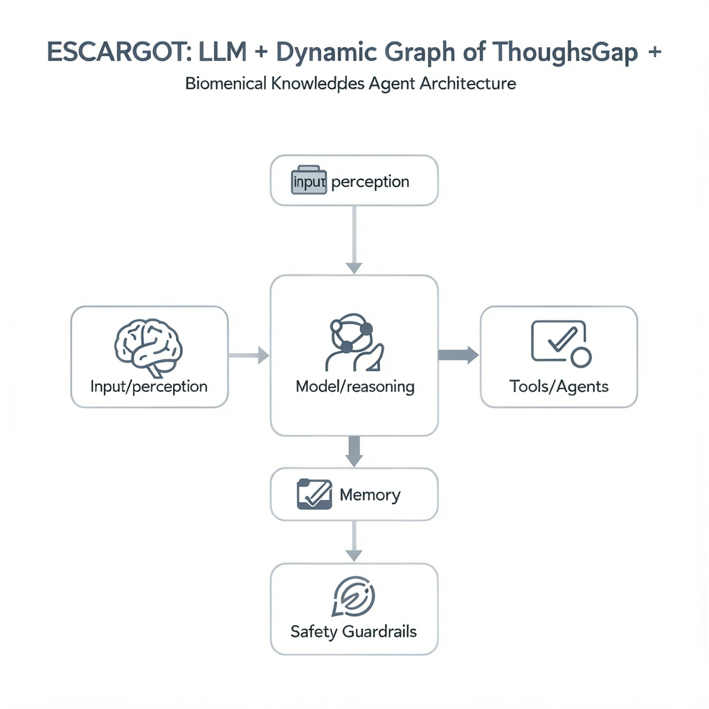

# AI 技術架構深度拆解：ESCARGOT: LLM + Dynamic Graph of Thoughts + Biomedical Knowledge Graphs Agent Architecture

- 日期：2026-11-20
- 選題理由：今日素材中 ESCARGOT 同時出現在論文與開源專案兩類來源，且明確定義了「LLM + 動態思維圖 + 知識圖譜」三層協作架構，屬少數具備完整代理推理循環、可落地生醫領域且已開源的最新架構，具代表性與可驗證性。

## 一、架構原理與核心機制
【輸入/感知】接受自然語言查詢（如疾病機制、基因交互），經實體識別與關係抽出模組映射至生醫知識圖譜節點，並編碼為圖結構輸入。 【模型推理】核心為大語言模型驅動的動態思維圖：LLM 依查詢生成初步推理步驟，每步驟對應一個圖節點；推理過程中根據中間結果動態擴展、修剪或合併節點，形成有向無環圖，支援多路徑並行探索與回溯。 【工具/代理協作】圖節點可調用外部工具：知識圖譜子圖檢索、文獻檢索 API、路徑排序演算法、數值計算模組；各工具封裝為可插拔代理，由主控 LLM 依圖拓撲決定調用順序與參數。 【記憶/資料層】分兩級：長期記憶為預建生醫知識圖譜（含基因、蛋白、通路、疾病、藥物等實體與關係，數百萬三元組），採用圖資料庫存儲支援子圖毫秒級查詢；短期工作記憶為當前推理圖的節點狀態、中間證據與置信度，隨對話輪次更新。 【輸出與監控】最終輸出包含結構化答案、推理圖可視化、關鍵證據引用與不確定性分數；監控層記錄每節點耗時、工具調用成功率、知識圖譜覆蓋率，支援事後審計與人工介入觸發條件。

## 二、海事領域應用（含實際例子）
1. 船舶故障診斷代理：輸入為機艙感測器時序資料（溫度、震動、壓力）與維修手冊知識圖譜（設備元件、故障模式、因果鏈）。系統將感測器異常映射至圖節點，動態思維圖引導 LLM 依因果鏈逐層推理，調用設備知識圖譜檢索相關故障模式與歷史案例，輸出最可能根因與建議檢修步驟。價值：縮短診斷時間、降低誤判；風險：知識圖譜若缺乏特定船型資料會導致推理斷層，感測器雜訊可能誤導圖擴展。 2. 海事法規合規航線規劃：輸入為出發/目的港、船舶參數、即時氣象與海域法規知識圖譜（分離區、限制區、環保區、通報要求）。代理以動態思維圖分解任務：航段生成→法規檢查→風險評估→替代方案生成，每步調用法規圖譜與氣象 API。價值：自動化合規檢核、減少人工疏漏；風險：法規更新滯後於圖譜維護、極端天氣下推理鏈可能過度保守。

## 三、醫療領域應用（含實際例子）
1. 罕見病診斷輔助：輸入為患者表型描述（HPO 用語）、全外顯體測序變異清單、疾病-基因-表型知識圖譜。系統將表型與變異映射至圖，動態思維圖引導 LLM 執行「表型→候選基因→變異致病性→通路機制」多跳推理，調用變異註釋工具與文獻檢索代理，輸出排序後診斷假設與證據鏈。價值：提升罕見病診斷率、提供可解釋推理路徑；合規風險：屬醫療器材決策支援軟體，需符合 FDA SaMD 或 TFDA 分級，訓練資料與知識圖譜來源須可追溯，輸出需附免責聲明並由醫師複核。 2. 多藥交互風險推理：輸入為處方清單、患者基因型（CYP 酵素型別）、藥物-標靶-代謝酵素-不良反應知識圖譜。代理以動態思維圖並行探索各藥物對組合的藥動學/藥效學交互，調用劑量調整指南 API，輸出風險等級、建議替代藥物與監測指標。價值：降低不良藥物事件、個體化用藥；合規風險：屬臨床決策支援，若直接輸出用藥建議可能觸犯執業法規，需定位為「參考資訊」並記錄完整審計軌跡。

## 四、其他產業應用（含實際例子）
1. 法律案例推理助理：輸入為爭點描述、法條與判例知識圖譜（法條、要件、裁判邏輯、引用關係）。動態思維圖分解為「爭點拆解→法條匹配→類案檢索→論證鏈構建」，各節點調用判例檢索與邏輯一致性檢查工具，輸出訴訟策略草稿與引用圖譜。價值：加速法律研究、揭示隱性邏輯鏈；風險：判例圖譜覆蓋度不足導致推理盲區。 2. 晶片設計驗證代理：輸入為 RTL 代碼、規格書與設計規則知識圖譜（模組、介面、時序約束、已知錯誤模式）。代理以動態思維圖執行「模組分解→屬性提取→形式驗證條件生成→反例分析」，調用模擬器與形式驗證工具，輸出覆蓋率報告與潛在錯誤定位。價值：自動化驗證閉環、縮短帶晶週期；風險：圖譜若未涵蓋最新製程規則會產生誤判。

## 五、限制、風險與治理建議
1. 知識圖譜建構與維護成本極高，領域專家標註瓶頸明顯，圖譜不完整直接導致推理斷鏈。2. 動態思維圖節點擴展具組合爆炸風險，需啟發式修剪，可能遺漏關鍵路徑。3. LLM 幻覺在工具參數生成與證據總結階段仍存，缺乏嚴格形式驗證機制。4. 端到端延遲隨推理深度線性增長，難滿足毫秒級即時決策需求。5. 評估指標缺乏標準化，推理正確性與可解釋性難以量化比較。

## 參考來源
- https://www.semanticscholar.org/paper/61d3f95318d52bd15ef36cdf93b25bae1fe135ef
- https://github.com/EpistasisLab/escargot
- https://pubmed.ncbi.nlm.nih.gov/43064800/
- https://pubmed.ncbi.nlm.nih.gov/43054956/
- https://pubmed.ncbi.nlm.nih.gov/43054954/
- https://pubmed.ncbi.nlm.nih.gov/43073275/
